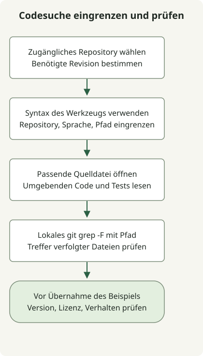

Beginnen Sie die Codesuche mit festgelegtem Repository und Dateiumfang. Lesen Sie dann die gefundene Implementierung im Kontext. Ein passender Symbolname ist ein Hinweis, aber kein Beleg für die richtige Abhängigkeitsversion oder das gewünschte Verhalten.

GitHub-Codesuche, Sourcegraph und ein lokaler Checkout durchsuchen unterschiedliche verfügbare Daten. Nutzen Sie das Werkzeug, das auf Ihr Repository zugreifen kann. Setzen Sie nicht voraus, dass eine öffentliche Instanz jedes Repository oder jede Revision indexiert.

## Ablauf



Den Suchraum vor dem Erweitern der Trefferliste eingrenzen. Bei relevanter Version die beabsichtigte Revision oder ihren Checkout statt des Standardbranches durchsuchen.

## Die jeweilige Abfragesprache verwenden

Eine [GitHub-Codesuchabfrage](https://docs.github.com/en/search-github/github-code-search/understanding-github-code-search-syntax) kann diese Qualifizierer mit einer Phrase in Anführungszeichen kombinieren:

```text
repo:spring-projects/spring-framework language:java path:WebClient.java "interface WebClient"
```

Die entsprechenden [Sourcegraph-Filter](https://sourcegraph.com/docs/code-search/queries) nutzen reguläre Ausdrücke für Repository und Datei:

```text
repo:^github\.com/spring-projects/spring-framework$ lang:java file:WebClient\.java$ "interface WebClient"
```

| Zweck | GitHub-Codesuche | Sourcegraph |
| --- | --- | --- |
| Repository | `repo:owner/name` | `repo:` als regulärer Ausdruck; bei genauer Zuordnung verankern |
| Java | `language:java` | `lang:java` oder `language:java` |
| Dateiumfang | `path:` als Pfadfilter | `file:` als regulärer Ausdruck |
| Exakte Phrase | Phrase in Anführungszeichen | Phrase in Anführungszeichen im Schlüsselwortmodus |

Dies sind Beispiele für den Abfrageaufbau, keine gemessenen Live-Trefferzahlen. Die Pfadfilter müssen nicht dieselben Mengen liefern: Das Sourcegraph-Beispiel verankert das Dateinamensende. Zugriff, indexierter Inhalt und gewählte Revision bestimmen weiterhin, was auffindbar ist.

## Die lokale Suche in einem leeren Verzeichnis reproduzieren

Das kleine Beispiel benötigt Git und eine POSIX-Shell. `mkdir` schlägt absichtlich fehl, wenn `demo-search` bereits existiert. Wählen Sie daher ein frisches Arbeitsverzeichnis.

```sh
set -eu
mkdir demo-search
cd demo-search
git init -q
mkdir src docs
printf '%s\n' 'interface WebClient {}' > src/WebClient.java
printf '%s\n' 'interface WebClient is discussed here' > docs/notes.txt
git add src docs
git grep -n -F 'interface WebClient' -- src
```

Ausgabe:

```text
src/WebClient.java:1:interface WebClient {}
```

Dieselbe Phrase steht in `docs/notes.txt`, doch `-- src` begrenzt die Suche. [`git grep -F`](https://git-scm.com/docs/git-grep) behandelt das Muster als feste Zeichenkette, `-n` zeigt Zeilennummern. Die Dateien wurden zum Index hinzugefügt, weil die Standardsuche im Arbeitsbaum verfolgte Dateien nutzt; das Beispiel erstellt keinen Commit. Für einen echten Checkout ersetzen Sie Beispielpfad und Muster, behalten aber den gewünschten Umfang bei.

Lesen Sie vor der Übernahme Aufrufer, Tests, Lizenz und Revision. Dieselbe Deklaration kann in einer anderen Veröffentlichung anders funktionieren. Prüfen Sie einen Clientvertrag mit den [WebClient-Antworttests](/en/posts/2023-09-19-springboot-test-webclient/), statt Verhalten aus einem Suchtreffer abzuleiten.
