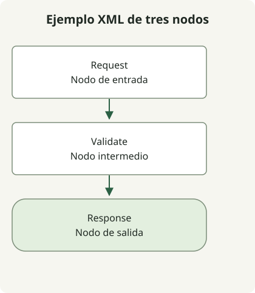

Conserva una fuente de diagrama editable junto a la imagen que publicas. La imagen muestra el resultado actual; la fuente preserva las formas, conexiones y etiquetas necesarias para el siguiente cambio.

La [guía de formatos de draw.io](https://www.drawio.com/docs/manual/editor/save-file-formats/) recomienda `.drawio`, un formato XML sin comprimir. SVG y PNG también pueden contener datos del diagrama, así que la extensión de imagen por sí sola no indica si el archivo es editable. Conserva la fuente explícita incluso si una exportación la incorpora.

## El flujo del ejemplo



La figura muestra los mismos tres vértices y dos conexiones dirigidas que el XML de abajo. Está renderizada para el artículo; no es una captura ni una exportación del editor.

## Guardar como request-flow.drawio

```xml
<mxfile host="app.diagrams.net">
  <diagram id="request-flow" name="Request flow">
    <mxGraphModel>
      <root>
        <mxCell id="0"/>
        <mxCell id="1" parent="0"/>
        <mxCell id="request" value="Request" style="rounded=1;whiteSpace=wrap;html=1;" vertex="1" parent="1">
          <mxGeometry x="40" y="40" width="160" height="60" as="geometry"/>
        </mxCell>
        <mxCell id="validate" value="Validate" style="rounded=1;whiteSpace=wrap;html=1;" vertex="1" parent="1">
          <mxGeometry x="40" y="160" width="160" height="60" as="geometry"/>
        </mxCell>
        <mxCell id="response" value="Response" style="rounded=1;whiteSpace=wrap;html=1;" vertex="1" parent="1">
          <mxGeometry x="40" y="280" width="160" height="60" as="geometry"/>
        </mxCell>
        <mxCell id="first" edge="1" parent="1" source="request" target="validate" style="endArrow=block;">
          <mxGeometry relative="1" as="geometry"/>
        </mxCell>
        <mxCell id="second" edge="1" parent="1" source="validate" target="response" style="endArrow=block;">
          <mxGeometry relative="1" as="geometry"/>
        </mxCell>
      </root>
    </mxGraphModel>
  </diagram>
</mxfile>
```

Los elementos `mxCell` con `vertex="1"` definen los tres nodos. Las dos aristas referencian sus identificadores de origen y destino, mientras `mxGeometry` proporciona posiciones y tamaños. Cambiar una etiqueta visible no es lo mismo que cambiar el identificador al que apunta una arista.

Abre el archivo en el editor. El archivo completo incluye los elementos externos `mxfile` y `diagram`. Si usas **Extras → Edit Diagram**, la [documentación del editor de fuentes](https://www.drawio.com/docs/manual/advanced/diagram-source-edit/) describe el `mxGraphModel` de la página actual; no confundas ese fragmento con la envoltura del archivo completo.

| Archivo | Propósito |
| --- | --- |
| `request-flow.drawio` | Fuente editable bajo control de versiones |
| `request-flow.svg` o `.png` | Salida para compartir/renderizar; comprobar si incorpora los datos |

Después de un cambio, vuelve a abrir la fuente, confirma la dirección de cada flecha y exporta una nueva imagen para compartir. Revisa el diff de la fuente y el resultado renderizado: el formato puede ocultar un pequeño cambio de relación.

En el ejemplo se comprueban localmente la estructura XML, los identificadores únicos y las referencias de las conexiones. El almacenamiento en la nube, la interacción con el editor y los ciclos de exportación quedan fuera de esas comprobaciones. Elige por separado las integraciones de almacenamiento según tu cuenta y editor. La [guía de búsqueda de código](/en/posts/2021-08-06-search-github/) muestra cómo acotar los archivos que inspeccionas en un repositorio.
