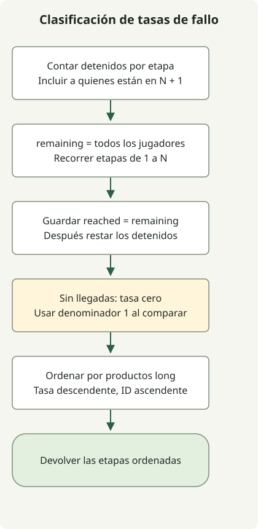

El denominador de la tasa de fallo de una etapa es el número de jugadores que llegaron a ella, no el total de jugadores. Cuenta dónde se detienen, actualiza la población restante que llegó y ordena por tasa descendente y número de etapa ascendente.

El [ejercicio](https://school.programmers.co.kr/learn/courses/30/lessons/42889) limita las etapas N a 500 y los jugadores M a 200 000. N+1 representa a quienes superaron todas las etapas y no es una etapa que deba clasificarse. Una etapa a la que nadie llegó tiene tasa de fallo 0.

## Flujo de procesamiento



Guarda los recuentos de llegada antes de restar a quienes se detienen. Compara tasas con productos cruzados long y desempata por número de etapa.

## Contar jugadores detenidos y llegados

Guarda la clase completa como `Solution.java`. El código del artículo original se compiló para Java 11 y se ejecutó en JDK 17.

```java
import java.util.Arrays;
import java.util.stream.IntStream;

public class Solution {
    public int[] solution(int N, int[] stages) {
        long[] stopped = new long[N + 2];
        for (int stage : stages) stopped[stage]++;
        long[] reached = new long[N + 1];
        long remaining = stages.length;
        for (int stage = 1; stage <= N; stage++) {
            reached[stage] = remaining;
            remaining -= stopped[stage];
        }
        Integer[] order = IntStream.rangeClosed(1, N).boxed().toArray(Integer[]::new);
        Arrays.sort(order, (a, b) -> {
            long denominatorA = reached[a] == 0 ? 1 : reached[a];
            long denominatorB = reached[b] == 0 ? 1 : reached[b];
            int byRate = Long.compare(stopped[b] * denominatorA, stopped[a] * denominatorB);
            return byRate != 0 ? byRate : Integer.compare(a, b);
        });
        return Arrays.stream(order).mapToInt(Integer::intValue).toArray();
    }
}
```

`remaining` cuenta a quienes llegaron a la etapa actual. Guarda `reached[stage]` **antes** de restar a quienes se detienen allí; el valor actualizado será el denominador de la siguiente etapa. Los jugadores en N+1 permanecen en el denominador durante todo el recorrido.

Para N=5 y `[2,1,2,6,2,4,3,3]`, las tasas son:

| Etapa | Detenidos | Llegados | Tasa de fallo |
| --- | --- | --- | --- |
| 1 | 1 | 8 | 1/8 |
| 2 | 3 | 7 | 3/7 |
| 3 | 2 | 4 | 2/4 |
| 4 | 1 | 2 | 1/2 |
| 5 | 0 | 1 | 0/1 |

Las etapas 3 y 4 empatan, así que el número menor va primero. El orden final es `[3,4,2,1,5]`.

## Comparar proporciones dentro de los límites numéricos

Con denominadores positivos, compara dos proporciones por multiplicación cruzada. Para ordenar de mayor a menor, `Long.compare` recibe primero el numerador de b por el denominador de a. Si las tasas coinciden, `Integer.compare(a, b)` ordena los números de etapa. Así se define el orden de forma explícita según el [contrato de Comparator](https://docs.oracle.com/en/java/javase/17/docs/api/java.base/java/util/Comparator.html).

Si nadie llegó a una etapa, una entrada válida tampoco tiene jugadores detenidos allí. Usa denominador 1 para comparar, representando la tasa como 0/1. Ambos recuentos pueden llegar a 200 000, así que los productos están limitados por 40 000 000 000. Mantén los arrays y la multiplicación como long: ese valor supera int. No conviertas una diferencia de productos a int como resultado de comparación.

El recuento cuesta O(M), las poblaciones llegadas O(N) y la ordenación O(N log N). El tiempo total es O(M + N log N), con O(N) de espacio adicional y sin modificar la entrada. Si todos completaron todas las etapas, las tasas son cero y decide el número de etapa.

Para otro ejemplo de elegir el tipo de multiplicación según las entradas, consulta [int y long en productos escalares de arrays](/en/posts/2021-07-22-dot-product/).
