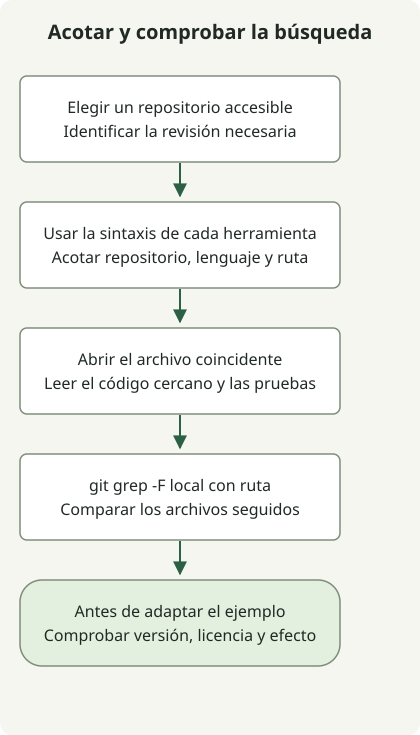

Empieza la búsqueda de código fijando el repositorio y el alcance de archivos; después inspecciona la implementación encontrada en su contexto. Un nombre de símbolo coincidente es una pista, no una prueba de que el código corresponda a tu versión de dependencia o al comportamiento deseado.

GitHub, Sourcegraph y un checkout local buscan sobre datos disponibles diferentes. Usa la herramienta que pueda acceder al repositorio necesario; no supongas que una instancia pública indexa todos los repositorios o revisiones.

## Flujo de procesamiento



Acota la consulta antes de ampliar la lista de resultados. Si importa la versión, abre la revisión deseada o busca en su checkout en lugar de depender de la rama predeterminada.

## Usar el lenguaje de consultas de cada servicio

Una [consulta de código de GitHub](https://docs.github.com/en/search-github/github-code-search/understanding-github-code-search-syntax) puede combinar estos calificadores con una frase entre comillas:

```text
repo:spring-projects/spring-framework language:java path:WebClient.java "interface WebClient"
```

Los [filtros de Sourcegraph](https://sourcegraph.com/docs/code-search/queries) correspondientes usan expresiones regulares de repositorio y archivo:

```text
repo:^github\.com/spring-projects/spring-framework$ lang:java file:WebClient\.java$ "interface WebClient"
```

| Objetivo | Búsqueda GitHub | Sourcegraph |
| --- | --- | --- |
| Repositorio | `repo:owner/name` | Expresión regular `repo:`; anclar si importa la coincidencia exacta |
| Java | `language:java` | `lang:java` o `language:java` |
| Alcance de archivos | Filtro de ruta `path:` | Expresión regular `file:` |
| Frase exacta | Frase entre comillas | Frase entre comillas en modo de palabras clave |

Son ejemplos de construcción de consultas, no mediciones de resultados en vivo. Los dos filtros de ruta no tienen por qué devolver conjuntos idénticos: el ejemplo de Sourcegraph ancla el sufijo del nombre de archivo. El acceso, el contenido indexado y la revisión seleccionada siguen determinando qué puedes encontrar.

## Reproducir la búsqueda local en un directorio vacío

Este pequeño ejemplo necesita Git y un shell POSIX. `mkdir` falla deliberadamente si `demo-search` ya existe, así que elige un directorio de trabajo nuevo.

```sh
set -eu
mkdir demo-search
cd demo-search
git init -q
mkdir src docs
printf '%s\n' 'interface WebClient {}' > src/WebClient.java
printf '%s\n' 'interface WebClient is discussed here' > docs/notes.txt
git add src docs
git grep -n -F 'interface WebClient' -- src
```

Salida:

```text
src/WebClient.java:1:interface WebClient {}
```

La misma frase existe en `docs/notes.txt`, pero `-- src` limita la búsqueda. [`git grep -F`](https://git-scm.com/docs/git-grep) trata el patrón como una cadena fija y `-n` muestra números de línea. Los archivos se añadieron al índice porque la búsqueda predeterminada en el árbol de trabajo usa archivos seguidos; este ejemplo no crea un commit. Para un checkout real, sustituye la ruta y el patrón conservando el alcance deseado.

Antes de adaptar un resultado, lee los llamadores, las pruebas, la licencia y la revisión. Una declaración coincidente puede comportarse de otra forma en otra versión. Usa las [pruebas de respuestas WebClient](/en/posts/2023-09-19-springboot-test-webclient/) para comprobar un contrato cliente en lugar de inferirlo de una coincidencia.
