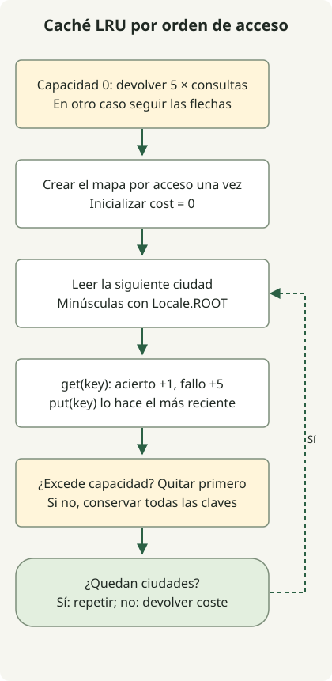

Una caché LRU expulsa la entrada que lleva más tiempo sin acceso. En Java, un `LinkedHashMap` ordenado por acceso mueve las entradas consultadas al extremo reciente, lo que permite calcular aciertos y costes en el orden de las solicitudes.

El [ejercicio de caché de Programmers](https://school.programmers.co.kr/learn/courses/30/lessons/17680) compara nombres ingleses de ciudades sin distinguir mayúsculas y asigna coste 1 al acierto y 5 al fallo. La capacidad va de 0 a 30, con un máximo de 100 000 solicitudes. Son costes del ejercicio, no tiempos de respuesta medidos de una base de datos.

## Flujo de procesamiento



Con capacidad cero se devuelve inmediatamente el resultado. En otro caso get/put actualizan el uso reciente y el desbordamiento expulsa la clave menos recientemente usada.

## Actualizar el orden con cada acceso

Guarda esta clase completa como `Solution.java`. Está dirigida a Java 11 o posterior; la ejecución local del artículo original compiló para Java 11 usando JDK 17. El método supone entradas que satisfacen las condiciones del ejercicio.

```java
import java.util.LinkedHashMap;
import java.util.Locale;

public class Solution {
    public int solution(int cacheSize, String[] cities) {
        if (cacheSize == 0) return 5 * cities.length;
        var cache = new LinkedHashMap<String, Boolean>(16, 0.75f, true);
        int cost = 0;
        for (String city : cities) {
            String key = city.toLowerCase(Locale.ROOT);
            cost += cache.get(key) == null ? 5 : 1;
            cache.put(key, Boolean.TRUE);
            if (cache.size() > cacheSize) {
                String oldest = cache.keySet().iterator().next();
                cache.remove(oldest);
            }
        }
        return cost;
    }
}
```

El argumento final `true` del constructor es importante. Frente al orden de inserción predeterminado, un [LinkedHashMap ordenado por acceso](https://docs.oracle.com/en/java/javase/17/docs/api/java.base/java/util/LinkedHashMap.html) actualiza el orden con accesos como `get` y `put`. Como esta implementación nunca almacena valores null, `get(key) == null` identifica un fallo de caché.

Al superar la capacidad, elimina la primera clave en el orden de iteración: la entrada menos recientemente consultada. Esto difiere de LFU, que elige por frecuencia de acceso. `Locale.ROOT` evita que la normalización del inglés dependa de la configuración regional predeterminada del equipo.

## Por qué un acierto cambia la expulsión

Con capacidad 2, estas solicitudes cuestan 21 en total. El contenido de la caché aparece del más antiguo al más reciente.

| Solicitud | Resultado | Caché tras solicitud | Coste total |
| --- | --- | --- | --- |
| Jeju | fallo | jeju | 5 |
| Pangyo | fallo | jeju, pangyo | 10 |
| Jeju | acierto | pangyo, jeju | 11 |
| Seoul | fallo | jeju, seoul | 16 |
| Pangyo | fallo | seoul, pangyo | 21 |

Si la tercera solicitud no actualiza la posición de Jeju, cambia la siguiente expulsión. La capacidad 0 no puede conservar entradas, así que el método devuelve `5 * cities.length` inmediatamente. `Jeju` y `JEJU` también deben normalizarse a la misma clave.

Suponiendo operaciones hash de tiempo constante en promedio, M solicitudes con longitud de nombre L y capacidad C requieren O(M×L), normalización incluida, y O(C×L) de almacenamiento. Recuerda los límites de L y C del ejercicio. Esta implementación no demuestra el comportamiento concurrente ni un rendimiento medido de la caché.

Continúa con [productos escalares Java y límites de int](/en/posts/2021-07-22-dot-product/) para los límites numéricos, o [normalización de ID](/en/posts/2021-07-19-new-id/) para transformaciones ordenadas de cadenas.
