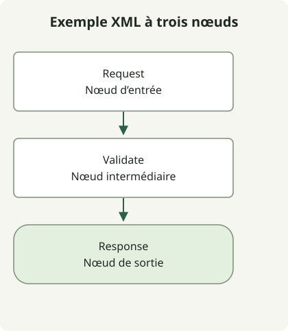

Conservez une source de diagramme modifiable à côté de l’image publiée. L’image montre le résultat actuel ; la source préserve les formes, connexions et libellés nécessaires à la prochaine modification.

Le [guide des formats draw.io](https://www.drawio.com/docs/manual/editor/save-file-formats/) recommande `.drawio`, un format XML non compressé. SVG et PNG peuvent aussi contenir des données de diagramme : l’extension d’image seule ne dit donc pas si le fichier est modifiable. Conservez la source explicite même lorsqu’un export l’intègre.

## Le déroulement de l’exemple



La figure montre les mêmes trois sommets et deux connexions orientées que le XML ci-dessous. Elle est rendue pour l’article, sans être une capture ou un export de l’éditeur.

## Enregistrer sous request-flow.drawio

```xml
<mxfile host="app.diagrams.net">
  <diagram id="request-flow" name="Request flow">
    <mxGraphModel>
      <root>
        <mxCell id="0"/>
        <mxCell id="1" parent="0"/>
        <mxCell id="request" value="Request" style="rounded=1;whiteSpace=wrap;html=1;" vertex="1" parent="1">
          <mxGeometry x="40" y="40" width="160" height="60" as="geometry"/>
        </mxCell>
        <mxCell id="validate" value="Validate" style="rounded=1;whiteSpace=wrap;html=1;" vertex="1" parent="1">
          <mxGeometry x="40" y="160" width="160" height="60" as="geometry"/>
        </mxCell>
        <mxCell id="response" value="Response" style="rounded=1;whiteSpace=wrap;html=1;" vertex="1" parent="1">
          <mxGeometry x="40" y="280" width="160" height="60" as="geometry"/>
        </mxCell>
        <mxCell id="first" edge="1" parent="1" source="request" target="validate" style="endArrow=block;">
          <mxGeometry relative="1" as="geometry"/>
        </mxCell>
        <mxCell id="second" edge="1" parent="1" source="validate" target="response" style="endArrow=block;">
          <mxGeometry relative="1" as="geometry"/>
        </mxCell>
      </root>
    </mxGraphModel>
  </diagram>
</mxfile>
```

Les éléments `mxCell` avec `vertex="1"` définissent les trois nœuds. Les deux arêtes référencent leurs identifiants source et cible, tandis que `mxGeometry` fournit positions et dimensions. Modifier un libellé visible diffère de modifier l’identifiant référencé par une arête.

Ouvrez le fichier dans l’éditeur. Le fichier complet inclut les éléments externes `mxfile` et `diagram`. Avec **Extras → Edit Diagram**, la [documentation de l’éditeur de source](https://www.drawio.com/docs/manual/advanced/diagram-source-edit/) décrit plutôt le `mxGraphModel` de la page courante ; ne confondez pas ce fragment avec l’enveloppe du fichier complet.

| Fichier | Rôle |
| --- | --- |
| `request-flow.drawio` | Source modifiable sous gestion de versions |
| `request-flow.svg` ou `.png` | Sortie de partage/affichage ; vérifier si les données sont intégrées |

Après une modification, rouvrez la source, confirmez le sens de chaque flèche et exportez une nouvelle image de partage. Examinez le diff de source et le résultat affiché : des changements de format peuvent masquer une petite modification de relation.

La structure XML, l’unicité des identifiants et les références des connexions sont vérifiées localement dans cet exemple. Le stockage cloud, les interactions avec l’éditeur et les allers-retours d’export sont hors périmètre. Choisissez séparément les intégrations de stockage pour votre compte et votre éditeur. Le [guide de recherche de code](/en/posts/2021-08-06-search-github/) montre comment limiter les fichiers examinés dans un dépôt.
