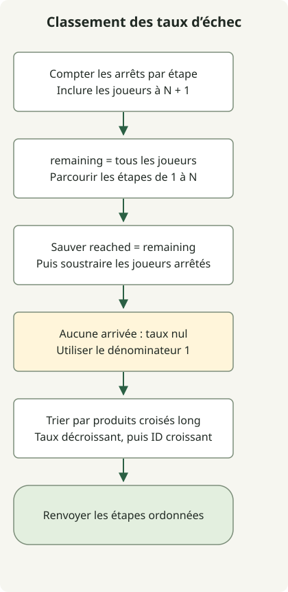

Le dénominateur du taux d’échec d’une étape est le nombre de joueurs qui l’ont atteinte, pas l’effectif total. Comptez les arrêts, actualisez la population restante ayant atteint l’étape, puis triez par taux décroissant et numéro d’étape croissant.

L’[exercice](https://school.programmers.co.kr/learn/courses/30/lessons/42889) limite les étapes N à 500 et les joueurs M à 200 000. N+1 représente les joueurs ayant terminé toutes les étapes et n’est pas une étape à classer. Une étape atteinte par personne a un taux d’échec de 0.

## Déroulement



Enregistrer les effectifs arrivés avant de soustraire les joueurs arrêtés. Comparer les taux par produits croisés long, puis départager par numéro d’étape.

## Compter les arrêts et les arrivées

Enregistrez la classe complète dans `Solution.java`. Le code de l’article source a été compilé pour Java 11 et exécuté sur JDK 17.

```java
import java.util.Arrays;
import java.util.stream.IntStream;

public class Solution {
    public int[] solution(int N, int[] stages) {
        long[] stopped = new long[N + 2];
        for (int stage : stages) stopped[stage]++;
        long[] reached = new long[N + 1];
        long remaining = stages.length;
        for (int stage = 1; stage <= N; stage++) {
            reached[stage] = remaining;
            remaining -= stopped[stage];
        }
        Integer[] order = IntStream.rangeClosed(1, N).boxed().toArray(Integer[]::new);
        Arrays.sort(order, (a, b) -> {
            long denominatorA = reached[a] == 0 ? 1 : reached[a];
            long denominatorB = reached[b] == 0 ? 1 : reached[b];
            int byRate = Long.compare(stopped[b] * denominatorA, stopped[a] * denominatorB);
            return byRate != 0 ? byRate : Integer.compare(a, b);
        });
        return Arrays.stream(order).mapToInt(Integer::intValue).toArray();
    }
}
```

`remaining` compte les joueurs ayant atteint l’étape courante. Enregistrez `reached[stage]` **avant** de soustraire ceux qui s’y arrêtent : la valeur actualisée devient le dénominateur de l’étape suivante. Les joueurs à N+1 restent dans le dénominateur tout au long du parcours.

Pour N=5 et `[2,1,2,6,2,4,3,3]`, les taux sont :

| Étape | Arrêtés | Arrivés | Taux d’échec |
| --- | --- | --- | --- |
| 1 | 1 | 8 | 1/8 |
| 2 | 3 | 7 | 3/7 |
| 3 | 2 | 4 | 2/4 |
| 4 | 1 | 2 | 1/2 |
| 5 | 0 | 1 | 0/1 |

Les étapes 3 et 4 sont à égalité, donc le plus petit numéro vient en premier. L’ordre final est `[3,4,2,1,5]`.

## Comparer les rapports dans les limites numériques

Avec des dénominateurs positifs, comparez les rapports par multiplication croisée. Pour trier en ordre décroissant, `Long.compare` reçoit d’abord le numérateur de b multiplié par le dénominateur de a. À taux égaux, `Integer.compare(a, b)` ordonne les étapes. L’ordre est ainsi défini explicitement selon le [contrat Comparator](https://docs.oracle.com/en/java/javase/17/docs/api/java.base/java/util/Comparator.html).

Si personne n’a atteint une étape, une entrée valide y donne aussi zéro joueur arrêté. Utilisez le dénominateur 1 pour la comparaison, soit le taux 0/1. Les deux effectifs peuvent atteindre 200 000 : les produits sont donc bornés par 40 000 000 000. Gardez les tableaux et la multiplication en long, car cette valeur dépasse int. Ne convertissez pas une différence de produits en int pour obtenir le résultat de comparaison.

Le comptage coûte O(M), les populations arrivées O(N) et le tri O(N log N). Au total, le temps est O(M + N log N), l’espace supplémentaire O(N), sans modifier l’entrée. Si tous les joueurs ont tout terminé, les taux sont nuls et l’ordre des numéros l’emporte.

Pour un autre choix de type de multiplication selon les bornes d’entrée, consultez [int et long dans le produit scalaire](/en/posts/2021-07-22-dot-product/).
