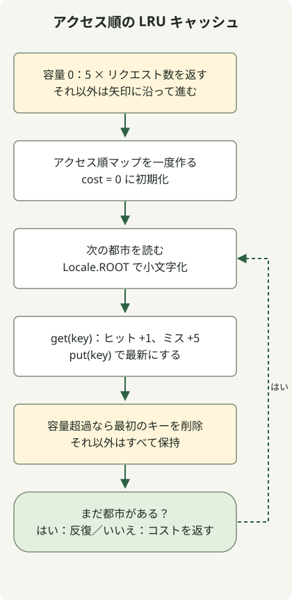

LRU キャッシュは、最も長くアクセスされていないエントリーを追い出します。Java のアクセス順 `LinkedHashMap` は、アクセスしたエントリーを最近の側へ移動し、リクエスト順にヒットとコストを計算できます。

[Programmers のキャッシュ問題](https://school.programmers.co.kr/learn/courses/30/lessons/17680)は英語の都市名を大文字小文字の区別なく比較し、ヒットのコストを 1、ミスを 5 とします。容量は 0 から 30、リクエストは最大 100,000 件です。これは問題上のコストであり、実測したデータベース応答時間ではありません。

## 処理の流れ



容量ゼロなら直ちに返します。それ以外では get/put で最近のアクセス順を更新し、容量超過時に最も長く未アクセスのキーを削除します。

## アクセス時に順序を更新する

完全なクラスを `Solution.java` として保存します。Java 11 以降が対象です。原文のローカル実行では Java 11 向けに JDK 17 でコンパイルしています。入力は問題の条件を満たすと仮定します。

```java
import java.util.LinkedHashMap;
import java.util.Locale;

public class Solution {
    public int solution(int cacheSize, String[] cities) {
        if (cacheSize == 0) return 5 * cities.length;
        var cache = new LinkedHashMap<String, Boolean>(16, 0.75f, true);
        int cost = 0;
        for (String city : cities) {
            String key = city.toLowerCase(Locale.ROOT);
            cost += cache.get(key) == null ? 5 : 1;
            cache.put(key, Boolean.TRUE);
            if (cache.size() > cacheSize) {
                String oldest = cache.keySet().iterator().next();
                cache.remove(oldest);
            }
        }
        return cost;
    }
}
```

コンストラクターの最後の `true` が重要です。既定の挿入順とは異なり、[アクセス順の LinkedHashMap](https://docs.oracle.com/en/java/javase/17/docs/api/java.base/java/util/LinkedHashMap.html) は `get` や `put` を含むアクセスで順序を更新します。この実装は null 値を保存しないので、`get(key) == null` でミスを判定できます。

容量を超えたら、反復順序の最初のキー、つまり最も長く未アクセスのエントリーを削除します。アクセス頻度で選ぶ LFU とは異なります。`Locale.ROOT` により、英語の大文字小文字の正規化がマシンの既定ロケールに依存しなくなります。

## ヒットが追い出しを変える理由

容量 2 で次のリクエストを処理すると、総コストは 21 です。キャッシュは古いものから表示します。

| リクエスト | 結果 | リクエスト後のキャッシュ | 累積コスト |
| --- | --- | --- | --- |
| Jeju | ミス | jeju | 5 |
| Pangyo | ミス | jeju, pangyo | 10 |
| Jeju | ヒット | pangyo, jeju | 11 |
| Seoul | ミス | jeju, seoul | 16 |
| Pangyo | ミス | seoul, pangyo | 21 |

三番目のリクエストで Jeju の位置を更新しなければ、次の追い出しが変わります。容量 0 ではエントリーを保持できないため、直ちに `5 * cities.length` を返します。`Jeju` と `JEJU` も同じキーへ正規化する必要があります。

ハッシュ操作が平均定数時間と仮定すると、名前の長さ L、容量 C で M 件を処理する時間は正規化込みで O(M×L)、記憶領域は O(C×L) です。問題の L と C の範囲に注意してください。この実装で並行アクセスの動作や実測キャッシュ性能が示されるわけではありません。

数値の範囲は [Java の内積と int の境界](/en/posts/2021-07-22-dot-product/)を、順序のある文字列変換は [ID の正規化](/en/posts/2021-07-19-new-id/)を参照してください。
