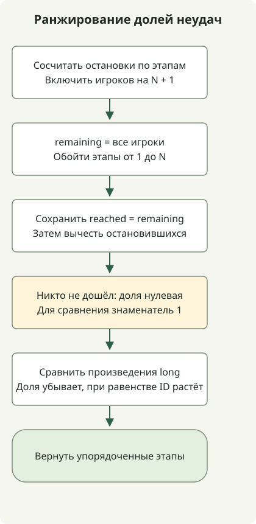

Знаменатель доли неудач на этапе — число игроков, достигших его, а не общее число игроков. Сосчитайте остановившихся, обновите оставшееся число достигших этапа, затем отсортируйте по убыванию доли и возрастанию номера этапа.

[Задача](https://school.programmers.co.kr/learn/courses/30/lessons/42889) ограничивает число этапов N значением 500, а игроков M — 200 000. N+1 обозначает игроков, прошедших все этапы, и само не является ранжируемым этапом. Доля неудач на этапе, которого никто не достиг, равна 0.

## Ход обработки



Сначала сохраняем число достигших этапа, затем вычитаем остановившихся. Сравниваем доли произведениями long, при равенстве — номерами этапов.

## Подсчёт остановившихся и достигших этапа

Сохраните полный класс в `Solution.java`. Код исходной статьи скомпилирован для Java 11 и выполнен на JDK 17.

```java
import java.util.Arrays;
import java.util.stream.IntStream;

public class Solution {
    public int[] solution(int N, int[] stages) {
        long[] stopped = new long[N + 2];
        for (int stage : stages) stopped[stage]++;
        long[] reached = new long[N + 1];
        long remaining = stages.length;
        for (int stage = 1; stage <= N; stage++) {
            reached[stage] = remaining;
            remaining -= stopped[stage];
        }
        Integer[] order = IntStream.rangeClosed(1, N).boxed().toArray(Integer[]::new);
        Arrays.sort(order, (a, b) -> {
            long denominatorA = reached[a] == 0 ? 1 : reached[a];
            long denominatorB = reached[b] == 0 ? 1 : reached[b];
            int byRate = Long.compare(stopped[b] * denominatorA, stopped[a] * denominatorB);
            return byRate != 0 ? byRate : Integer.compare(a, b);
        });
        return Arrays.stream(order).mapToInt(Integer::intValue).toArray();
    }
}
```

`remaining` считает игроков, достигших текущего этапа. Сохраните `reached[stage]` **до** вычитания остановившихся здесь: обновлённое значение станет знаменателем следующего этапа. Игроки на N+1 остаются в знаменателе на всём протяжении.

Для N=5 и `[2,1,2,6,2,4,3,3]` доли таковы:

| Этап | Остановились | Достигли | Доля неудач |
| --- | --- | --- | --- |
| 1 | 1 | 8 | 1/8 |
| 2 | 3 | 7 | 3/7 |
| 3 | 2 | 4 | 2/4 |
| 4 | 1 | 2 | 1/2 |
| 5 | 0 | 1 | 0/1 |

Этапы 3 и 4 равны по доле, поэтому меньший номер идёт первым. Итоговый порядок — `[3,4,2,1,5]`.

## Сравнение отношений в числовых границах

При положительных знаменателях два отношения сравниваются перекрёстным умножением. Для убывающего порядка `Long.compare` сначала получает числитель b, умноженный на знаменатель a. При равных долях `Integer.compare(a, b)` упорядочивает номера этапов. Это явно задаёт порядок согласно [контракту Comparator](https://docs.oracle.com/en/java/javase/17/docs/api/java.base/java/util/Comparator.html).

Если этапа никто не достиг, допустимый вход также даёт ноль остановившихся на нём. Для сравнения используйте знаменатель 1, представляя долю как 0/1. Оба количества могут достигать 200 000, поэтому произведения ограничены 40 000 000 000. Массивы и умножение должны оставаться long: это больше диапазона int. Не приводите разность произведений к int как результат сравнения.

Подсчёт требует O(M), расчёт достигших этапов — O(N), сортировка — O(N log N). Итого O(M + N log N) времени и O(N) дополнительной памяти без изменения входа. Если все прошли все этапы, все доли нулевые и порядок определяется номерами.

Другой пример выбора типа умножения по границам входа — [int и long в скалярном произведении](/en/posts/2021-07-22-dot-product/).
