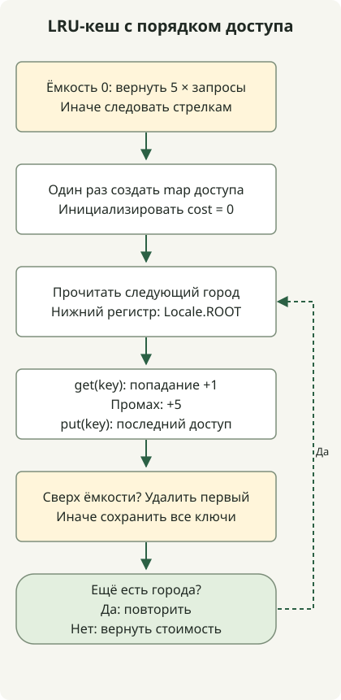

LRU-кеш вытесняет запись, к которой дольше всего не обращались. В Java `LinkedHashMap` с порядком доступа перемещает использованные записи в конец недавних обращений, позволяя считать попадания и стоимость в порядке запросов.

[Задача о кеше Programmers](https://school.programmers.co.kr/learn/courses/30/lessons/17680) сравнивает английские названия городов без учёта регистра и назначает стоимость 1 попаданию, 5 — промаху. Ёмкость — от 0 до 30, запросов не более 100 000. Это условная стоимость задачи, а не измеренное время ответа базы данных.

## Ход обработки



При нулевой ёмкости результат возвращается сразу. Иначе get/put обновляют порядок обращений, а переполнение вытесняет ключ с самым давним доступом.

## Обновление порядка при доступе

Сохраните полный класс в `Solution.java`. Он рассчитан на Java 11 и новее; при локальном запуске исходной статьи компиляция выполнялась для Java 11 с JDK 17. Метод предполагает соблюдение ограничений задачи.

```java
import java.util.LinkedHashMap;
import java.util.Locale;

public class Solution {
    public int solution(int cacheSize, String[] cities) {
        if (cacheSize == 0) return 5 * cities.length;
        var cache = new LinkedHashMap<String, Boolean>(16, 0.75f, true);
        int cost = 0;
        for (String city : cities) {
            String key = city.toLowerCase(Locale.ROOT);
            cost += cache.get(key) == null ? 5 : 1;
            cache.put(key, Boolean.TRUE);
            if (cache.size() > cacheSize) {
                String oldest = cache.keySet().iterator().next();
                cache.remove(oldest);
            }
        }
        return cost;
    }
}
```

Важен последний аргумент конструктора `true`. В отличие от обычного порядка вставки, [LinkedHashMap с порядком доступа](https://docs.oracle.com/en/java/javase/17/docs/api/java.base/java/util/LinkedHashMap.html) обновляет порядок при обращениях, включая `get` и `put`. Реализация никогда не хранит значения null, поэтому `get(key) == null` выявляет промах.

При превышении ёмкости удалите первый ключ в порядке обхода — запись с самым давним обращением. Это отличается от LFU, выбирающего по частоте обращений. `Locale.ROOT` делает нормализацию английского регистра независимой от локали машины по умолчанию.

## Почему попадание меняет вытеснение

При ёмкости 2 эти запросы стоят 21 суммарно. Содержимое кеша показано от самой старой записи.

| Запрос | Результат | Кеш после запроса | Общая стоимость |
| --- | --- | --- | --- |
| Jeju | промах | jeju | 5 |
| Pangyo | промах | jeju, pangyo | 10 |
| Jeju | попадание | pangyo, jeju | 11 |
| Seoul | промах | jeju, seoul | 16 |
| Pangyo | промах | seoul, pangyo | 21 |

Если третий запрос не обновит позицию Jeju, следующее вытеснение изменится. Ёмкость 0 не позволяет хранить запись, поэтому метод сразу возвращает `5 * cities.length`. `Jeju` и `JEJU` также должны нормализоваться в один ключ.

При среднем постоянном времени хеш-операций M запросов с длиной имени L и ёмкостью C требуют O(M×L) времени с нормализацией и O(C×L) памяти. Помните об ограничениях L и C в задаче. Реализация не подтверждает поведение при конкурентном доступе или измеренную производительность кеша.

Для числовых границ см. [скалярные произведения Java и границы int](/en/posts/2021-07-22-dot-product/), для упорядоченных преобразований строк — [нормализацию ID](/en/posts/2021-07-19-new-id/).
