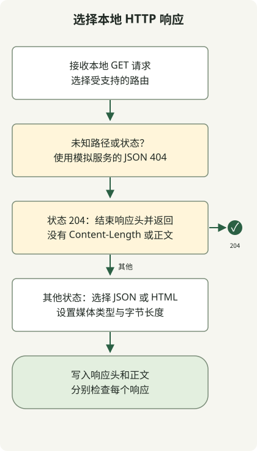

仅有状态码不能证明响应可用。客户端可能收到状态为 200 的 HTML，也可能收到成功的 204，却没有可解码的正文。本地模拟服务可以在不依赖外部响应服务的情况下复现这些情形。

本例使用 Python 3.11 或更高版本，只依赖标准库。服务绑定到 127.0.0.1，为一小组固定路由实现 GET。这是开发用的模拟服务，而非应用服务器。

## 处理流程



处理器先选择状态与表示，再写入响应头。204 分支不含正文或 Content-Length，其他路由写入声明的字节数。

## 将完整服务器保存为 status_server.py

```python
import argparse
import json
import re
from http.server import BaseHTTPRequestHandler, ThreadingHTTPServer
from urllib.parse import urlsplit

SUPPORTED = {200, 201, 204, 400, 404, 429, 500, 503}

class StatusHandler(BaseHTTPRequestHandler):
    def do_GET(self):
        path = urlsplit(self.path).path
        match = re.fullmatch(r"/status/([0-9]{3})", path)
        requested = int(match.group(1)) if match else None
        status = requested if requested in SUPPORTED else 404
        content_type = "application/json; charset=utf-8"
        body = json.dumps({"status": status}).encode("utf-8")
        if path == "/html/200":
            status = 200
            content_type = "text/html; charset=utf-8"
            body = b"<html><body>not JSON</body></html>"
        self.send_response(status)
        if status == 204:
            self.end_headers()
            return
        self.send_header("Content-Type", content_type)
        self.send_header("Content-Length", str(len(body)))
        self.end_headers()
        self.wfile.write(body)

    def log_message(self, format, *args):
        pass

def make_server(port=8089):
    return ThreadingHTTPServer(("127.0.0.1", port), StatusHandler)

if __name__ == "__main__":
    parser = argparse.ArgumentParser()
    parser.add_argument("--port", type=int, default=8089)
    args = parser.parse_args()
    if not 0 <= args.port <= 65535:
        parser.error("port must be from 0 through 65535")
    with make_server(args.port) as server:
        print(f"http://127.0.0.1:{server.server_port}", flush=True)
        try:
            server.serve_forever()
        except KeyboardInterrupt:
            pass

```

[Python HTTP 服务器 API](https://docs.python.org/3/library/http.server.html)提供请求处理与线程化监听器。不受支持的路径或状态码会返回模拟服务的 JSON 404。路由 `/html/200` 刻意以成功状态返回 HTML。

在一个终端启动服务器，再在另一个终端发送请求：

```sh
python3 status_server.py --port 8089
```

```sh
curl -i http://127.0.0.1:8089/status/500
curl -i http://127.0.0.1:8089/html/200
curl -i http://127.0.0.1:8089/status/204
```

使用端口 0 可让操作系统选择空闲端口，服务器会打印实际 URL。按 Ctrl+C 停止。这些 curl 命令特意省略 `--fail`，以便同时检查错误响应。

| 请求 | 状态 | 表示 |
| --- | --- | --- |
| `/status/200` | 200 | 包含状态 200 的 JSON |
| `/html/200` | 200 | HTML，而非 JSON |
| `/status/500` | 500 | 包含状态 500 的 JSON |
| `/status/204` | 204 | 没有正文，也没有 Content-Length |

[RFC 9110](https://www.rfc-editor.org/rfc/rfc9110.html#section-8.6)禁止在 204 响应中使用 Content-Length。正文是否可用，应与 2xx 检查分别处理。此模拟服务检查状态、媒体类型和消息定界，不模拟慢响应、TLS、认证或重试时序。关于客户端解码与错误信号，可继续阅读 [WebClient 响应测试](/en/posts/2023-09-19-springboot-test-webclient/)。
