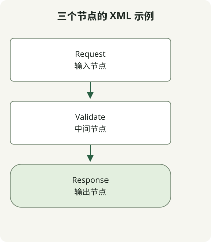

在发布的图片旁保留可编辑的图形原文件。图片展示当前结果，原文件则保留下一次修改所需的形状、连接与标签。

[draw.io 格式指南](https://www.drawio.com/docs/manual/editor/save-file-formats/)推荐使用未压缩 XML 格式 `.drawio`。SVG 和 PNG 也可以包含图数据，因此不能仅凭图片扩展名判断文件是否可编辑。即使导出文件嵌入了图数据，也应保留明确的原文件。

## 示例流程



此图与下方 XML 具有相同的三个顶点和两条有向连接。它是为本文渲染的，不是编辑器截图或导出结果。

## 保存为 request-flow.drawio

```xml
<mxfile host="app.diagrams.net">
  <diagram id="request-flow" name="Request flow">
    <mxGraphModel>
      <root>
        <mxCell id="0"/>
        <mxCell id="1" parent="0"/>
        <mxCell id="request" value="Request" style="rounded=1;whiteSpace=wrap;html=1;" vertex="1" parent="1">
          <mxGeometry x="40" y="40" width="160" height="60" as="geometry"/>
        </mxCell>
        <mxCell id="validate" value="Validate" style="rounded=1;whiteSpace=wrap;html=1;" vertex="1" parent="1">
          <mxGeometry x="40" y="160" width="160" height="60" as="geometry"/>
        </mxCell>
        <mxCell id="response" value="Response" style="rounded=1;whiteSpace=wrap;html=1;" vertex="1" parent="1">
          <mxGeometry x="40" y="280" width="160" height="60" as="geometry"/>
        </mxCell>
        <mxCell id="first" edge="1" parent="1" source="request" target="validate" style="endArrow=block;">
          <mxGeometry relative="1" as="geometry"/>
        </mxCell>
        <mxCell id="second" edge="1" parent="1" source="validate" target="response" style="endArrow=block;">
          <mxGeometry relative="1" as="geometry"/>
        </mxCell>
      </root>
    </mxGraphModel>
  </diagram>
</mxfile>
```

带有 `vertex="1"` 的 `mxCell` 元素定义三个节点。两条边引用各自的源和目标 ID，`mxGeometry` 则提供位置与尺寸。修改可见标签与修改边所引用的 ID 是两回事。

在编辑器中打开文件。完整文件包含外层 `mxfile` 和 `diagram` 元素。如果使用 **Extras → Edit Diagram**，[源编辑器文档](https://www.drawio.com/docs/manual/advanced/diagram-source-edit/)描述的是当前页面的 `mxGraphModel`；不要将页面片段与完整文件的外层结构混淆。

| 文件 | 用途 |
| --- | --- |
| `request-flow.drawio` | 纳入版本控制的可编辑原文件 |
| `request-flow.svg` 或 `.png` | 共享或渲染输出；需检查是否嵌入图数据 |

修改后重新打开原文件，确认每条箭头的方向，再导出新的共享图片。请同时查看原文件差异与渲染结果：格式变化可能掩盖细小的关系变化。

本例在本地检查 XML 结构、ID 唯一性与连接引用。云存储、编辑器界面交互以及导出往返不在检查范围内。请根据使用的账户与编辑器另行选择存储集成。[代码搜索指南](/en/posts/2021-08-06-search-github/)介绍了如何缩小仓库中要检查的文件范围。
