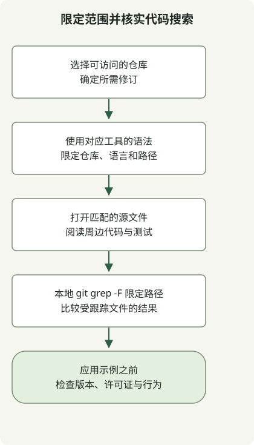

搜索代码时，先确定仓库与文件范围，再结合上下文查看匹配的实现。符号名匹配只是线索，并不能证明代码符合你的依赖版本或预期行为。

GitHub 代码搜索、Sourcegraph 与本地检出副本搜索的可用数据不同。请选择能访问所需仓库的工具；不要假定公共实例已索引每个仓库或修订。

## 处理流程



先限定查询范围，再展开结果列表。版本重要时，应打开目标修订或搜索该修订的检出副本，而非依赖默认分支。

## 使用各服务自己的查询语言

[GitHub 代码搜索查询](https://docs.github.com/en/search-github/github-code-search/understanding-github-code-search-syntax)可以将以下限定词与带引号的短语组合：

```text
repo:spring-projects/spring-framework language:java path:WebClient.java "interface WebClient"
```

对应的 [Sourcegraph 过滤器](https://sourcegraph.com/docs/code-search/queries)使用仓库与文件正则表达式：

```text
repo:^github\.com/spring-projects/spring-framework$ lang:java file:WebClient\.java$ "interface WebClient"
```

| 目的 | GitHub 代码搜索 | Sourcegraph |
| --- | --- | --- |
| 仓库 | `repo:owner/name` | `repo:` 正则表达式；需要精确匹配时添加锚点 |
| Java | `language:java` | `lang:java` 或 `language:java` |
| 文件范围 | `path:` 路径过滤器 | `file:` 正则表达式 |
| 精确短语 | 带引号的短语 | 关键词模式中带引号的短语 |

这些是查询构造示例，而非实测在线结果数量。两种路径过滤器不一定返回相同集合：Sourcegraph 示例锚定了文件名后缀。权限、已索引内容和选定修订仍决定能找到什么。

## 在空目录中复现本地搜索

这个小示例需要 Git 和 POSIX shell。如果 `demo-search` 已存在，`mkdir` 会按设计失败，因此请选择新的工作目录。

```sh
set -eu
mkdir demo-search
cd demo-search
git init -q
mkdir src docs
printf '%s\n' 'interface WebClient {}' > src/WebClient.java
printf '%s\n' 'interface WebClient is discussed here' > docs/notes.txt
git add src docs
git grep -n -F 'interface WebClient' -- src
```

输出：

```text
src/WebClient.java:1:interface WebClient {}
```

相同短语也存在于 `docs/notes.txt` 中，但 `-- src` 限制了搜索范围。[`git grep -F`](https://git-scm.com/docs/git-grep)将模式视为固定字符串，`-n` 则显示行号。由于默认工作树搜索使用受跟踪文件，因此示例先将文件加入索引，但没有创建提交。检查真实检出副本时，可替换示例路径与模式，同时保留所需范围。

采用搜索结果前，请阅读调用方、测试、许可证与修订。相同声明在其他版本中可能有不同的行为。可用 [WebClient 响应测试](/en/posts/2023-09-19-springboot-test-webclient/)检查客户端契约，而非根据一次搜索命中推断行为。
