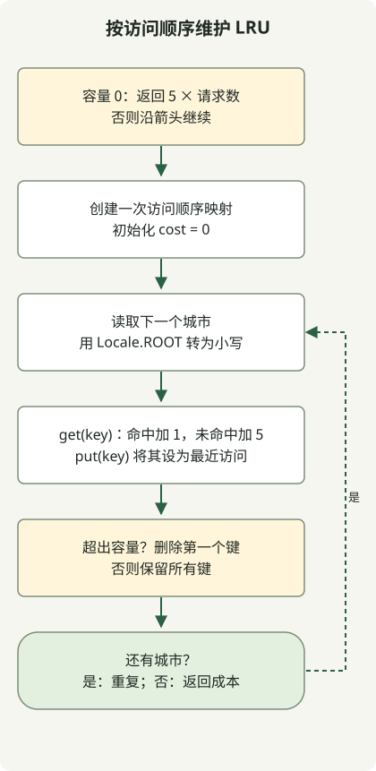

LRU 缓存淘汰最久未被访问的条目。Java 中按访问顺序排列的 `LinkedHashMap` 会将被访问的条目移至最近访问的一端，因此可以按请求顺序计算命中与成本。

[Programmers 缓存题目](https://school.programmers.co.kr/learn/courses/30/lessons/17680)忽略英文城市名的大小写，命中成本为 1，未命中成本为 5。容量范围是 0 到 30，请求最多 100,000 次。这些是题目规定的成本，并非测得的数据库响应时间。

## 处理流程



容量为零时立即返回。否则 get/put 刷新最近访问顺序，容量溢出时淘汰最久未访问的键。

## 在访问时更新顺序

将完整类保存为 `Solution.java`。目标版本为 Java 11 或更高；原文的本地执行按 Java 11 目标编译，使用 JDK 17。方法假设输入满足题目约束。

```java
import java.util.LinkedHashMap;
import java.util.Locale;

public class Solution {
    public int solution(int cacheSize, String[] cities) {
        if (cacheSize == 0) return 5 * cities.length;
        var cache = new LinkedHashMap<String, Boolean>(16, 0.75f, true);
        int cost = 0;
        for (String city : cities) {
            String key = city.toLowerCase(Locale.ROOT);
            cost += cache.get(key) == null ? 5 : 1;
            cache.put(key, Boolean.TRUE);
            if (cache.size() > cacheSize) {
                String oldest = cache.keySet().iterator().next();
                cache.remove(oldest);
            }
        }
        return cost;
    }
}
```

构造函数最后的 `true` 参数很重要。与默认的插入顺序不同，[访问顺序 LinkedHashMap](https://docs.oracle.com/en/java/javase/17/docs/api/java.base/java/util/LinkedHashMap.html)会在 `get`、`put` 等访问操作后更新顺序。此实现从不存储 null 值，因此可通过 `get(key) == null` 判断未命中。

超出容量时，删除迭代顺序中的第一个键，即最久未被访问的条目。这不同于按访问频次选择的 LFU。`Locale.ROOT` 避免英文大小写规范化依赖机器的默认区域设置。

## 为什么命中会改变淘汰结果

容量为 2 时，以下请求的总成本为 21。缓存内容按最旧者在前显示。

| 请求 | 结果 | 请求后的缓存 | 累计成本 |
| --- | --- | --- | --- |
| Jeju | 未命中 | jeju | 5 |
| Pangyo | 未命中 | jeju, pangyo | 10 |
| Jeju | 命中 | pangyo, jeju | 11 |
| Seoul | 未命中 | jeju, seoul | 16 |
| Pangyo | 未命中 | seoul, pangyo | 21 |

如果第三个请求没有刷新 Jeju 的位置，下一次淘汰就会改变。容量 0 无法保留条目，因此方法立即返回 `5 * cities.length`。`Jeju` 与 `JEJU` 也必须规范化为同一个键。

假设哈希操作平均为常数时间，则 M 个请求、名称长度 L、容量 C 的时间为 O(M×L)，包括规范化；存储空间为 O(C×L)。请注意题目对 L 和 C 的限制。此实现并不能证明并发访问行为或实际测得的缓存性能。

数值范围可继续阅读 [Java 内积与 int 边界](/en/posts/2021-07-22-dot-product/)；有序字符串转换可参阅 [ID 规范化](/en/posts/2021-07-19-new-id/)。
