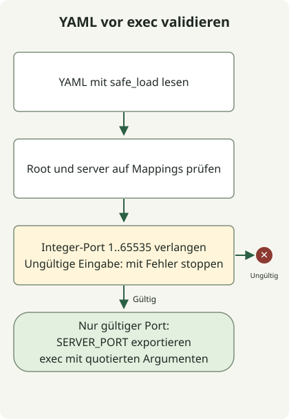

Um einen YAML-Port ohne `eval` aus der Shell zu lesen, verwenden Sie einen [YAML-Parser](https://pyyaml.org/wiki/PyYAMLDocumentation#loading-yaml), prüfen Typ und Wertebereich und übergeben nur benötigte Variablen. Das Beispiel liest mit Python und PyYAML einen Wert `server.port` und startet den Kindbefehl erst nach erfolgreicher Validierung. Nähern Sie die vollständige YAML-Grammatik nicht mit sed/awk an.

Allein der dargestellte Text unterscheidet die YAML-Ganzzahl `8080` nicht zuverlässig vom String `"8080"`. Der Loader **wandelt Strings nicht in Zahlen um**: Er akzeptiert nur als Integer geparste Werte zwischen 1 und 65535. In Python ist bool eine Unterklasse von int, daher lehnt `type(port) is int` boolesche Werte ab, während `isinstance(port, int)` dies nicht täte.

## Ablauf



Den Integer-Port vor dem Export von SERVER_PORT parsen und validieren. Ein Loader-Fehler verhindert den Start des Zielbefehls; exec erhält dessen Status.

## Umgebung und Eingabe

Verwenden Sie Python 3 und [PyYAML 6.0.3](https://pypi.org/project/PyYAML/6.0.3/). Die lokale Ausführungsumgebung nutzt Python 3.13. Speichern Sie die drei Dateien im selben Verzeichnis und installieren Sie die Abhängigkeit in einer eigenen virtuellen Umgebung.

```sh
python3 -m venv .venv
.venv/bin/python -m pip install PyYAML==6.0.3
```

### `application.yml`

```yaml
server:
  port: 8080
```

### `read-port.py`

```python
import sys
from pathlib import Path
import yaml

if len(sys.argv) != 2:
    sys.exit("usage: read-port.py CONFIG")
try:
    with Path(sys.argv[1]).open(encoding="utf-8") as stream:
        config = yaml.safe_load(stream)
    if not isinstance(config, dict):
        raise ValueError("root must be a mapping")
    server = config.get("server")
    if not isinstance(server, dict):
        raise ValueError("server must be a mapping")
    port = server.get("port")
    if type(port) is not int or not 1 <= port <= 65535:
        raise ValueError("server.port must be an integer from 1 to 65535")
except (OSError, UnicodeError, yaml.YAMLError, ValueError) as error:
    print(f"invalid configuration: {error}", file=sys.stderr)
    sys.exit(2)
print(port)
```

### `run-with-port.sh`

```sh
#!/bin/sh
set -eu
if [ "$#" -lt 2 ]; then
    printf '%s\n' 'usage: run-with-port.sh CONFIG COMMAND [ARG ...]' >&2
    exit 2
fi
config=$1
shift
script_dir=$(CDPATH= cd -- "$(dirname -- "$0")" && pwd)
port=$("${PYTHON:-python3}" "$script_dir/read-port.py" "$config")
export SERVER_PORT="$port"
exec "$@"
```

## Einen Befehl mit dem validierten Wert starten

```sh
PYTHON=.venv/bin/python sh run-with-port.sh application.yml \
  .venv/bin/python -c 'import os; print(os.environ["SERVER_PORT"])'
```

```text
8080
```

`read-port.py` schreibt nur den gültigen Wert nach stdout und Fehler nach stderr. Fehlende Dateien, ungültiges YAML, mehrere Dokumente, Eingaben ohne Mapping, fehlende Felder, Strings, boolesche Werte, Fließkommazahlen und Werte außerhalb des Bereichs werden mit Status 2 abgelehnt. `run-with-port.sh` reicht den Fehler weiter, ohne den Zielbefehl zu starten. Nach dessen Start erhält `exec` den Exitstatus.

`"$@"` bewahrt Befehl und jedes Argument getrennt. Leerzeichen oder `$()` in einem Argument werden nicht erneut als Shell-Quelltext ausgewertet. Relative `PYTHON`- und Konfigurationspfade beziehen sich auf das Arbeitsverzeichnis des Aufrufers; der Wrapper findet `read-port.py` neben sich selbst.

Der Export erreicht den Kindprozess, ohne die Umgebung der aufrufenden Eltern-Shell zu ändern. Starten Sie den Wrapper mit `sh run-with-port.sh ...`, statt ihn per source einzulesen. Prüfen Sie separat, ob Ihre Anwendung `SERVER_PORT` tatsächlich liest.

## Grenzen des Loaders

[`safe_load`](https://pyyaml.org/wiki/PyYAMLDocumentation) erlaubt keine Tags, die beliebige Python-Objekte erzeugen; anwendungsspezifische Typ- und Bereichsprüfungen bleiben erforderlich. Das Beispiel begrenzt Speicher und Laufzeit für bösartig große Eingaben nicht und richtet sich daher an vertrauenswürdige lokale Konfigurationen.

Es folgt den impliziten Typregeln von PyYAML: Werte wie `on` können boolesch werden. Doppelte Schlüssel werden nicht abgelehnt; der spätere Wert kann bestehen bleiben. Verbieten und prüfen Sie diese separat in der Eingabe. Dies ist weder eine vollständige YAML-1.2-Typpolitik noch ein allgemeiner Konfigurationsschema-Validator. Definieren Sie Typ und Verhalten bei fehlenden Werten für jedes zusätzliche Feld explizit.

Zu Befehlsfehlern und Exitstatus siehe die [Abfrage von GitHub-Releases](/en/posts/2023-09-23-linux-shellscript-github-latest/). Zur Kompatibilität persistierter Daten in JVM-Jobs siehe [Migration auf Spring Batch 5](/en/posts/2023-10-27-springbatch5-migration/).
