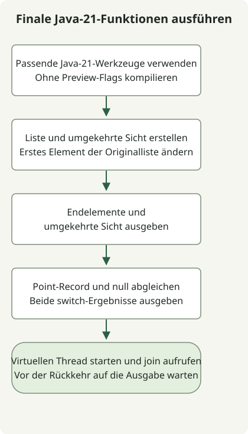

Virtuelle Threads, sequenzierte Collections, Record Patterns und Pattern Matching für switch sind finale Funktionen in JDK 21 und funktionieren ohne Preview-Flags. String Templates waren in dieser Version noch eine Preview-Funktion; ein JDK-Upgrade verleiht nicht jeder neuen Funktion denselben Stabilitätsstatus. Die [JDK-21-Release-Notes](https://www.oracle.com/java/technologies/javase/21all-relnotes.html) unterscheiden finale, Preview- und Incubator-Funktionen.

[Java 21 wurde am 19. September 2023 allgemein verfügbar](https://inside.java/2023/09/19/the-arrival-of-java-21/). Dieser Artikel betrachtet den Release anhand eines reproduzierbaren Beispiels. Er empfiehlt weder das neueste JDK noch eine Patch-Version für den Produktivbetrieb.

## Ablauf



Der Ablauf folgt Jdk21Example ohne Preview-Flags. Die umgekehrte Liste ist eine Sicht; join wartet auf die Ausgabe des virtuellen Threads.

## Funktionsstatus in JDK 21

| Funktion | Status in JDK 21 | Was zu prüfen ist |
| --- | --- | --- |
| Virtuelle Threads | Final | Für viele I/O-lastige Aufgaben erwägen; sie garantieren keine schnellere CPU-Berechnung |
| Sequenzierte Collections | Final | Einheitliche APIs für erste/letzte Elemente und umgekehrte Sichten |
| Record Patterns und Pattern Matching für switch | Final | Werte zerlegen und nach Mustern verzweigen |
| String Templates | Preview | Nicht davon ausgehen, dass spätere JDKs sie beibehalten |
| Strukturierte Nebenläufigkeit | Preview | Getrennt von der Finalisierung virtueller Threads beurteilen |
| Vector API | Sechster Incubator | Inkubierende APIs von finalen und Preview-Funktionen unterscheiden |

Dies ist eine Auswahl. Die [JDK-21-Release-Notes](https://www.oracle.com/java/technologies/javase/21all-relnotes.html) dokumentieren auch Preview- und Incubator-Status. Den Status von Sprachfunktionen finden Sie in den [Java-21-Sprachänderungen](https://docs.oracle.com/en/java/javase/21/language/java-language-changes.html). String Templates waren in JDK 23 nicht enthalten; siehe [Historie und Standardalternativen](/en/posts/2023-09-23-jdk-21-string-templates/).

## Ohne Preview-Flags kompilieren

Der folgende Code wurde lokal mit Zulu JDK 21.0.1 ausgeführt. Diese alte Patch-Version dokumentiert die Reproduktionsumgebung und ist keine Produktionsempfehlung. Prüfen Sie zuerst, ob `javac` und `java` dieselbe JDK-21-Installation verwenden.

### `Jdk21Example.java`

```java
import java.util.ArrayList;
import java.util.List;

public class Jdk21Example {
    record Point(int x, int y) {}

    static String describe(Object value) {
        return switch (value) {
            case null -> "missing";
            case Point(int x, int y) -> "point=" + x + "," + y;
            default -> "other";
        };
    }

    public static void main(String[] args) throws InterruptedException {
        var names = new ArrayList<>(List.of("alpha", "beta", "gamma"));
        var reverse = names.reversed();
        names.set(0, "ALPHA");
        System.out.println(names.getFirst() + "/" + names.getLast());
        System.out.println(reverse);
        System.out.println(describe(new Point(2, 3)));
        System.out.println(describe(null));
        Thread worker = Thread.ofVirtual().start(() ->
                System.out.println("virtual=" + Thread.currentThread().isVirtual()));
        worker.join();
    }
}
```

```sh
javac --release 21 Jdk21Example.java
java Jdk21Example
```

```text
ALPHA/gamma
[gamma, beta, ALPHA]
point=2,3
missing
virtual=true
```

`reversed()` liefert eine umgekehrte Sicht statt einer unabhängigen Kopie. Ändert sich das erste Element der Originalliste, ist auch das letzte Element der umgekehrten Ausgabe `ALPHA`. `getFirst()` würde bei einer leeren Collection eine Ausnahme auslösen; dieses Beispiel verwendet eine nicht leere Liste. Die [SequencedCollection-API](https://docs.oracle.com/en/java/javase/21/docs/api/java.base/java/util/SequencedCollection.html) definiert den Sichtvertrag.

`Point(int x, int y)` ist ein Record Pattern; `case null` behandelt null separat. Der virtuelle Thread gibt die letzte Zeile aus, und `join()` wartet auf seinen Abschluss. Dies prüft API-Verhalten, ohne Durchsatz oder Latenz zu messen. Der [Leitfaden zu virtuellen Threads](https://docs.oracle.com/en/java/javase/21/core/virtual-threads.html) erläutert ihre Eignung für Nebenläufigkeit mit überwiegenden I/O-Wartezeiten.

Prüfen Sie vor einem Wechsel der Anwendungslaufzeit die JDK-21-Kompatibilität von Framework, Build-Werkzeugen und Instrumentierungsagenten. JDK-Funktionsstatus und Supportzeitraum eines Distributors sind getrennte Fragen. [Temurin-21-Release-Historie und Binärauswahl](/en/posts/2023-10-10-temurin-jdk21-delay/) zeigt, wie Sie die tatsächlich veröffentlichten Artefakte eines Distributors prüfen.
