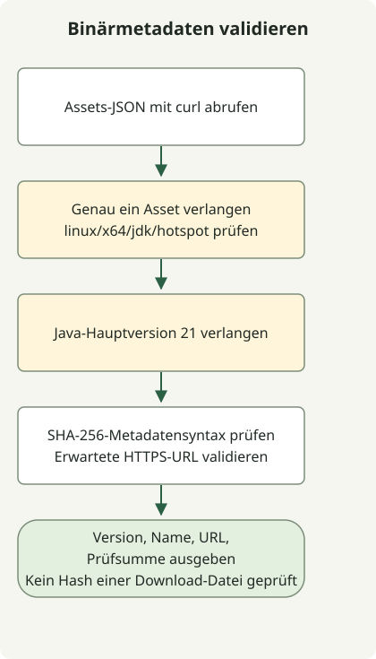

Um eine Temurin-JDK-21-Binärdatei zu finden, fragen Sie die Adoptium-API mit benötigtem Betriebssystem, CPU, JVM und Pakettyp ab. Das folgende Beispiel prüft Linux-x64-JDK-Metadaten, Prüfsummensyntax und URL-Ziel. Es lädt das Archiv weder herunter noch berechnet es dessen Hash.

Die anfängliche Verzögerung von Temurin 21 im Jahr 2023 war vom OpenJDK-21-Release getrennt. Adoptium führte sie auf die Prüfung der TCK-Vereinbarung zurück und unterschied später den TCK-Erhalt von der Veröffentlichung der Release-Binärdateien. Die historische Verzögerung bedeutet nicht, dass Temurin 21 weiterhin auf seine Veröffentlichung wartet.

## Ablauf



Dies ist ein Beispiel zur Metadatenauswahl, kein Installationsablauf. Es prüft Plattform, Java-Hauptversion, Prüfsummenformat und URL-Ziel, ohne das Archiv herunterzuladen oder zu hashen.

## Ankündigungs- und Veröffentlichungsdaten trennen

[Adoptium veröffentlichte den Verzögerungshinweis](https://adoptium.net/news/2023/09/temurin21-delay) am 28. September 2023. Das **Update vom 9. Oktober** meldet den TCK-Erhalt und den Beginn der Tests. Datieren Sie dieses Update nicht auf den 10. Oktober und setzen Sie den Testbeginn nicht mit abgeschlossenen Releases aller Plattformen gleich.

Separat liefern die [GitHub-Metadaten](https://api.github.com/repos/adoptium/temurin21-binaries/releases/tags/jdk-21%2B35) zum [Release `jdk-21+35`](https://github.com/adoptium/temurin21-binaries/releases/tag/jdk-21%2B35) den Wert `2023-10-10T13:55:52Z` für `published_at`. Dieser Zeitpunkt bezeichnet die Veröffentlichung des Releases, nicht den Abschluss sämtlicher Asset-Uploads. Early-Access-Builds und offizielle Releases sind ebenfalls zu unterscheiden.

## Eine aktuell verfügbare Java-21-Binärdatei abfragen

Geben Sie in der [Adoptium-API](https://api.adoptium.net/q/swagger-ui/) Java 21, Linux, x64, HotSpot und JDK an. Ändern Sie die Filter gemeinsam, wenn Betriebssystem oder CPU abweichen. Das Beispiel ruft nur Metadaten ab; es lädt keine JDK-Binärdatei herunter und installiert sie nicht. Es erfordert Python 3 und curl.

```sh
curl --fail --show-error --silent --location \
  'https://api.adoptium.net/v3/assets/latest/21/hotspot?architecture=x64&image_type=jdk&os=linux&vendor=eclipse' \
  --output assets.json &&
  python3 select-temurin.py assets.json
```

### `select-temurin.py`

```python
import json
import re
import sys
from pathlib import Path
from urllib.parse import urlparse

if len(sys.argv) != 2:
    sys.exit("usage: select-temurin.py ASSETS_JSON")
try:
    assets = json.loads(Path(sys.argv[1]).read_text(encoding="utf-8"))
    if not isinstance(assets, list) or len(assets) != 1:
        raise ValueError("expected exactly one asset")
    asset = assets[0]
    binary = asset["binary"]
    if (binary["os"], binary["architecture"], binary["image_type"], binary["jvm_impl"]) != ("linux", "x64", "jdk", "hotspot"):
        raise ValueError("unexpected platform or image type")
    if asset["version"]["major"] != 21:
        raise ValueError("expected Java 21")
    package = binary["package"]
    checksum = package["checksum"]
    if not isinstance(checksum, str) or not re.fullmatch(r"[0-9a-fA-F]{64}", checksum):
        raise ValueError("invalid SHA-256 metadata")
    link = package["link"]
    if not isinstance(link, str):
        raise ValueError("package URL must be a string")
    url = urlparse(link)
    if url.scheme != "https" or url.netloc != "github.com" or not url.path.startswith("/adoptium/temurin21-binaries/releases/download/"):
        raise ValueError("unexpected package URL")
    result = {"version": asset["version"]["semver"], "name": package["name"], "url": link, "sha256": checksum}
except (OSError, UnicodeError, ValueError, KeyError, TypeError) as error:
    print(f"invalid release metadata: {error}", file=sys.stderr)
    sys.exit(2)
print(json.dumps(result, indent=2))
```

Der Selektor gibt nur dann ein Ergebnis aus, wenn genau ein Asset die erwartete Java-Hauptversion, Plattform, den Image-Typ, die Distributions-URL und das Prüfsummenformat besitzt. Fehlende Felder, mehrere Assets und ungültiges JSON führen zum Fehler. `&&` verhindert die Ausführung des Selektors, wenn `curl` scheitert.

`latest/21` bezeichnet das zum Abfragezeitpunkt gelieferte Java-21-Update. Es fixiert weder den ersten Release `21+35` noch wählt es die neueste JDK-Hauptversion. Für wiederholbare Deployments Version, URL und SHA-256 aus der Antwort festhalten und fixieren.

Dies validiert das **Format** der Prüfsumme, nicht die Integrität einer heruntergeladenen Datei. Wenn Sie das Archiv separat herunterladen, berechnen Sie dessen SHA-256 und vergleichen Sie ihn vor dem Entpacken oder Installieren mit den Metadaten. Die Übereinstimmung tatsächlicher Binärdateien mit veröffentlichten Prüfsummen liegt außerhalb des Ausführungsumfangs dieses Metadatenbeispiels.

Ein weiteres Beispiel zur Asset-Auswahl bietet die [Abfrage von GitHub-Releases und Assets](/en/posts/2023-09-23-linux-shellscript-github-latest/). Zum Stabilitätsstatus siehe [finale und Preview-Funktionen von JDK 21](/en/posts/2023-09-20-jdk-21-release/).

Nach dem Herunterladen des ausgewählten Assets [dessen SHA-256-Prüfsumme mit einem vertrauenswürdigen Sollwert vergleichen](/en/posts/2026-10-30-verify-sha256-download/). Das Prüfprogramm liest lokale Bytes; es lädt das Release nicht herunter und authentifiziert den Herausgeber nicht.
