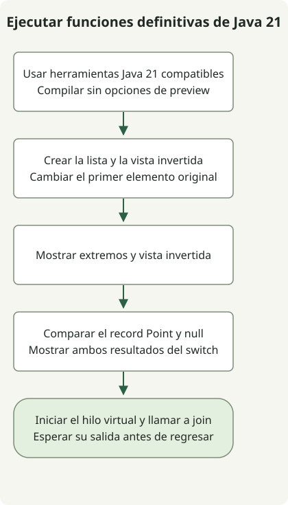

Los hilos virtuales, las colecciones secuenciadas, los patrones de record y la coincidencia de patrones en switch son funciones definitivas de JDK 21 y funcionan sin opciones de preview. Las plantillas de cadenas seguían en preview en esa versión; actualizar el JDK no da a todas las funciones nuevas el mismo estado de estabilidad. Las [notas de JDK 21](https://www.oracle.com/java/technologies/javase/21all-relnotes.html) distinguen funciones definitivas, previews e incubación.

[Java 21 alcanzó la disponibilidad general](https://inside.java/2023/09/19/the-arrival-of-java-21/) el 19 de septiembre de 2023. Este artículo revisita esa versión con un ejemplo reproducible. No recomienda el JDK más reciente ni una versión de parche para producción.

## Flujo de procesamiento



El flujo sigue Jdk21Example sin opciones de preview. La lista invertida es una vista y join espera la salida del hilo virtual.

## Estado de las funciones en JDK 21

| Función | Estado en JDK 21 | Qué comprobar |
| --- | --- | --- |
| Hilos virtuales | Definitiva | Considerarlos para muchas tareas de E/S; no garantizan cálculos de CPU más rápidos |
| Colecciones secuenciadas | Definitiva | API coherentes para primeros/últimos elementos y vistas invertidas |
| Patrones de record y coincidencia de patrones en switch | Definitiva | Descomponer valores y ramificar según patrones |
| Plantillas de cadenas | Preview | No dar por hecho que se mantienen en JDK posteriores |
| Concurrencia estructurada | Preview | Evaluarla por separado de la finalización de los hilos virtuales |
| Vector API | Sexta incubación | Distinguir las API en incubación de funciones definitivas y previews |

Es una selección. Las [notas de JDK 21](https://www.oracle.com/java/technologies/javase/21all-relnotes.html) también documentan el estado de preview e incubación. Consulta los [cambios del lenguaje Java 21](https://docs.oracle.com/en/java/javase/21/language/java-language-changes.html) para las funciones del lenguaje. Las plantillas de cadenas no se incluyeron en JDK 23; consulta su [historial y alternativas estándar](/en/posts/2023-09-23-jdk-21-string-templates/).

## Compilar sin opciones de preview

El código siguiente se ejecutó localmente con Zulu JDK 21.0.1. Ese parche antiguo registra el entorno de reproducción, sin ser una recomendación para producción. Comprueba primero que `javac` y `java` apuntan a la misma instalación de JDK 21.

### `Jdk21Example.java`

```java
import java.util.ArrayList;
import java.util.List;

public class Jdk21Example {
    record Point(int x, int y) {}

    static String describe(Object value) {
        return switch (value) {
            case null -> "missing";
            case Point(int x, int y) -> "point=" + x + "," + y;
            default -> "other";
        };
    }

    public static void main(String[] args) throws InterruptedException {
        var names = new ArrayList<>(List.of("alpha", "beta", "gamma"));
        var reverse = names.reversed();
        names.set(0, "ALPHA");
        System.out.println(names.getFirst() + "/" + names.getLast());
        System.out.println(reverse);
        System.out.println(describe(new Point(2, 3)));
        System.out.println(describe(null));
        Thread worker = Thread.ofVirtual().start(() ->
                System.out.println("virtual=" + Thread.currentThread().isVirtual()));
        worker.join();
    }
}
```

```sh
javac --release 21 Jdk21Example.java
java Jdk21Example
```

```text
ALPHA/gamma
[gamma, beta, ALPHA]
point=2,3
missing
virtual=true
```

`reversed()` devuelve una vista invertida, no una copia independiente. Al cambiar el primer elemento de la lista original, el último de la salida invertida también pasa a ser `ALPHA`. Llamar a `getFirst()` con una colección vacía lanzaría una excepción; este ejemplo usa una lista no vacía. La [API SequencedCollection](https://docs.oracle.com/en/java/javase/21/docs/api/java.base/java/util/SequencedCollection.html) define el contrato de la vista.

`Point(int x, int y)` es un patrón de record y `case null` trata la entrada null por separado. El hilo virtual imprime la última línea y `join()` espera su finalización. Esto comprueba el comportamiento de las API sin medir rendimiento ni latencia. La [guía de hilos virtuales](https://docs.oracle.com/en/java/javase/21/core/virtual-threads.html) explica su idoneidad para concurrencia dominada por esperas de E/S.

Antes de cambiar el entorno de ejecución de una aplicación, comprueba la compatibilidad con JDK 21 del framework, las herramientas de compilación y los agentes de instrumentación. El estado de las funciones del JDK y el periodo de soporte del distribuidor son cuestiones distintas. El [historial de Temurin 21 y la selección de binarios](/en/posts/2023-10-10-temurin-jdk21-delay/) explican cómo verificar lo que publicó realmente un distribuidor.
