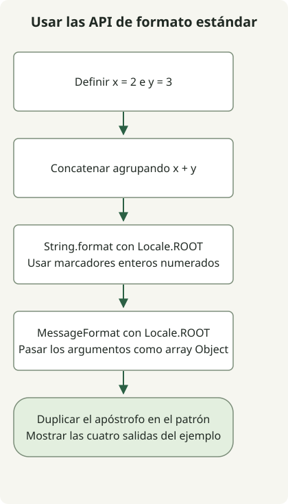

Las plantillas de cadenas fueron funciones en preview en JDK 21 y 22 y se retiraron en JDK 23. Añadir `--enable-preview` a JDK 23 no restaura `STR`. Para código que deba superar esas previews, usa las API estándar de cadenas o un serializador específico del formato. La [explicación de Oracle sobre la retirada](https://inside.java/2024/06/20/newscast-71/) describe el cambio.

## Flujo de procesamiento



Se muestra el FormattingExample estándar, no el antiguo ejemplo de preview. Compara tres formas de formato y comprueba el tratamiento del apóstrofo en MessageFormat.

## ¿Qué JDK puede ejecutar el ejemplo antiguo?

| JDK | Estado de String Templates | Qué hacer |
| --- | --- | --- |
| 21 | Preview | Usar JDK 21 tanto para compilar como para ejecutar, con preview habilitada. |
| 22 | Segunda preview | Usar compilador JDK 22, entorno y opciones de preview correspondientes. |
| 23 | Retiradas | Sustituir la sintaxis de preview; las opciones no restauran funciones retiradas. |

La opción `--release` no revive una preview antigua en un compilador más reciente. La [guía de previews de Oracle](https://docs.oracle.com/en/java/javase/21/language/preview-language-and-vm-features.html) exige el compilador de la versión de esa preview.

## Ejecutar el ejemplo histórico de JDK 21

Guarda esta clase completa como `Example.java`. Esta sección requiere JDK 21 aunque otro JDK sea el predeterminado.

```java
public class Example {
    public static void main(String[] args) {
        int x = 2;
        int y = 3;
        String result = STR."\{x} plus \{y} equals \{x + y}";
        System.out.println(result);
    }
}
```

Comprueba las herramientas seleccionadas y compila y ejecuta en el directorio del archivo:

```sh
javac -version
java -version
javac --enable-preview --release 21 Example.java
java --enable-preview Example
```

La salida es `2 plus 3 equals 5`. La compilación también informa del uso de funciones en preview. `STR` se importa implícitamente en esta preview de JDK 21; añadir un import no resuelve la ausencia del procesador en un JDK posterior. Consulta la [guía de String Templates de JDK 21](https://docs.oracle.com/en/java/javase/21/language/string-templates.html).

## Sustituir la sintaxis de preview por API estándar

Guarda lo siguiente como `FormattingExample.java`. Usa API estándar sin opciones de preview. La clase completa funciona en Java 17. Aquí `String.format` y `MessageFormat` reciben una configuración regional explícita para reproducir la salida numérica.

```java
import java.text.MessageFormat;
import java.util.Locale;

public class FormattingExample {
    public static void main(String[] args) {
        int x = 2;
        int y = 3;
        System.out.println(x + " plus " + y + " equals " + (x + y));
        System.out.println(String.format(Locale.ROOT, "%1$d plus %2$d equals %3$d", x, y, x + y));
        MessageFormat format = new MessageFormat("{0} plus {1} equals {2}", Locale.ROOT);
        System.out.println(format.format(new Object[] {x, y, x + y}));
        System.out.println(new MessageFormat("It''s {0}", Locale.ROOT)
            .format(new Object[] {"ready"}));
    }
}
```

```sh
javac FormattingExample.java
java FormattingExample
```

Salida:

```text
2 plus 3 equals 5
2 plus 3 equals 5
2 plus 3 equals 5
It's ready
```

| Necesidad | API adecuada | Detalle que conservar |
| --- | --- | --- |
| Expresión corta | `+` | Los paréntesis de `x + y` dejan explícita la operación aritmética. |
| Adiciones repetidas | `StringBuilder` | Útil al construir texto de forma incremental. |
| Cadena de formato | `String.format` o `.formatted` | `%d` y `%s` siguen las reglas de Formatter; usa `String.format(Locale.ROOT, ...)` si necesitas una configuración regional explícita. |
| Patrón de mensaje localizado | `MessageFormat` | Usa argumentos numerados, un array de objetos y otras reglas de comillas. |

`MessageFormat` trata las comillas simples como sintaxis del patrón. La comilla duplicada en `It''s {0}` produce el apóstrofo literal mostrado arriba. Sustituir un patrón `%s` por `{0}` también implica cambiar de API y comprobar su comportamiento regional. [API MessageFormat](https://docs.oracle.com/en/java/javase/21/docs/api/java.base/java/text/MessageFormat.html), [API String](https://docs.oracle.com/en/java/javase/21/docs/api/java.base/java/lang/String.html).

## Separar formato y codificación

Ni `STR` ni el formato ordinario convierten valores arbitrarios en JSON, SQL o HTML seguros. Usa un serializador JSON, parámetros SQL vinculados o el escape HTML del sistema de renderizado según el destino. Una cadena correcta con valores sencillos puede fallar si un valor contiene comillas o barras inversas.

Ambas clases completas se compilaron y ejecutaron con los comandos anteriores: la preview en JDK 21.0.1 y la alternativa estándar en JDK 17.0.8.1 y 21.0.1. Las filas JDK 22 y 23 describen el historial documentado; no se ejecutaron en este entorno.

Actualizar el JDK también afecta a la compatibilidad del framework. Para una aplicación Spring antigua, consulta la [secuencia de migración de Spring Boot 2.7 a 3.0](/en/posts/2023-09-08-springboot3-migration/).
