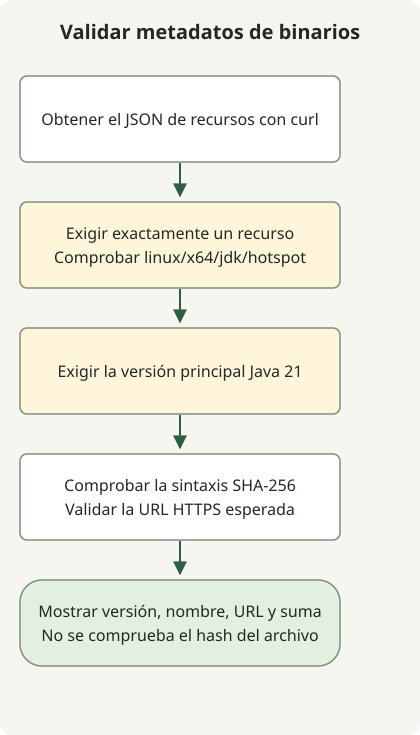

Para localizar un binario Temurin JDK 21, consulta la API Adoptium con el sistema operativo, CPU, JVM y tipo de paquete necesarios. El ejemplo comprueba metadatos JDK de Linux x64, sintaxis de la suma de comprobación y destino de la URL. No descarga el archivo ni calcula su hash.

El retraso inicial de Temurin 21 en 2023 fue independiente del lanzamiento de OpenJDK 21. Adoptium lo atribuyó a la revisión del acuerdo TCK y después distinguió recibir el TCK de publicar los binarios. Este retraso histórico no significa que Temurin 21 siga pendiente de lanzamiento.

## Flujo de procesamiento



Es un ejemplo de selección de metadatos, no un proceso de instalación. Comprueba plataforma, versión principal de Java, sintaxis de la suma de comprobación y destino de la URL sin descargar ni calcular el hash del archivo.

## Separar fechas de anuncio y publicación

[Adoptium publicó el aviso de retraso](https://adoptium.net/news/2023/09/temurin21-delay) el 28 de septiembre de 2023. La **actualización del 9 de octubre** informa de la recepción del TCK y del paso a las pruebas. No la feches el 10 de octubre ni equipares empezar las pruebas con completar los lanzamientos para todas las plataformas.

Por separado, los [metadatos de GitHub](https://api.github.com/repos/adoptium/temurin21-binaries/releases/tags/jdk-21%2B35) de la [versión `jdk-21+35`](https://github.com/adoptium/temurin21-binaries/releases/tag/jdk-21%2B35) devuelven `2023-10-10T13:55:52Z` como `published_at`. Esa marca indica la publicación de la versión, no el fin de la carga de todos sus recursos. También hay que distinguir las compilaciones Early Access de las versiones oficiales.

## Consultar un binario Java 21 disponible ahora

Especifica Java 21, Linux, x64, HotSpot y JDK en la [API Adoptium](https://api.adoptium.net/q/swagger-ui/). Cambia los filtros juntos si tu sistema operativo o CPU difieren. El ejemplo solo obtiene metadatos: no descarga ni instala binarios JDK. Requiere Python 3 y curl.

```sh
curl --fail --show-error --silent --location \
  'https://api.adoptium.net/v3/assets/latest/21/hotspot?architecture=x64&image_type=jdk&os=linux&vendor=eclipse' \
  --output assets.json &&
  python3 select-temurin.py assets.json
```

### `select-temurin.py`

```python
import json
import re
import sys
from pathlib import Path
from urllib.parse import urlparse

if len(sys.argv) != 2:
    sys.exit("usage: select-temurin.py ASSETS_JSON")
try:
    assets = json.loads(Path(sys.argv[1]).read_text(encoding="utf-8"))
    if not isinstance(assets, list) or len(assets) != 1:
        raise ValueError("expected exactly one asset")
    asset = assets[0]
    binary = asset["binary"]
    if (binary["os"], binary["architecture"], binary["image_type"], binary["jvm_impl"]) != ("linux", "x64", "jdk", "hotspot"):
        raise ValueError("unexpected platform or image type")
    if asset["version"]["major"] != 21:
        raise ValueError("expected Java 21")
    package = binary["package"]
    checksum = package["checksum"]
    if not isinstance(checksum, str) or not re.fullmatch(r"[0-9a-fA-F]{64}", checksum):
        raise ValueError("invalid SHA-256 metadata")
    link = package["link"]
    if not isinstance(link, str):
        raise ValueError("package URL must be a string")
    url = urlparse(link)
    if url.scheme != "https" or url.netloc != "github.com" or not url.path.startswith("/adoptium/temurin21-binaries/releases/download/"):
        raise ValueError("unexpected package URL")
    result = {"version": asset["version"]["semver"], "name": package["name"], "url": link, "sha256": checksum}
except (OSError, UnicodeError, ValueError, KeyError, TypeError) as error:
    print(f"invalid release metadata: {error}", file=sys.stderr)
    sys.exit(2)
print(json.dumps(result, indent=2))
```

El selector solo muestra un resultado si hay exactamente un recurso con la versión principal de Java, plataforma, tipo de imagen, URL de distribución y formato de suma esperados. Campos ausentes, múltiples recursos y JSON inválido fallan. `&&` impide ejecutar el selector si falla `curl`.

`latest/21` significa la actualización Java 21 devuelta al consultar. No fija la primera versión `21+35` ni selecciona la versión principal más reciente del JDK. Registra y fija la versión, URL y SHA-256 devueltos para despliegues repetibles.

Esto valida el **formato** de la suma de comprobación, no la integridad de un archivo descargado. Si descargas el archivo por separado, calcula su SHA-256 y compáralo con los metadatos antes de extraerlo o instalarlo. Comprobar la coincidencia del binario real con la suma publicada queda fuera del alcance de ejecución de este ejemplo.

Para otro ejemplo de selección, consulta las [versiones y recursos de GitHub](/en/posts/2023-09-23-linux-shellscript-github-latest/). Para la estabilidad de funciones, consulta las [funciones definitivas y en preview del JDK 21](/en/posts/2023-09-20-jdk-21-release/).
