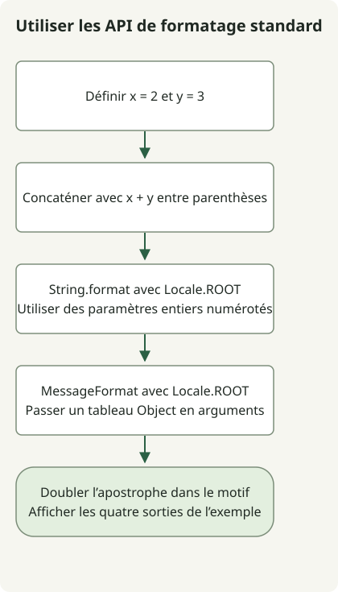

Les String Templates étaient en preview dans JDK 21 et 22 et ont été retirés dans JDK 23. Ajouter `--enable-preview` à JDK 23 ne rétablit pas `STR`. Pour dépasser ces previews, utilisez les API de chaînes standard ou un sérialiseur propre au format. L’[explication du retrait par Oracle](https://inside.java/2024/06/20/newscast-71/) décrit ce changement.

## Déroulement



Le schéma représente le FormattingExample standard, pas l’ancien exemple en preview. Il compare trois formes de formatage et vérifie les apostrophes dans MessageFormat.

## Quel JDK peut exécuter l’ancien exemple ?

| JDK | Statut des String Templates | Marche à suivre |
| --- | --- | --- |
| 21 | Preview | Utiliser JDK 21 pour compiler et exécuter, avec la preview activée. |
| 22 | Deuxième preview | Utiliser le compilateur JDK 22, l’environnement et les options de preview correspondants. |
| 23 | Retirés | Remplacer la syntaxe de preview ; les options ne rétablissent pas une fonction retirée. |

L’option `--release` ne permet pas de ressusciter une ancienne preview avec un compilateur plus récent. Le [guide des previews d’Oracle](https://docs.oracle.com/en/java/javase/21/language/preview-language-and-vm-features.html) exige le compilateur de la version concernée.

## Exécuter l’exemple historique du JDK 21

Enregistrez cette classe complète dans `Example.java`. Cette section exige JDK 21 même si un autre JDK est celui par défaut.

```java
public class Example {
    public static void main(String[] args) {
        int x = 2;
        int y = 3;
        String result = STR."\{x} plus \{y} equals \{x + y}";
        System.out.println(result);
    }
}
```

Vérifiez les outils sélectionnés, puis compilez et exécutez dans le répertoire du fichier :

```sh
javac -version
java -version
javac --enable-preview --release 21 Example.java
java --enable-preview Example
```

La sortie est `2 plus 3 equals 5`. La compilation signale aussi l’utilisation de fonctions en preview. `STR` est importé implicitement dans cette preview du JDK 21 ; ajouter un import ne corrige pas son absence dans un JDK ultérieur. Voir le [guide des String Templates du JDK 21](https://docs.oracle.com/en/java/javase/21/language/string-templates.html).

## Remplacer la syntaxe de preview par les API standard

Enregistrez le code suivant dans `FormattingExample.java`. Il utilise des API standard sans options de preview. La classe complète fonctionne sur Java 17. `String.format` et `MessageFormat` reçoivent ici une locale explicite pour rendre la sortie numérique reproductible.

```java
import java.text.MessageFormat;
import java.util.Locale;

public class FormattingExample {
    public static void main(String[] args) {
        int x = 2;
        int y = 3;
        System.out.println(x + " plus " + y + " equals " + (x + y));
        System.out.println(String.format(Locale.ROOT, "%1$d plus %2$d equals %3$d", x, y, x + y));
        MessageFormat format = new MessageFormat("{0} plus {1} equals {2}", Locale.ROOT);
        System.out.println(format.format(new Object[] {x, y, x + y}));
        System.out.println(new MessageFormat("It''s {0}", Locale.ROOT)
            .format(new Object[] {"ready"}));
    }
}
```

```sh
javac FormattingExample.java
java FormattingExample
```

Sortie :

```text
2 plus 3 equals 5
2 plus 3 equals 5
2 plus 3 equals 5
It's ready
```

| Besoin | API adaptée | Détail à préserver |
| --- | --- | --- |
| Expression courte | `+` | Les parenthèses autour de `x + y` explicitent le calcul. |
| Ajouts répétés | `StringBuilder` | Utile pour construire progressivement du texte. |
| Chaîne de formatage | `String.format` ou `.formatted` | `%d` et `%s` suivent les règles de Formatter ; utiliser `String.format(Locale.ROOT, ...)` pour une locale explicite. |
| Motif de message localisé | `MessageFormat` | Utilise des arguments numérotés, un tableau d’objets et d’autres règles de citation. |

`MessageFormat` traite les apostrophes comme une syntaxe de motif. L’apostrophe doublée dans `It''s {0}` produit l’apostrophe littérale affichée plus haut. Remplacer un motif `%s` par `{0}` implique aussi de changer d’API et de vérifier son comportement de locale. [API MessageFormat](https://docs.oracle.com/en/java/javase/21/docs/api/java.base/java/text/MessageFormat.html), [API String](https://docs.oracle.com/en/java/javase/21/docs/api/java.base/java/lang/String.html).

## Séparer formatage et encodage

Ni `STR` ni le formatage ordinaire ne rendent des valeurs arbitraires sûres en JSON, SQL ou HTML. Utilisez un sérialiseur JSON, la liaison des paramètres SQL ou l’échappement HTML du moteur de rendu selon le format cible. Une chaîne correcte avec des valeurs simples peut échouer si une valeur contient des guillemets ou des barres obliques inverses.

Les deux classes complètes ont été compilées et exécutées avec les commandes ci-dessus : la preview sur JDK 21.0.1, l’alternative standard sur JDK 17.0.8.1 et 21.0.1. Les lignes JDK 22 et 23 décrivent l’historique documenté ; elles n’ont pas été exécutées dans cet environnement.

Une mise à niveau du JDK affecte aussi la compatibilité des frameworks. Pour une ancienne application Spring, voir la [séquence de migration de Spring Boot 2.7 vers 3.0](/en/posts/2023-09-08-springboot3-migration/).
