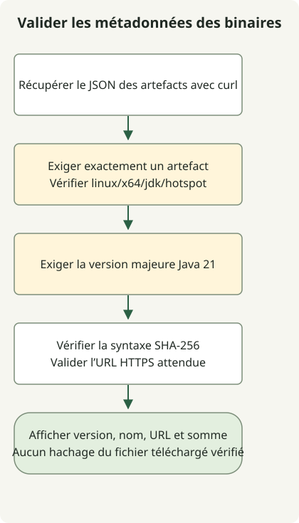

Pour trouver un binaire Temurin JDK 21, interrogez l’API Adoptium avec l’OS, le CPU, la JVM et le type de paquet nécessaires. L’exemple contrôle les métadonnées JDK Linux x64, la syntaxe de la somme de contrôle et l’emplacement de l’URL. Il ne télécharge ni ne hache l’archive.

Le retard initial de Temurin 21 en 2023 était distinct de la sortie d’OpenJDK 21. Adoptium l’a attribué à l’examen de l’accord TCK, puis a distingué la réception du TCK de la publication des binaires. Ce retard historique ne signifie pas que Temurin 21 attend encore sa sortie.

## Déroulement



Il s’agit de sélectionner des métadonnées, pas d’installer un JDK. Le flux contrôle la plateforme, la version majeure Java, la syntaxe de la somme de contrôle et l’emplacement de l’URL, sans télécharger ni hacher l’archive.

## Distinguer dates d’annonce et de publication

[Adoptium a publié son avis de retard](https://adoptium.net/news/2023/09/temurin21-delay) le 28 septembre 2023. Sa **mise à jour du 9 octobre** indique la réception du TCK et le passage aux tests. Ne datez pas cette mise à jour du 10 octobre et n’assimilez pas le début des tests à la fin des publications pour toutes les plateformes.

Séparément, les [métadonnées GitHub](https://api.github.com/repos/adoptium/temurin21-binaries/releases/tags/jdk-21%2B35) de la [version `jdk-21+35`](https://github.com/adoptium/temurin21-binaries/releases/tag/jdk-21%2B35) renvoient `2023-10-10T13:55:52Z` pour `published_at`. Cet instant correspond à la publication de cette version, pas à la fin du téléversement de tous ses artefacts. Il faut aussi distinguer builds Early Access et versions officielles.

## Rechercher un binaire Java 21 disponible maintenant

Spécifiez Java 21, Linux, x64, HotSpot et JDK dans l’[API Adoptium](https://api.adoptium.net/q/swagger-ui/). Adaptez les filtres ensemble si votre OS ou CPU diffère. Cet exemple récupère seulement les métadonnées ; il ne télécharge ni n’installe de binaire JDK. Python 3 et curl sont nécessaires.

```sh
curl --fail --show-error --silent --location \
  'https://api.adoptium.net/v3/assets/latest/21/hotspot?architecture=x64&image_type=jdk&os=linux&vendor=eclipse' \
  --output assets.json &&
  python3 select-temurin.py assets.json
```

### `select-temurin.py`

```python
import json
import re
import sys
from pathlib import Path
from urllib.parse import urlparse

if len(sys.argv) != 2:
    sys.exit("usage: select-temurin.py ASSETS_JSON")
try:
    assets = json.loads(Path(sys.argv[1]).read_text(encoding="utf-8"))
    if not isinstance(assets, list) or len(assets) != 1:
        raise ValueError("expected exactly one asset")
    asset = assets[0]
    binary = asset["binary"]
    if (binary["os"], binary["architecture"], binary["image_type"], binary["jvm_impl"]) != ("linux", "x64", "jdk", "hotspot"):
        raise ValueError("unexpected platform or image type")
    if asset["version"]["major"] != 21:
        raise ValueError("expected Java 21")
    package = binary["package"]
    checksum = package["checksum"]
    if not isinstance(checksum, str) or not re.fullmatch(r"[0-9a-fA-F]{64}", checksum):
        raise ValueError("invalid SHA-256 metadata")
    link = package["link"]
    if not isinstance(link, str):
        raise ValueError("package URL must be a string")
    url = urlparse(link)
    if url.scheme != "https" or url.netloc != "github.com" or not url.path.startswith("/adoptium/temurin21-binaries/releases/download/"):
        raise ValueError("unexpected package URL")
    result = {"version": asset["version"]["semver"], "name": package["name"], "url": link, "sha256": checksum}
except (OSError, UnicodeError, ValueError, KeyError, TypeError) as error:
    print(f"invalid release metadata: {error}", file=sys.stderr)
    sys.exit(2)
print(json.dumps(result, indent=2))
```

Le sélecteur n’affiche un résultat que pour exactement un artefact présentant la version majeure Java, la plateforme, le type d’image, l’URL de distribution et le format de somme attendus. Champs manquants, artefacts multiples et JSON invalide échouent. `&&` empêche l’exécution du sélecteur si `curl` échoue.

`latest/21` désigne la mise à jour Java 21 renvoyée au moment de la requête. Cela ne fixe pas la première version `21+35` et ne sélectionne pas le JDK majeur le plus récent. Consignez et fixez la version, l’URL et le SHA-256 retournés pour des déploiements reproductibles.

Cela valide le **format** de la somme de contrôle, pas l’intégrité d’un fichier téléchargé. Si vous récupérez l’archive séparément, calculez son SHA-256 et comparez-le aux métadonnées avant extraction ou installation. Vérifier la concordance entre le binaire réel et la somme publiée dépasse le périmètre d’exécution de cet exemple.

Pour un autre exemple de sélection, voir la [recherche des versions et artefacts GitHub](/en/posts/2023-09-23-linux-shellscript-github-latest/). Pour la stabilité des fonctions, voir les [fonctions définitives et en preview du JDK 21](/en/posts/2023-09-20-jdk-21-release/).
