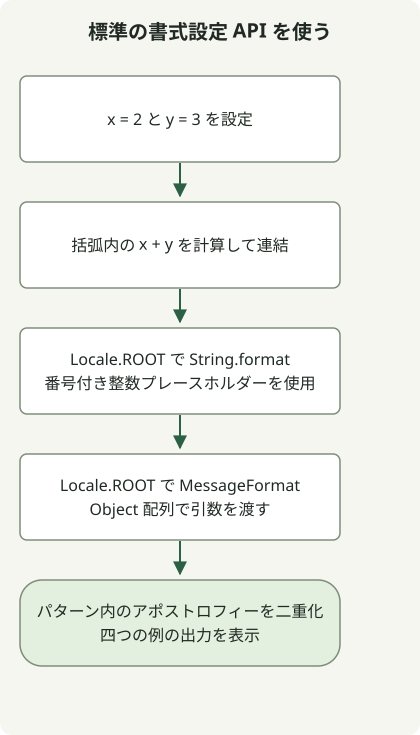

文字列テンプレートは JDK 21 と 22 のプレビュー機能で、JDK 23 では削除されました。JDK 23 に `--enable-preview` を付けても `STR` は戻りません。これらのプレビューより先へ移行するコードでは、標準の文字列 API や形式に応じたシリアライザーを使ってください。[Oracle の削除に関する説明](https://inside.java/2024/06/20/newscast-71/)で経緯を確認できます。

## 処理の流れ



過去のプレビュー例ではなく標準の FormattingExample の流れです。三つの書式設定を比較し、MessageFormat のアポストロフィー処理を確認します。

## 古い例を実行できる JDK は？

| JDK | 文字列テンプレートの状態 | 対応 |
| --- | --- | --- |
| 21 | プレビュー | コンパイルも実行も JDK 21 を使い、プレビューを有効にする。 |
| 22 | 二回目のプレビュー | 対応する JDK 22 のコンパイラー・ランタイム・プレビュー設定を使う。 |
| 23 | 削除済み | プレビュー構文を置き換える。オプションで削除済み機能は戻せない。 |

コンパイラーの `--release` オプションは、新しいコンパイラーで古いプレビュー機能を復活させる手段ではありません。[Oracle のプレビューガイド](https://docs.oracle.com/en/java/javase/21/language/preview-language-and-vm-features.html)では、そのプレビューのリリースに対応するコンパイラーが必要とされています。

## 過去の JDK 21 の例を実行する

完全なクラスを `Example.java` として保存します。別の JDK が既定でも、この節には JDK 21 が必要です。

```java
public class Example {
    public static void main(String[] args) {
        int x = 2;
        int y = 3;
        String result = STR."\{x} plus \{y} equals \{x + y}";
        System.out.println(result);
    }
}
```

選択したツールを確認し、ファイルのあるディレクトリでコンパイル・実行します。

```sh
javac -version
java -version
javac --enable-preview --release 21 Example.java
java --enable-preview Example
```

出力は `2 plus 3 equals 5` です。コンパイル時にはプレビュー機能の使用も通知されます。この JDK 21 プレビューでは `STR` は暗黙にインポートされます。後の JDK でプロセッサーが見つからなくても import の追加では直りません。[JDK 21 文字列テンプレートガイド](https://docs.oracle.com/en/java/javase/21/language/string-templates.html)を参照してください。

## プレビュー構文を標準 API に置き換える

以下を `FormattingExample.java` として保存します。標準 API を使い、プレビューオプションは不要です。完全なクラスは Java 17 で動きます。数値出力を再現できるよう、`String.format` と `MessageFormat` にはロケールを明示します。

```java
import java.text.MessageFormat;
import java.util.Locale;

public class FormattingExample {
    public static void main(String[] args) {
        int x = 2;
        int y = 3;
        System.out.println(x + " plus " + y + " equals " + (x + y));
        System.out.println(String.format(Locale.ROOT, "%1$d plus %2$d equals %3$d", x, y, x + y));
        MessageFormat format = new MessageFormat("{0} plus {1} equals {2}", Locale.ROOT);
        System.out.println(format.format(new Object[] {x, y, x + y}));
        System.out.println(new MessageFormat("It''s {0}", Locale.ROOT)
            .format(new Object[] {"ready"}));
    }
}
```

```sh
javac FormattingExample.java
java FormattingExample
```

出力：

```text
2 plus 3 equals 5
2 plus 3 equals 5
2 plus 3 equals 5
It's ready
```

| 用途 | 適した API | 維持する点 |
| --- | --- | --- |
| 短い式 | `+` | `x + y` の括弧で算術計算を明示する。 |
| 繰り返しの追加 | `StringBuilder` | テキストを段階的に組み立てる場合に適する。 |
| 書式文字列 | `String.format` または `.formatted` | `%d` と `%s` は Formatter の規則に従う。明示的なロケールには `String.format(Locale.ROOT, ...)` を使う。 |
| ローカライズしたメッセージパターン | `MessageFormat` | 番号付き引数・オブジェクト配列・異なる引用規則を使う。 |

`MessageFormat` は単一引用符をパターン構文として扱います。`It''s {0}` の二重の引用符により、上記のアポストロフィーがそのまま出力されます。`%s` パターンを `{0}` に変える場合は API も切り替え、ロケール動作を確認する必要があります。[MessageFormat API](https://docs.oracle.com/en/java/javase/21/docs/api/java.base/java/text/MessageFormat.html)、[String API](https://docs.oracle.com/en/java/javase/21/docs/api/java.base/java/lang/String.html)。

## 書式設定とエンコードを分ける

`STR` も通常の書式設定も、任意の値を安全な JSON・SQL・HTML にするものではありません。出力形式に合わせて JSON シリアライザー、SQL パラメーター束縛、レンダリングシステムの HTML エスケープを使ってください。単純な値で正しく見える文字列も、引用符やバックスラッシュを含むと失敗し得ます。

完全な二つのクラスは上記コマンドでコンパイル・実行しました。プレビューは JDK 21.0.1、標準の代替例は JDK 17.0.8.1 と 21.0.1 です。JDK 22 と 23 の行は文書に基づく機能の履歴で、この環境では実行していません。

JDK の更新はフレームワークの互換性にも影響します。古い Spring アプリでは [Spring Boot 2.7 から 3.0 への移行順序](/en/posts/2023-09-08-springboot3-migration/)を参照してください。
