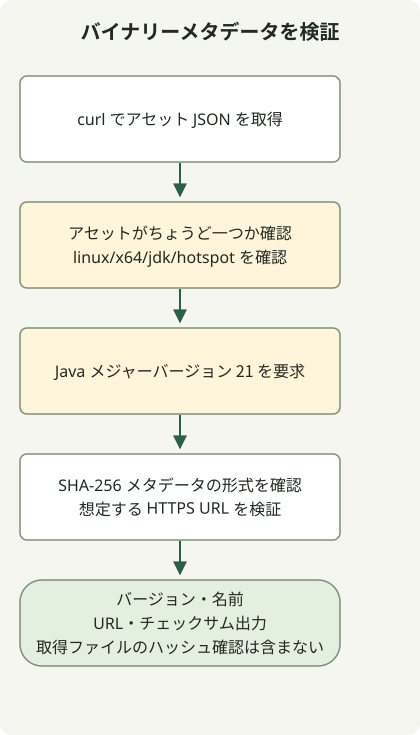

Temurin JDK 21 のバイナリーを探すには、必要な OS・CPU・JVM・パッケージ種別で Adoptium API を検索します。以下の例は Linux x64 JDK のメタデータ、チェックサムの形式、URL の場所を確認します。アーカイブのダウンロードやハッシュ計算は行いません。

Temurin 21 の 2023 年当初の遅延は OpenJDK 21 のリリースとは別の出来事です。Adoptium は TCK 契約の審査を遅延の理由とし、その後も TCK の受領とリリースバイナリーの公開を区別しています。この過去の遅延は、Temurin 21 が今も未公開という意味ではありません。

## 処理の流れ



インストールではなくメタデータ選択の例です。プラットフォーム・Java メジャーバージョン・チェックサムの形式・URL の場所を確認し、アーカイブのダウンロードやハッシュ計算は行いません。

## 告知日と公開日を分ける

[Adoptium は 2023年9月28日に遅延を告知しました](https://adoptium.net/news/2023/09/temurin21-delay)。**10月9日の更新**では TCK を受領してテストに進んだと報告しています。この更新を 10月10日と記録したり、テスト開始を全プラットフォームのリリース完了とみなしたりしないでください。

別途、[GitHub メタデータ](https://api.github.com/repos/adoptium/temurin21-binaries/releases/tags/jdk-21%2B35)の [`jdk-21+35` リリース](https://github.com/adoptium/temurin21-binaries/releases/tag/jdk-21%2B35)では `published_at` が `2023-10-10T13:55:52Z` です。これはそのリリースの公開時刻であり、すべてのアセットのアップロード完了時刻ではありません。Early Access ビルドと正式リリースも区別する必要があります。

## 現在利用できる Java 21 バイナリーを検索する

[Adoptium API](https://api.adoptium.net/q/swagger-ui/)に Java 21・Linux・x64・HotSpot・JDK を指定します。OS や CPU が違う場合はフィルターをまとめて変更してください。この例はメタデータの取得のみで、JDK バイナリーのダウンロードやインストールはしません。Python 3 と curl が必要です。

```sh
curl --fail --show-error --silent --location \
  'https://api.adoptium.net/v3/assets/latest/21/hotspot?architecture=x64&image_type=jdk&os=linux&vendor=eclipse' \
  --output assets.json &&
  python3 select-temurin.py assets.json
```

### `select-temurin.py`

```python
import json
import re
import sys
from pathlib import Path
from urllib.parse import urlparse

if len(sys.argv) != 2:
    sys.exit("usage: select-temurin.py ASSETS_JSON")
try:
    assets = json.loads(Path(sys.argv[1]).read_text(encoding="utf-8"))
    if not isinstance(assets, list) or len(assets) != 1:
        raise ValueError("expected exactly one asset")
    asset = assets[0]
    binary = asset["binary"]
    if (binary["os"], binary["architecture"], binary["image_type"], binary["jvm_impl"]) != ("linux", "x64", "jdk", "hotspot"):
        raise ValueError("unexpected platform or image type")
    if asset["version"]["major"] != 21:
        raise ValueError("expected Java 21")
    package = binary["package"]
    checksum = package["checksum"]
    if not isinstance(checksum, str) or not re.fullmatch(r"[0-9a-fA-F]{64}", checksum):
        raise ValueError("invalid SHA-256 metadata")
    link = package["link"]
    if not isinstance(link, str):
        raise ValueError("package URL must be a string")
    url = urlparse(link)
    if url.scheme != "https" or url.netloc != "github.com" or not url.path.startswith("/adoptium/temurin21-binaries/releases/download/"):
        raise ValueError("unexpected package URL")
    result = {"version": asset["version"]["semver"], "name": package["name"], "url": link, "sha256": checksum}
except (OSError, UnicodeError, ValueError, KeyError, TypeError) as error:
    print(f"invalid release metadata: {error}", file=sys.stderr)
    sys.exit(2)
print(json.dumps(result, indent=2))
```

Java メジャーバージョン・プラットフォーム・イメージ種別・配布 URL・チェックサム形式が想定どおりのアセットがちょうど一つある場合のみ、選択処理は結果を出力します。フィールド不足、複数アセット、不正 JSON は失敗します。`&&` により `curl` が失敗したときは選択処理が実行されません。

`latest/21` は検索時に返される Java 21 の更新版を意味します。最初の `21+35` に固定するものでも、最新の JDK メジャーバージョンを選ぶものでもありません。再現可能なデプロイには返されたバージョン・URL・SHA-256 を記録して固定してください。

検証するのはチェックサムの**形式**であり、ダウンロードしたファイルの完全性ではありません。別途アーカイブを取得したら SHA-256 を計算し、メタデータと比較してから展開・インストールを判断してください。実際のバイナリーと公開チェックサムの一致は、このメタデータ例の実行検証範囲外です。

別のアセット選択例は [GitHub リリースとアセットの検索](/en/posts/2023-09-23-linux-shellscript-github-latest/)、機能の安定性は [JDK 21 の正式機能とプレビュー機能](/en/posts/2023-09-20-jdk-21-release/)を参照してください。

選択したアセットをダウンロードしたら、[ファイルの SHA-256 チェックサムを信頼できる期待値と比較します](/en/posts/2026-10-30-verify-sha256-download/)。検証器はローカルのバイト列を読み取ります。リリースのダウンロードや配布元の認証は行いません。
