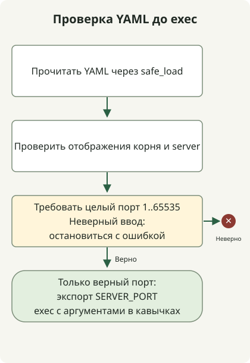

При чтении YAML из shell используйте YAML-парсер, проверяйте тип и диапазон значения и передавайте лишь нужные переменные. Не приближайте полную грамматику через sed/awk и не исполняйте сгенерированный текст через `eval`. Пример читает одно значение `server.port` через Python и PyYAML и запускает дочернюю команду только после успешной проверки.

Проверка только отображённого текста не позволяет надёжно отличить YAML-целое `8080` от строки `"8080"`. Загрузчик **не преобразует строки в числа**: принимает лишь значение, разобранное как целое от 1 до 65535. bool в Python — подкласс int, поэтому `type(port) is int` отклоняет булевы значения, а `isinstance(port, int)` не отклонил бы.

## Порядок обработки



Разберите и проверьте целочисленный порт до экспорта SERVER_PORT. Ошибка загрузчика не даёт запустить целевую команду; exec сохраняет её статус.

## Среда и входные данные

Используйте Python 3 и [PyYAML 6.0.3](https://pypi.org/project/PyYAML/6.0.3/). Локальная среда выполнения использует Python 3.13. Сохраните три файла в одном каталоге и установите зависимость в отдельное виртуальное окружение.

```sh
python3 -m venv .venv
.venv/bin/python -m pip install PyYAML==6.0.3
```

### `application.yml`

```yaml
server:
  port: 8080
```

### `read-port.py`

```python
import sys
from pathlib import Path
import yaml

if len(sys.argv) != 2:
    sys.exit("usage: read-port.py CONFIG")
try:
    with Path(sys.argv[1]).open(encoding="utf-8") as stream:
        config = yaml.safe_load(stream)
    if not isinstance(config, dict):
        raise ValueError("root must be a mapping")
    server = config.get("server")
    if not isinstance(server, dict):
        raise ValueError("server must be a mapping")
    port = server.get("port")
    if type(port) is not int or not 1 <= port <= 65535:
        raise ValueError("server.port must be an integer from 1 to 65535")
except (OSError, UnicodeError, yaml.YAMLError, ValueError) as error:
    print(f"invalid configuration: {error}", file=sys.stderr)
    sys.exit(2)
print(port)
```

### `run-with-port.sh`

```sh
#!/bin/sh
set -eu
if [ "$#" -lt 2 ]; then
    printf '%s\n' 'usage: run-with-port.sh CONFIG COMMAND [ARG ...]' >&2
    exit 2
fi
config=$1
shift
script_dir=$(CDPATH= cd -- "$(dirname -- "$0")" && pwd)
port=$("${PYTHON:-python3}" "$script_dir/read-port.py" "$config")
export SERVER_PORT="$port"
exec "$@"
```

## Запуск команды с проверенным значением

```sh
PYTHON=.venv/bin/python sh run-with-port.sh application.yml \
  .venv/bin/python -c 'import os; print(os.environ["SERVER_PORT"])'
```

```text
8080
```

`read-port.py` пишет только допустимое значение в stdout, ошибки — в stderr. Отсутствующие файлы, неверный YAML, несколько документов, ввод не в виде отображения, отсутствующие поля, строки, булевы и дробные значения, выход за диапазон отклоняются со статусом 2. `run-with-port.sh` передаёт ошибку, не запуская целевую команду. После запуска `exec` сохраняет её код завершения.

`"$@"` сохраняет команду и каждый аргумент отдельно. Пробелы или `$()` в аргументе не вычисляются повторно как shell-код. Относительные пути `PYTHON` и конфигурации разрешаются от рабочего каталога вызывающего процесса, а обёртка находит `read-port.py` рядом с собой.

Экспорт достигает дочернего процесса, не меняя окружение вызывающей родительской оболочки. Запускайте обёртку через `sh run-with-port.sh ...`, а не через source. Отдельно проверьте, действительно ли приложение читает `SERVER_PORT`.

## Границы загрузчика

[`safe_load`](https://pyyaml.org/wiki/PyYAMLDocumentation) не разрешает теги, создающие произвольные объекты Python, но прикладные проверки типов и диапазонов всё равно нужны. Пример не ограничивает память и время для злонамеренно больших данных, поэтому предназначен для доверенной локальной конфигурации.

Он следует неявным правилам типов PyYAML: значения вроде `on` могут стать булевыми. Повторяющиеся ключи не отклоняются, позднее значение может сохраниться; запрещайте их во входных данных и проверяйте отдельно. Это не полная политика типов YAML 1.2 и не универсальный валидатор схем конфигурации. Для каждого нового поля явно задавайте тип и поведение при отсутствии значения.

Об ошибках команд и кодах завершения см. [запрос выпусков GitHub](/en/posts/2023-09-23-linux-shellscript-github-latest/). О совместимости сохраняемых данных заданий JVM см. [миграцию Spring Batch 5](/en/posts/2023-10-27-springbatch5-migration/).
