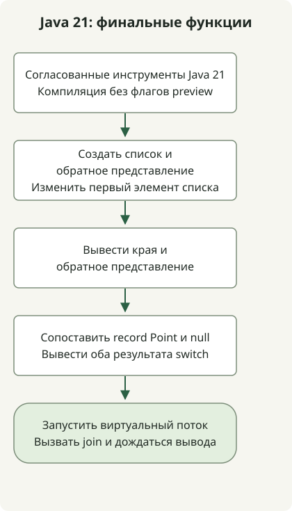

В JDK 21 виртуальные потоки, упорядоченные коллекции, образцы record и сопоставление с образцом в switch доступны без флагов preview. Шаблоны строк в этом выпуске ещё были предварительной возможностью. Обновление JDK не придаёт всем новым возможностям одинаковый статус стабильности.

[Java 21 стал общедоступен](https://inside.java/2023/09/19/the-arrival-of-java-21/) 19 сентября 2023 года. Статья возвращается к этому выпуску через воспроизводимый пример. Она не рекомендует новейший JDK или версию исправлений для рабочей среды.

## Порядок обработки



Схема следует Jdk21Example без флагов preview. Обратный список — представление; join ждёт вывода виртуального потока.

## Статус возможностей в JDK 21

| Возможность | Статус в JDK 21 | Что проверить |
| --- | --- | --- |
| Виртуальные потоки | Окончательный | Рассматривать для множества задач с ожиданием ввода-вывода; ускорение вычислений CPU не гарантируется |
| Упорядоченные коллекции | Окончательный | Согласованные API для первых/последних элементов и обратных представлений |
| Образцы record и сопоставление с образцом в switch | Окончательный | Декомпозиция значений и ветвление по образцам |
| Шаблоны строк | Preview | Не предполагать сохранение в последующих JDK |
| Структурированная конкурентность | Preview | Оценивать отдельно от окончательного статуса виртуальных потоков |
| Vector API | Шестая инкубация | Отличать инкубационные API от окончательных возможностей и preview |

Это выборочный список. [Примечания к выпуску JDK 21](https://www.oracle.com/java/technologies/javase/21all-relnotes.html) также описывают статусы preview и инкубации. Статус языковых возможностей проверяйте в [изменениях языка Java 21](https://docs.oracle.com/en/java/javase/21/language/java-language-changes.html). Шаблоны строк не вошли в JDK 23; см. их [историю и стандартные альтернативы](/en/posts/2023-09-23-jdk-21-string-templates/).

## Компиляция без флагов preview

Следующий код выполнялся локально на Zulu JDK 21.0.1. Эта старая версия исправлений фиксирует среду воспроизведения, а не рекомендацию для эксплуатации. Сначала проверьте, что `javac` и `java` относятся к одной установке JDK 21.

### `Jdk21Example.java`

```java
import java.util.ArrayList;
import java.util.List;

public class Jdk21Example {
    record Point(int x, int y) {}

    static String describe(Object value) {
        return switch (value) {
            case null -> "missing";
            case Point(int x, int y) -> "point=" + x + "," + y;
            default -> "other";
        };
    }

    public static void main(String[] args) throws InterruptedException {
        var names = new ArrayList<>(List.of("alpha", "beta", "gamma"));
        var reverse = names.reversed();
        names.set(0, "ALPHA");
        System.out.println(names.getFirst() + "/" + names.getLast());
        System.out.println(reverse);
        System.out.println(describe(new Point(2, 3)));
        System.out.println(describe(null));
        Thread worker = Thread.ofVirtual().start(() ->
                System.out.println("virtual=" + Thread.currentThread().isVirtual()));
        worker.join();
    }
}
```

```sh
javac --release 21 Jdk21Example.java
java Jdk21Example
```

```text
ALPHA/gamma
[gamma, beta, ALPHA]
point=2,3
missing
virtual=true
```

`reversed()` возвращает обратное представление, а не независимую копию. После изменения первого элемента исходного списка последним в обратном выводе тоже становится `ALPHA`. Вызов `getFirst()` для пустой коллекции вызвал бы исключение; здесь список непустой. Контракт представления определяет [API SequencedCollection](https://docs.oracle.com/en/java/javase/21/docs/api/java.base/java/util/SequencedCollection.html).

`Point(int x, int y)` — образец record, а `case null` отдельно обрабатывает null. Виртуальный поток выводит последнюю строку, и `join()` ждёт его завершения. Это проверка поведения API без измерения пропускной способности или задержки. [Руководство по виртуальным потокам](https://docs.oracle.com/en/java/javase/21/core/virtual-threads.html) объясняет их пригодность для конкурентных задач, где преобладает ожидание ввода-вывода.

Перед сменой среды выполнения приложения проверьте совместимость фреймворка, инструментов сборки и агентов инструментирования с JDK 21. Статус возможностей JDK и срок поддержки дистрибьютора — разные вопросы. [История Temurin 21 и выбор бинарных файлов](/en/posts/2023-10-10-temurin-jdk21-delay/) показывают, как проверить фактически опубликованные дистрибьютором файлы.
