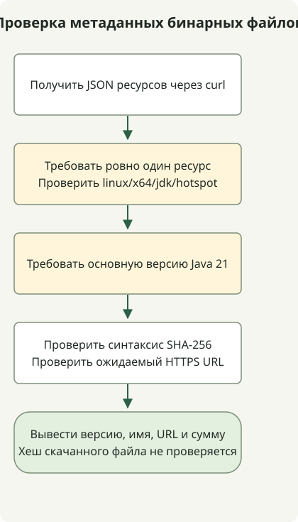

Чтобы найти бинарный файл Temurin JDK 21, запросите API Adoptium с нужными ОС, CPU, JVM и типом пакета. Пример проверяет метаданные JDK Linux x64, синтаксис контрольной суммы и адрес URL. Архив не скачивается, его хеш не вычисляется.

Первоначальная задержка Temurin 21 в 2023 году была отдельной от выпуска OpenJDK 21. Adoptium связал её с рассмотрением соглашения TCK, а затем различал получение TCK и публикацию бинарных выпусков. Эта историческая задержка не означает, что Temurin 21 всё ещё не выпущен.

## Порядок обработки



Это выбор метаданных, а не установка. Проверяются платформа, основная версия Java, синтаксис контрольной суммы и адрес URL без скачивания архива или вычисления его хеша.

## Различайте даты объявления и публикации

[Adoptium опубликовал сообщение о задержке](https://adoptium.net/news/2023/09/temurin21-delay) 28 сентября 2023 года. **Обновление от 9 октября** сообщает о получении TCK и переходе к тестированию. Не датируйте обновление 10 октября и не приравнивайте начало тестов к завершению выпусков для всех платформ.

Отдельно [метаданные GitHub](https://api.github.com/repos/adoptium/temurin21-binaries/releases/tags/jdk-21%2B35) для [выпуска `jdk-21+35`](https://github.com/adoptium/temurin21-binaries/releases/tag/jdk-21%2B35) возвращают `2023-10-10T13:55:52Z` в `published_at`. Это время публикации выпуска, а не завершения загрузки каждого ресурса. Сборки Early Access и официальные выпуски также нужно различать.

## Запрос доступного сейчас бинарного файла Java 21

Укажите Java 21, Linux, x64, HotSpot и JDK в [API Adoptium](https://api.adoptium.net/q/swagger-ui/). Если ОС или CPU другие, измените фильтры совместно. Пример только получает метаданные: не скачивает и не устанавливает JDK. Нужны Python 3 и curl.

```sh
curl --fail --show-error --silent --location \
  'https://api.adoptium.net/v3/assets/latest/21/hotspot?architecture=x64&image_type=jdk&os=linux&vendor=eclipse' \
  --output assets.json &&
  python3 select-temurin.py assets.json
```

### `select-temurin.py`

```python
import json
import re
import sys
from pathlib import Path
from urllib.parse import urlparse

if len(sys.argv) != 2:
    sys.exit("usage: select-temurin.py ASSETS_JSON")
try:
    assets = json.loads(Path(sys.argv[1]).read_text(encoding="utf-8"))
    if not isinstance(assets, list) or len(assets) != 1:
        raise ValueError("expected exactly one asset")
    asset = assets[0]
    binary = asset["binary"]
    if (binary["os"], binary["architecture"], binary["image_type"], binary["jvm_impl"]) != ("linux", "x64", "jdk", "hotspot"):
        raise ValueError("unexpected platform or image type")
    if asset["version"]["major"] != 21:
        raise ValueError("expected Java 21")
    package = binary["package"]
    checksum = package["checksum"]
    if not isinstance(checksum, str) or not re.fullmatch(r"[0-9a-fA-F]{64}", checksum):
        raise ValueError("invalid SHA-256 metadata")
    link = package["link"]
    if not isinstance(link, str):
        raise ValueError("package URL must be a string")
    url = urlparse(link)
    if url.scheme != "https" or url.netloc != "github.com" or not url.path.startswith("/adoptium/temurin21-binaries/releases/download/"):
        raise ValueError("unexpected package URL")
    result = {"version": asset["version"]["semver"], "name": package["name"], "url": link, "sha256": checksum}
except (OSError, UnicodeError, ValueError, KeyError, TypeError) as error:
    print(f"invalid release metadata: {error}", file=sys.stderr)
    sys.exit(2)
print(json.dumps(result, indent=2))
```

Селектор выводит результат только при наличии ровно одного ресурса с ожидаемыми основной версией Java, платформой, типом образа, URL дистрибутива и форматом контрольной суммы. Отсутствующие поля, несколько ресурсов и некорректный JSON приводят к ошибке. `&&` предотвращает запуск селектора при ошибке `curl`.

`latest/21` означает обновление Java 21, возвращённое на момент запроса. Оно не фиксирует первый выпуск `21+35` и не выбирает новейшую основную версию JDK. Для повторяемых развёртываний сохраните и зафиксируйте возвращённые версию, URL и SHA-256.

Проверяется **формат** контрольной суммы, а не целостность скачанного файла. Если скачиваете архив отдельно, вычислите его SHA-256 и сравните с метаданными до решения о распаковке или установке. Сверка реального бинарного файла с опубликованной суммой выходит за рамки выполнения этого примера метаданных.

Другой пример выбора ресурсов — [запрос выпусков и ресурсов GitHub](/en/posts/2023-09-23-linux-shellscript-github-latest/). О стабильности возможностей см. [окончательные возможности JDK 21 и preview](/en/posts/2023-09-20-jdk-21-release/).

После скачивания выбранного файла [сравните его контрольную сумму SHA-256 с ожидаемым значением из доверенного источника](/en/posts/2026-10-30-verify-sha256-download/). Программа читает локальные байты; она не скачивает релиз и не удостоверяет личность издателя.
