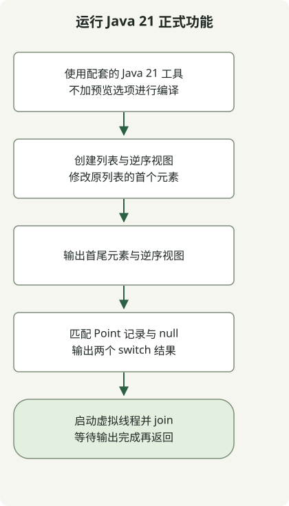

虚拟线程、有序集合、记录模式与 switch 模式匹配都是 JDK 21 的正式功能，无需预览选项即可使用。字符串模板在该版本中仍是预览功能；升级 JDK 不代表所有新功能具有相同的稳定性状态。[JDK 21 发行说明](https://www.oracle.com/java/technologies/javase/21all-relnotes.html)也区分了正式、预览与孵化功能。

[Java 21 于 2023年9月19日正式发布](https://inside.java/2023/09/19/the-arrival-of-java-21/)。本文通过可复现的示例回顾该版本，并不推荐最新 JDK 或某个生产环境补丁版本。

## 处理流程



流程展示不使用预览选项的 Jdk21Example。逆序列表是视图，join 等待虚拟线程的输出。

## JDK 21 中的功能状态

| 功能 | 在 JDK 21 中的状态 | 需要检查的内容 |
| --- | --- | --- |
| 虚拟线程 | 正式 | 可用于大量 I/O 密集型任务；不保证 CPU 计算更快 |
| 有序集合 | 正式 | 为首尾元素与逆序视图提供一致的 API |
| 记录模式与 switch 模式匹配 | 正式 | 解构值并按模式分支 |
| 字符串模板 | 预览 | 不要假定后续 JDK 版本仍保留它 |
| 结构化并发 | 预览 | 与虚拟线程正式化分开评估 |
| Vector API | 第六次孵化 | 区分孵化 API、正式功能与预览功能 |

这只是部分功能。[JDK 21 发行说明](https://www.oracle.com/java/technologies/javase/21all-relnotes.html)也记录了预览与孵化状态。语言功能状态可查阅 [Java 21 语言变更](https://docs.oracle.com/en/java/javase/21/language/java-language-changes.html)。JDK 23 未包含字符串模板；参见其[历史与标准替代方案](/en/posts/2023-09-23-jdk-21-string-templates/)。

## 不加预览选项进行编译

以下代码曾在本地 Zulu JDK 21.0.1 上运行。这个旧补丁版本仅记录复现环境，并非生产环境推荐。先确认 `javac` 与 `java` 指向同一套 JDK 21 安装。

### `Jdk21Example.java`

```java
import java.util.ArrayList;
import java.util.List;

public class Jdk21Example {
    record Point(int x, int y) {}

    static String describe(Object value) {
        return switch (value) {
            case null -> "missing";
            case Point(int x, int y) -> "point=" + x + "," + y;
            default -> "other";
        };
    }

    public static void main(String[] args) throws InterruptedException {
        var names = new ArrayList<>(List.of("alpha", "beta", "gamma"));
        var reverse = names.reversed();
        names.set(0, "ALPHA");
        System.out.println(names.getFirst() + "/" + names.getLast());
        System.out.println(reverse);
        System.out.println(describe(new Point(2, 3)));
        System.out.println(describe(null));
        Thread worker = Thread.ofVirtual().start(() ->
                System.out.println("virtual=" + Thread.currentThread().isVirtual()));
        worker.join();
    }
}
```

```sh
javac --release 21 Jdk21Example.java
java Jdk21Example
```

```text
ALPHA/gamma
[gamma, beta, ALPHA]
point=2,3
missing
virtual=true
```

`reversed()` 返回逆序视图，而非独立副本。修改原列表的首个元素后，逆序输出的最后一个元素也变为 `ALPHA`。在空集合上调用 `getFirst()` 会抛出异常；本例使用非空列表。[SequencedCollection API](https://docs.oracle.com/en/java/javase/21/docs/api/java.base/java/util/SequencedCollection.html)定义了视图契约。

`Point(int x, int y)` 是记录模式，`case null` 单独处理 null 输入。虚拟线程打印最后一行，`join()` 等待它完成。本例检查 API 行为，不测量吞吐量或延迟。[虚拟线程指南](https://docs.oracle.com/en/java/javase/21/core/virtual-threads.html)解释了它们为何适合以 I/O 等待为主的并发任务。

更换应用运行时之前，检查框架、构建工具与插桩代理对 JDK 21 的兼容性。JDK 功能状态与发行商的支持期限是两个问题。[Temurin 21 发布历史与二进制选择](/en/posts/2023-10-10-temurin-jdk21-delay/)介绍如何检查发行商实际发布的内容。
