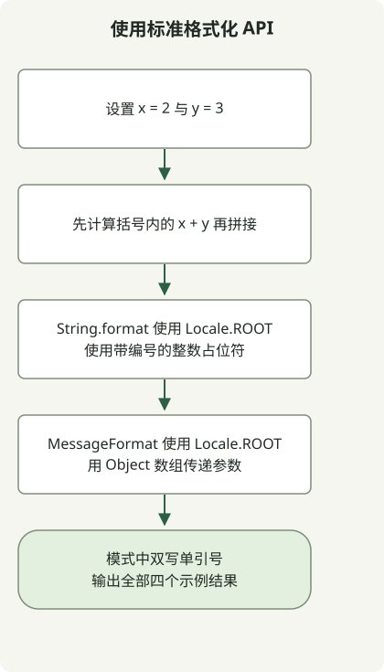

字符串模板在 JDK 21 和 22 中是预览功能，在 JDK 23 中被移除。给 JDK 23 添加 `--enable-preview` 并不能恢复 `STR`。需要超越这些预览版本的代码应使用标准字符串 API 或针对目标格式的序列化器。[Oracle 的移除说明](https://inside.java/2024/06/20/newscast-71/)解释了这一变化。

## 处理流程



图中展示的是标准 FormattingExample，而非历史预览示例。它比较三种格式化形式，并检查 MessageFormat 的单引号转义。

## 哪个 JDK 能运行旧示例？

| JDK | 字符串模板状态 | 做法 |
| --- | --- | --- |
| 21 | 预览 | 编译与运行都使用 JDK 21，并启用预览。 |
| 22 | 第二次预览 | 使用配套的 JDK 22 编译器、运行时与预览设置。 |
| 23 | 已移除 | 替换预览语法；选项无法恢复已移除的功能。 |

编译器的 `--release` 选项不能让新编译器恢复旧预览功能。[Oracle 预览指南](https://docs.oracle.com/en/java/javase/21/language/preview-language-and-vm-features.html)要求使用该预览版本对应的编译器。

## 运行历史 JDK 21 示例

将完整类保存为 `Example.java`。即使默认 JDK 是其他版本，本节也要求 JDK 21。

```java
public class Example {
    public static void main(String[] args) {
        int x = 2;
        int y = 3;
        String result = STR."\{x} plus \{y} equals \{x + y}";
        System.out.println(result);
    }
}
```

确认所选工具，然后在文件所在目录编译并运行：

```sh
javac -version
java -version
javac --enable-preview --release 21 Example.java
java --enable-preview Example
```

输出为 `2 plus 3 equals 5`。编译时也会提示此类使用了预览功能。在这个 JDK 21 预览中，`STR` 被隐式导入；后续 JDK 缺少处理器的问题并不能靠添加 import 解决。参见 [JDK 21 字符串模板指南](https://docs.oracle.com/en/java/javase/21/language/string-templates.html)。

## 用标准 API 替换预览语法

将以下内容保存为 `FormattingExample.java`。它使用标准 API，无需预览选项，完整类可在 Java 17 上工作。这里为 `String.format` 与 `MessageFormat` 显式指定区域设置，使数字输出可复现。

```java
import java.text.MessageFormat;
import java.util.Locale;

public class FormattingExample {
    public static void main(String[] args) {
        int x = 2;
        int y = 3;
        System.out.println(x + " plus " + y + " equals " + (x + y));
        System.out.println(String.format(Locale.ROOT, "%1$d plus %2$d equals %3$d", x, y, x + y));
        MessageFormat format = new MessageFormat("{0} plus {1} equals {2}", Locale.ROOT);
        System.out.println(format.format(new Object[] {x, y, x + y}));
        System.out.println(new MessageFormat("It''s {0}", Locale.ROOT)
            .format(new Object[] {"ready"}));
    }
}
```

```sh
javac FormattingExample.java
java FormattingExample
```

输出：

```text
2 plus 3 equals 5
2 plus 3 equals 5
2 plus 3 equals 5
It's ready
```

| 需求 | 适用 API | 需保留的细节 |
| --- | --- | --- |
| 简短表达式 | `+` | `x + y` 外的括号明确保留算术运算。 |
| 重复追加 | `StringBuilder` | 适合逐步构造文本。 |
| 格式字符串 | `String.format` 或 `.formatted` | `%d` 与 `%s` 遵循 Formatter 规则；需要显式区域设置时使用 `String.format(Locale.ROOT, ...)`。 |
| 本地化消息模式 | `MessageFormat` | 使用带编号的参数、对象数组与不同的引号规则。 |

`MessageFormat` 将单引号视为模式语法。`It''s {0}` 中双写的单引号生成上面显示的字面单引号。将 `%s` 模式换成 `{0}` 也意味着切换 API，并检查其区域设置行为。[MessageFormat API](https://docs.oracle.com/en/java/javase/21/docs/api/java.base/java/text/MessageFormat.html)、[String API](https://docs.oracle.com/en/java/javase/21/docs/api/java.base/java/lang/String.html)。

## 区分格式化与编码

`STR` 和普通格式化都不能让任意值成为安全的 JSON、SQL 或 HTML。应针对目标格式使用 JSON 序列化器、SQL 参数绑定或渲染系统的 HTML 转义。简单样例值看起来正确的字符串，遇到引号或反斜杠时仍可能失败。

两个完整类均曾用以上命令编译运行：预览示例使用 JDK 21.0.1，标准替代方案使用 JDK 17.0.8.1 与 21.0.1。表中的 JDK 22 和 23 行描述文档记载的功能历史，并未在此环境执行。

升级 JDK 还会影响框架兼容性。旧版 Spring 应用可参阅 [Spring Boot 2.7 到 3.0 的迁移顺序](/en/posts/2023-09-08-springboot3-migration/)。
