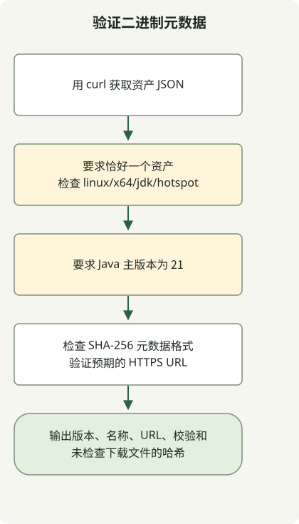

要查找 Temurin JDK 21 二进制文件，请按所需操作系统、CPU、JVM 与包类型查询 Adoptium API。以下示例检查 Linux x64 JDK 元数据、校验和格式与 URL 位置，不下载归档，也不计算其哈希。

Temurin 21 在 2023 年最初的延迟与 OpenJDK 21 的发布是两回事。Adoptium 将延迟归因于 TCK 协议审核，之后也将收到 TCK 与发布二进制文件区分开。这段历史延迟并不意味着 Temurin 21 至今仍未发布。

## 处理流程



这是元数据选择示例，而非安装流程。它检查平台、Java 主版本、校验和格式与 URL 位置，不下载归档，也不计算其哈希。

## 区分公告与发布日期

[Adoptium 于 2023年9月28日发布延迟公告](https://adoptium.net/news/2023/09/temurin21-delay)。其中的 **10月9日更新**报告已收到 TCK 并开始测试。不要将该更新记为 10月10日，也不要将开始测试等同于所有平台均已完成发布。

另外，[GitHub 元数据](https://api.github.com/repos/adoptium/temurin21-binaries/releases/tags/jdk-21%2B35)中，[`jdk-21+35` 发行版](https://github.com/adoptium/temurin21-binaries/releases/tag/jdk-21%2B35)的 `published_at` 为 `2023-10-10T13:55:52Z`。这是该发行版的发布时间，不代表所有资产均已上传完成。还应区分 Early Access 构建与正式发行版。

## 查询当前可用的 Java 21 二进制文件

在 [Adoptium API](https://api.adoptium.net/q/swagger-ui/)中指定 Java 21、Linux、x64、HotSpot 与 JDK。如果操作系统或 CPU 不同，应一起调整筛选条件。此示例只获取元数据，不下载或安装 JDK 二进制文件。需要 Python 3 和 curl。

```sh
curl --fail --show-error --silent --location \
  'https://api.adoptium.net/v3/assets/latest/21/hotspot?architecture=x64&image_type=jdk&os=linux&vendor=eclipse' \
  --output assets.json &&
  python3 select-temurin.py assets.json
```

### `select-temurin.py`

```python
import json
import re
import sys
from pathlib import Path
from urllib.parse import urlparse

if len(sys.argv) != 2:
    sys.exit("usage: select-temurin.py ASSETS_JSON")
try:
    assets = json.loads(Path(sys.argv[1]).read_text(encoding="utf-8"))
    if not isinstance(assets, list) or len(assets) != 1:
        raise ValueError("expected exactly one asset")
    asset = assets[0]
    binary = asset["binary"]
    if (binary["os"], binary["architecture"], binary["image_type"], binary["jvm_impl"]) != ("linux", "x64", "jdk", "hotspot"):
        raise ValueError("unexpected platform or image type")
    if asset["version"]["major"] != 21:
        raise ValueError("expected Java 21")
    package = binary["package"]
    checksum = package["checksum"]
    if not isinstance(checksum, str) or not re.fullmatch(r"[0-9a-fA-F]{64}", checksum):
        raise ValueError("invalid SHA-256 metadata")
    link = package["link"]
    if not isinstance(link, str):
        raise ValueError("package URL must be a string")
    url = urlparse(link)
    if url.scheme != "https" or url.netloc != "github.com" or not url.path.startswith("/adoptium/temurin21-binaries/releases/download/"):
        raise ValueError("unexpected package URL")
    result = {"version": asset["version"]["semver"], "name": package["name"], "url": link, "sha256": checksum}
except (OSError, UnicodeError, ValueError, KeyError, TypeError) as error:
    print(f"invalid release metadata: {error}", file=sys.stderr)
    sys.exit(2)
print(json.dumps(result, indent=2))
```

只有恰好一个资产，且 Java 主版本、平台、镜像类型、发行 URL 与校验和格式均符合预期时，选择器才输出结果。缺失字段、多个资产或无效 JSON 都会失败。`&&` 阻止选择器在 `curl` 失败后运行。

`latest/21` 表示查询时返回的 Java 21 更新版本，既不固定最初的 `21+35`，也不选择最新的 JDK 主版本。为可重复部署，应记录并固定返回的版本、URL 与 SHA-256。

这里只验证校验和的**格式**，不验证下载文件的完整性。如果另外下载归档，应计算其 SHA-256 并与元数据比较，再决定是否解压或安装。实际二进制与公布校验和的一致性检查，不在本元数据示例的执行范围内。

另一个资产选择示例可参阅[查询 GitHub 发行版与资产](/en/posts/2023-09-23-linux-shellscript-github-latest/)。功能稳定性可参阅 [JDK 21 正式与预览功能](/en/posts/2023-09-20-jdk-21-release/)。

下载所选资源后，[将文件的 SHA-256 校验和与可信的预期值进行比较](/en/posts/2026-10-30-verify-sha256-download/)。验证器读取本地字节，不下载发布文件，也不验证发布者身份。
