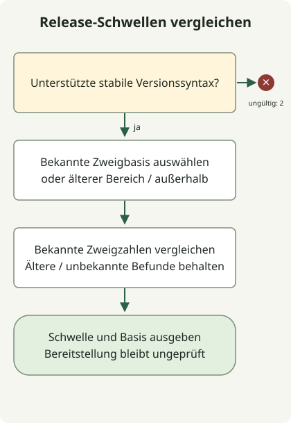

Die Behebung von GitLab2Shell bedeutet, **GitLab CE/EE auf eine Version mit Korrektur für CVE-2026-110264 zu aktualisieren und ihre Übernahme in der Bereitstellung zu prüfen**. Der [GitLab-Hinweis vom 21. Oktober](https://docs.gitlab.com/releases/patches/patch-release-gitlab-19-5-1-released/) beschreibt nicht authentifizierte entfernte Codeausführung unter bestimmten Bedingungen durch einen Ganzzahlüberlauf beim Kompilieren regulärer Ausdrücke. Nur GitLab Shell oder Runner zu aktualisieren, schließt die Behebung des CE/EE-Servers nicht ab.

## Zuerst CVE und Produktversion zuordnen

Dieser Artikel behandelt **CVE-2026-110264** aus dem offiziellen GitLab-Hinweis, bewertet mit 10.0 nach CVSS v3.1. Unterscheiden Sie sie von anderen ungefähr zeitgleich veröffentlichten GitLab-CVEs und ähnlich benannten Shell-Komponenten. Der [von GitLab verfasste CVE-Eintrag](https://cveawg.mitre.org/api/cve/CVE-2026-110264) nennt dieselben betroffenen Bereiche und Korrekturschwellen.

| GitLab-CE/EE-Zweig | Erste Version mit Korrektur dieser CVE |
| --- | --- |
| 18.11 | 18.11.13 |
| 19.0 | 19.0.10 |
| 19.1 | 19.1.9 |
| 19.2 | 19.2.9 |
| 19.3 | 19.3.6 |
| 19.4 | 19.4.3 |
| 19.5 | 19.5.1 |

Der Hinweis nennt Versionen ab 7.0 vor 18.11.13 sowie jeden aufgeführten Zweig vor seiner ersten korrigierten Version als betroffen. Die am 30. Oktober 2026 geprüfte Tabelle enthält **Schwellen der ersten Korrektur**, keine eingefrorene Liste der neuesten zu installierenden Versionen. GitLab.com und GitLab Dedicated haben im Hinweis eigene Angaben zur Übernahme; wenden Sie die Self-Managed-Upgrade-Anleitung nicht unterschiedslos auf diese Dienste an.

## Deklarierte Versionszeichenfolge offline vergleichen



Das Diagramm folgt dem folgenden Vergleichscode. Er validiert die Eingabe vor dem Vergleich registrierter Zweige. Ältere betroffene Zweige benötigen einen Upgrade-Pfad; Zweige außerhalb der Tabelle bleiben unbekannt. Kein Ergebnis authentifiziert den Serverzustand oder die Herkunft des Patches.

Speichern Sie diese Datei mit Python 3.11 oder neuer in einem neuen Verzeichnis. Sie unterstützt den numerischen Vergleich offizieller Upstream-CE/EE-Versionen ohne Netzwerkanfragen, Diensterkennung oder Ausnutzung. Sie akzeptiert Formen wie `19.5.1`, `19.5.1-ee` und `19.5.1-ee.0`; Formate für Vorab-, Nightly- oder angepasste Anbieterversionen werden nicht erraten.

### `release-threshold.py`

```python
import re
import sys

FIRST_FIX = {
    (18, 11): 13,
    (19, 0): 10,
    (19, 1): 9,
    (19, 2): 9,
    (19, 3): 6,
    (19, 4): 3,
    (19, 5): 1,
}
NUMBER = r"(0|[1-9][0-9]{0,2})"
VERSION = rf"{NUMBER}\.{NUMBER}\.{NUMBER}(?:-(?:ce|ee)(?:\.[0-9]{{1,3}})?)?"


def main(argv):
    match = re.fullmatch(VERSION, argv[1]) if len(argv) == 2 else None
    if match is None:
        print("usage: release-threshold.py VERSION (stable CE/EE release format)", file=sys.stderr)
        return 2
    major, minor, patch = map(int, match.groups())
    branch = (major, minor)
    if branch in FIRST_FIX:
        baseline = f"{major}.{minor}.{FIRST_FIX[branch]}"
        state = "met" if patch >= FIRST_FIX[branch] else "below"
        status = 0 if state == "met" else 1
    elif (7, 0) <= branch < (18, 11):
        baseline, state, status = "upgrade-path-required", "below", 1
    else:
        baseline, state, status = "not-covered", "outside-table", 2
    print(f"release-threshold={state}")
    print(f"baseline={baseline}")
    print("deployment-and-release-provenance=not-verified")
    return status


if __name__ == "__main__":
    raise SystemExit(main(sys.argv))
```

```sh
python3 release-threshold.py 19.5.1-ee.0
```

Der lokale Lauf lieferte diese Ausgabe und Exit-Status 0.

```text
release-threshold=met
baseline=19.5.1
deployment-and-release-provenance=not-verified
```

Status 0 bedeutet nur, dass **die angegebenen Zahlen die veröffentlichte Korrekturschwelle dieser CVE erreichen**. Status 1 bedeutet unterhalb der veröffentlichten Schwelle; Status 2 bedeutet ein nicht unterstütztes Format oder einen Zweig außerhalb der Tabelle. Er prüft weder, ob die Version existiert, noch ob das Paket offiziell ist oder irgendein Knoten es ausführt. Backports und eigene Builds benötigen separate Korrekturbelege des Anbieters.

## Installationsbelege mit laufender Übernahme verbinden

Die [offizielle Wartungsdokumentation](https://docs.gitlab.com/administration/raketasks/maintenance/) beschreibt das Erfassen von GitLab-, Ruby- und Komponenteninformationen mit `sudo gitlab-rake gitlab:env:info` für Linux-Pakete oder `bundle exec rake gitlab:env:info RAILS_ENV=production` für Quellinstallationen. Führen Sie dies bei Bereitstellungen mit mehreren Knoten auf den Rails-Knoten aus. Die Ausgabe kann interne Pfade und Adressen enthalten; bewahren Sie sie daher in zugriffsbeschränkten Betriebsaufzeichnungen auf.

Diese Befehle wurden hier nicht auf einem Produktivserver ausgeführt. Verknüpfen Sie bei der tatsächlichen Behebung die Informationen mit vollständigen Paketrevisionen, bereitgestellten Image-Digests und jedem Web-/Hintergrundknoten und prüfen Sie nach dem Upgrade die Übernahme auf allen Zielen. Ein einzelner HTTP-Banner oder die Befehlsausgabe eines anderen Knotens ist kein Beleg für die gesamte Bereitstellung.

## Aktuellen Patch wählen und Migrationen abschließen

Folgen Sie dem [offiziellen Upgrade-Pfad](https://docs.gitlab.com/update/upgrade_paths/) ausgehend von der installierten Version und lassen Sie Hintergrundmigrationen an jedem erforderlichen Zwischenstopp vor dem Fortfahren abschließen. Eine alte Installation unterstützt möglicherweise keinen direkten Sprung auf die höchste Version der Tabelle. Planen Sie Sicherung/Wiederherstellung, Erweiterungskompatibilität, Ausfallzeit und Verfahren für mehrere Knoten gemeinsam.

Unterscheiden Sie erste Korrekturen von aktuellen Patches. Der [Patch-Hinweis vom 29. Oktober](https://docs.gitlab.com/releases/patches/patch-release-gitlab-19-5-3-released/) nennt spätere Versionen einschließlich 19.5.3 und 19.4.5 sowie einige Datenbankmigrationen und erklärt ausdrücklich, dass 19.5.2 und 19.4.4 übersprungen wurden. Das Skript fragt keinen Versionskatalog ab und vergleicht daher auch diese Zeichenfolgen numerisch. Wählen Sie den tatsächlichen Installationskandidaten stets aus offiziellen Vertriebsnachweisen.

Prüfen Sie nach dem Upgrade laufende Versionen, abgeschlossene Migrationen, normale Anmeldung, Repository-Zugriff und Auftragsverarbeitung separat. Die im Hinweis genannten Erkennungen von Onigmo-Worker-Abstürzen und gehäuften Org-mode-Renderfehlern sind Untersuchungsansätze; für sich genommen belegen oder widerlegen sie keine Kompromittierung. Bewahren Sie Logs sowie Prozess- und Bereitstellungsbelege und untersuchen Sie bei Verdacht separat.

Die Behebung von Java-Zertifikatsproblemen aus demselben Zeitraum ist ein separates Thema. Lesen Sie für Build- und Integrationsdienste mit JDK auch [eMudhra und die Prüfung des JVM-Truststores](/en/posts/2026-10-30-jdk-emudhra-truststore/).
