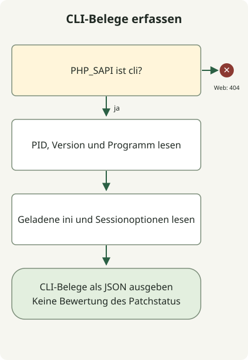

Die Behebung von PHP2Shell endet nicht mit einem CMS- oder Plugin-Update. Beschaffen Sie einen PHP-Build, der [CVE-2026-109618](https://github.com/php/php-src/security/advisories/GHSA-w8hw-w9fx-j79w) und [CVE-2026-109619](https://github.com/php/php-src/security/advisories/GHSA-6wmf-4rv5-p3rp) behebt, und prüfen Sie anschließend, dass jeder Worker für Webanfragen ihn verwendet. `php -v` in einem Terminal beschreibt nur die dort ausgewählte CLI.

## Was betrifft PHP2Shell?

Die beiden CVEs betreffen Anfragezustand und Speicherlebensdauer in der PHP-Engine. Bei der ersten wird ein ungültiger Zustand während der Bereinigung verwendet, nachdem eine Speicherknappheitsbehandlung die Initialisierung unterbrochen hat. Bei der zweiten bleibt interner Zustand nach der Freigabe des Anfragespeichers erhalten und wird von einer späteren Anfrage auf demselben Worker verwendet. Unter den betroffenen Bedingungen ist nicht authentifizierte entfernte Codeausführung möglich.

Der [Sicherheitshinweis des PHP-Teams](https://www.php.net/archive/2026.php) nennt neben mod_php auch PHP-FPM, php-cgi, FrankenPHP und LiteSpeed als zu untersuchende Webbereitstellungen. Eine bestimmte SAPI ist kein Grund, einen Dienst auszuschließen. Umgekehrt belegt eine verwundbare Versionszeichenfolge allein keinen erreichbaren Angriffspfad in diesem Dienst.

## Welche Version sollten Sie vergleichen?

Dies sind die **ersten Upstream-Quellversionen, die die beiden ursprünglichen CVEs beheben**, geprüft am 30. Oktober 2026. Prüfen Sie vor der Installation die aktuelle unterstützte Version desselben Anbieters und nachfolgende Sicherheitshinweise.

| PHP-Zweig | Erste Quellversion, die beide CVEs behebt |
| --- | --- |
| 8.2 | 8.2.35 |
| 8.3 | 8.3.36 |
| 8.4 | 8.4.27 |
| 8.5 | 8.5.12 |

Vergleichen Sie bei Distributionspaketen die vollständige Paketrevision mit dem Sicherheitshinweis des Anbieters statt mit der kurzen PHP-Version. Beispielsweise nennt [Ubuntu USN-8948-1](https://ubuntu.com/security/notices/USN-8948-1) `8.3.6-0ubuntu0.24.04.13` als korrigiertes `php8.3-fpm`-Paket für Ubuntu 24.04. Der Vergleich dieser Nummer mit Upstream `8.3.36` stuft einen Backport falsch ein. Der Hinweis authentifiziert keine beliebigen eigenen Builds mit derselben Versionszeichenfolge.

PHP 8.1 und älter werden vom PHP-Projekt nicht mehr unterstützt. Prüfen Sie Herstellerunterstützung und Belege für Backports oder wechseln Sie zu einem unterstützten Zweig. Ein veröffentlichter Quellpatch und der Nachweis, dass ein Server ihn ausführt, sind unterschiedliche Dinge.

## CLI-Belege sammeln, ohne sie mit Web-Belegen zu verwechseln



Das Diagramm folgt dem folgenden Erfassungsprogramm. Unter einer Web-SAPI beendet es sich ohne Informationsausgabe. Unter der CLI erfasst es Programmdatei, Version und Konfiguration, ohne über den Patchstatus zu entscheiden. Dienstidentifikation, Patchen und Neustart sind separate Betriebsschritte, die dieser Code nicht ausführt.

Speichern Sie die Datei bei PHP 8.2 oder neuer in einem neuen Verzeichnis außerhalb des Dokumentenstamms. Sie liest nur den aktuellen Prozess mithilfe von [PHP-Konstanten](https://www.php.net/manual/en/reserved.constants.php) und [ini_get](https://www.php.net/manual/en/function.ini-get.php); sie sendet keine Anfragen, ändert keine Einstellungen und startet keine Sessions. Eine `phpinfo()`-Seite muss nicht veröffentlicht werden.

### `runtime-evidence.php`

```php
<?php
if (PHP_SAPI !== 'cli') {
    http_response_code(404);
    exit;
}

$evidence = [
    'scope' => 'this-cli-process-only',
    'pid' => getmypid(),
    'version' => PHP_VERSION,
    'sapi' => PHP_SAPI,
    'binary' => PHP_BINARY,
    'loadedIni' => php_ini_loaded_file() ?: null,
    'uploadProgress' => ini_get('session.upload_progress.enabled'),
    'serializeHandler' => ini_get('session.serialize_handler'),
];
echo json_encode($evidence, JSON_PRETTY_PRINT | JSON_THROW_ON_ERROR), PHP_EOL;
```

```sh
php runtime-evidence.php
php -n -d session.upload_progress.enabled=0 runtime-evidence.php
```

Der erste Befehl liest die Konfiguration der ausgewählten CLI. Der zweite überspringt ini-Dateien und deaktiviert den Uploadfortschritt nur für diesen CLI-Aufruf. **Er ändert weder Webserver-Einstellungen noch prüft er die wirksame Konfiguration eines Web-Workers.**

Die lokale Prüfung lief in einem isolierten PHP-CLI-Container und bestätigte JSON-Ausgabe mit `sapi` gleich `cli`. Der zweite Befehl lieferte `null` für `loadedIni` und die Zeichenfolge `"0"` für `uploadProgress`. Pfade, PID, Version und Standardwerte unterscheiden sich je nach Umgebung. Diese Ergebnisse belegen weder den Patchstatus eines Produktivdienstes noch reproduzieren sie eine Ausnutzung.

## Installation und laufende Worker getrennt prüfen

1. Folgen Sie der Upstream-, FastCGI- oder Modulkonfiguration des Webservers, um die tatsächliche PHP-Programmdatei, Pools, Container und Replikate zu identifizieren. Gehen Sie nicht davon aus, dass Host-CLI und Web-Laufzeit denselben Installationspfad verwenden.
2. Vergleichen Sie Anbieter und vollständige Paketrevision oder Image-Digest dieser Laufzeit mit dem Sicherheitshinweis. Stellen Sie bei einem eigenen Build die Verbindung zwischen Korrektur-Commit und bereitgestelltem Artefakt her.
3. Stellen Sie einen kompatiblen korrigierten Build bereit und ersetzen Sie die betroffenen Pool- oder Dienst-Worker beziehungsweise deren Container. Prüfen Sie vorher den Änderungsumfang, wenn andere Dienste dieselbe Laufzeit nutzen.
4. Prüfen Sie die Verbindung zwischen neuen Prozessen und korrigiertem Build auf jedem Ziel. Prüfen Sie normale Seiten, Anmeldung/Session-Verhalten, Uploads und Fehlerraten. Werten Sie einen Teil-Rollout oder fehlende Belege zu laufenden Prozessen nicht als Abschluss.

Die Trennung von „korrigiertes Artefakt identifiziert“ und „laufende Übernahme geprüft“ in internen Bestandsdaten hilft, übersehene Worker zu finden. Ein Absturz allein belegt keine Kompromittierung, und fehlende Fehlerlogs schließen sie nicht aus. Bewahren Sie bei Verdacht auf Kompromittierung Belege und untersuchen Sie den Vorfall getrennt vom Patchen.

## Session-Nachbesserung und Windows-Neubuild getrennt betrachten

Die [PHP-Nachbesserung vom 23. Oktober](https://www.php.net/archive/2026.php) behandelt **CVE-2026-115560** separat. Sie betrifft das Zusammentreffen von `session.serialize_handler` mit dem Wert `php_binary` oder `php_serialize`, Anwendungscode, der ihn auf `php` umstellt, bevor er `session_start()` aufruft, und weiterhin aktiviertem Uploadfortschritt. Der Hinweis empfiehlt `session.upload_progress.enabled=0` bis zur nächsten regulären Korrektur. Diese Einstellung belegt nicht, dass beide ursprünglichen CVEs vollständig behoben sind. Prüfen Sie die wirksame Web-SAPI-Konfiguration und die Auswirkungen auf Funktionen.

Der [Windows-Hinweis vom 26. Oktober](https://www.php.net/archive/2026.php) kündigt die Pakete `8.5.12-1`, `8.4.27-1`, `8.3.36-1` und `8.2.35-1` mit der Brotli-Korrektur für **CVE-2026-111497** an. Sie bauen Abhängigkeiten neu, ohne die PHP-Quellversion zu ändern; `PHP_VERSION` allein kann sie daher nicht unterscheiden. Windows-Bereitstellungen mit automatischer cURL-Dekompression von Antworten müssen auch diese Paketkorrektur prüfen. Lesen Sie den [Node2Shell-Leitfaden](/en/posts/2026-10-30-node2shell-brotli-runtime-patching/) zur selben Brotli-CVE in Node.js.
