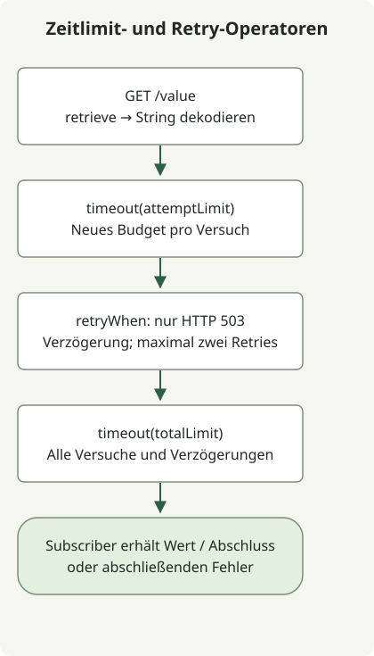

Setzen Sie ein `timeout` pro Versuch vor `retryWhen` und ein Gesamt-`timeout` dahinter, damit Wiederholungsverzögerungen zum Gesamtbudget zählen. Wiederholen Sie nur Fehler, die der API-Vertrag erlaubt: Dieses GET-Beispiel wiederholt HTTP 503 höchstens zweimal und bricht bei Zeitüberschreitungen oder anderen Fehlern ab. Spring dokumentiert [Transportzeitlimits](https://docs.spring.io/spring-framework/reference/6.2/web/webflux-webclient/client-builder.html) getrennt vom [Publisher-Zeitlimit](https://projectreactor.io/docs/core/3.7.12/api/reactor/core/publisher/Mono.html) in Reactor.

## Welche Grenze steuert die jeweilige Einstellung?

| Einstellung | Geltungsbereich in diesem Beispiel |
| --- | --- |
| `CONNECT_TIMEOUT_MILLIS` | Aufbau einer TCP-Verbindung; kein vollständiges Budget für DNS, Pool-Zuteilung oder TLS |
| `responseTimeout` | Höchster Abstand zwischen Netzwerk-Lesevorgängen beim Antwortempfang; keine Frist für den gesamten Body |
| Erstes `timeout(attemptLimit)` | Eine Subscription bis zur Body-Dekodierung; beginnt bei jeder Wiederholung neu |
| Letztes `timeout(totalLimit)` | Die gesamte Subscription einschließlich aller Versuche und Wiederholungsverzögerungen |
| `StepVerifier.verify(GUARD)` | Maximale Wartezeit des Testläufers; konfiguriert nicht den Client |

Die [Dokumentation zu responseTimeout](https://projectreactor.io/docs/netty/1.2.11/api/reactor/netty/http/client/HttpClient.html) von Reactor Netty beschreibt ein Leseintervall. Eine Antwort, die laufend Daten liefert, kann daher insgesamt länger dauern. Das äußere Publisher-Zeitlimit stellt eine separate Gesamtfrist bereit. Abbruch beendet diese Subscription; bereits ausgeführte Arbeit des entfernten Dienstes macht er nicht rückgängig.

## Wiederholungen begrenzen, bevor weitere Fehlerfälle hinzukommen



Das Diagramm fasst die Verschachtelung der Operatoren zusammen, nicht jedes HTTP-Ereignis. Jeder Versuch gelingt oder gibt einen Fehler aus. Nur ein 503-Fehler bei verbleibenden Wiederholungen löst nach einer Verzögerung eine erneute Subscription aus; andere Fehler stoppen sofort. Das äußere Zeitlimit kann einen laufenden Versuch oder eine Wiederholungsverzögerung abbrechen.

[`Retry.fixedDelay(2, delay)`](https://projectreactor.io/docs/core/release/api/reactor/util/retry/Retry.html) erlaubt zwei Wiederholungen nach dem ersten Versuch: höchstens drei Anwendungsversuche pro Subscription. `.onRetryExhaustedThrow` reicht die letzte 503-Ausnahme statt eines Wrappers für ausgeschöpfte Wiederholungen weiter. `.disableRetry(true)` deaktiviert die separate automatische Wiederholung von Reactor Netty bei einem TCP-Abbruch, sodass keine verborgene Transportwiederholung zu diesen Zählungen hinzukommt.

Das Beispiel führt ein GET aus und wiederholt bewusst nur 503. Eine Zeitüberschreitung belegt nicht, dass der Server nichts getan hat. Übernehmen Sie diese Regel ohne ausdrücklichen Idempotenzvertrag nicht für Zahlungen oder andere Schreibvorgänge. Sie verarbeitet weder `Retry-After` noch wiederholt sie 429; sie verwendet weder exponentiellen Backoff noch Jitter und koordiniert Wiederholungen nicht zwischen Aufrufern. Die kurze feste Verzögerung beschleunigt Tests; wählen Sie produktive Grenzen und Backoff anhand Ihres API-Vertrags und Lastbudgets.

## Eigenständiges Projekt erstellen

Verwenden Sie ein neues leeres Verzeichnis, JDK 17 und Gradle 8.4. Das Beispiel legt Boot BOM 3.5.7 und MockWebServer 4.12.0 passend zu den [Tests des Antwortvertrags](/en/posts/2023-09-19-springboot-test-webclient/) fest. Dies sind Eingaben zur Reproduktion, keine aktuellen Versionsempfehlungen für den Produktivbetrieb. Die erste Abhängigkeitsauflösung nutzt Maven Central; die HTTP-Tests verwenden nur Loopback. Eine laufende Boot-Anwendung oder ein Gradle-Wrapper wird nicht mitgeliefert.

### `settings.gradle`

```groovy
rootProject.name = 'webclient-timeout-retry'
```

### `build.gradle`

```groovy
plugins { id 'java' }
repositories { mavenCentral() }
dependencies {
    implementation platform('org.springframework.boot:spring-boot-dependencies:3.5.7')
    implementation 'org.springframework.boot:spring-boot-starter-webflux'
    testImplementation 'org.springframework.boot:spring-boot-starter-test'
    testImplementation 'io.projectreactor:reactor-test'
    testImplementation 'com.squareup.okhttp3:mockwebserver:4.12.0'
    testRuntimeOnly 'org.junit.platform:junit-platform-launcher'
}
test { useJUnitPlatform() }
```

## Die beiden Fristen an unterschiedlichen Positionen belassen

Speichern Sie die folgende Implementierung. Der Konstruktor übernimmt positive, vom Aufrufer gewählte Zeitspannen; der Test liefert explizite Werte. Das Antwortzeitlimit und das TCP-Verbindungszeitlimit von 1000 ms gehören zur Transport-Factory.

### `src/main/java/RetryClient.java`

```java
import java.time.Duration;
import io.netty.channel.ChannelOption;
import org.springframework.http.client.reactive.ReactorClientHttpConnector;
import org.springframework.web.reactive.function.client.WebClient;
import org.springframework.web.reactive.function.client.WebClientResponseException;
import reactor.core.publisher.Mono;
import reactor.netty.http.client.HttpClient;
import reactor.util.retry.Retry;

public class RetryClient {
    private final WebClient client;
    private final Duration attemptLimit;
    private final Duration totalLimit;
    private final Duration retryDelay;

    public RetryClient(WebClient client, Duration attemptLimit,
                       Duration totalLimit, Duration retryDelay) {
        this.client = client;
        this.attemptLimit = attemptLimit;
        this.totalLimit = totalLimit;
        this.retryDelay = retryDelay;
    }

    public static WebClient transport(String baseUrl, Duration responseLimit) {
        HttpClient http = HttpClient.create()
            .disableRetry(true)
            .option(ChannelOption.CONNECT_TIMEOUT_MILLIS, 1000)
            .responseTimeout(responseLimit);
        return WebClient.builder().baseUrl(baseUrl)
            .clientConnector(new ReactorClientHttpConnector(http)).build();
    }

    public Mono<String> get() {
        return Mono.defer(() -> client.get().uri("/value")
                .retrieve().bodyToMono(String.class))
            .timeout(attemptLimit)
            .retryWhen(Retry.fixedDelay(2, retryDelay)
                .filter(error -> error instanceof WebClientResponseException response
                    && response.getStatusCode().value() == 503)
                .onRetryExhaustedThrow((spec, signal) -> signal.failure()))
            .timeout(totalLimit);
    }
}
```

## Neun Regelverträge reproduzieren

Sieben Tests verwenden einen echten WebClient und einen lokalen MockWebServer. Zwei verwenden einen synthetischen Austausch und virtuelle Reactor-Zeit, um das Operator-Timing unabhängig von der Netzwerkplanung zu prüfen. Virtuelle Zeit testet die tatsächlichen Socket-Zeitlimits von Reactor Netty nicht. Der Transporttest prüft die eingepackte Ursache des Lesezeitlimits, während das Publisher-Zeitlimit eine `TimeoutException` erzeugt.

### `src/test/java/RetryClientTest.java`

```java
import java.io.IOException;
import java.time.Duration;
import java.util.concurrent.TimeUnit;
import java.util.concurrent.TimeoutException;
import java.util.concurrent.atomic.AtomicInteger;
import io.netty.handler.timeout.ReadTimeoutException;
import okhttp3.mockwebserver.MockResponse;
import okhttp3.mockwebserver.MockWebServer;
import okhttp3.mockwebserver.SocketPolicy;
import org.junit.jupiter.api.AfterEach;
import org.junit.jupiter.api.BeforeAll;
import org.junit.jupiter.api.BeforeEach;
import org.junit.jupiter.api.Test;
import org.springframework.http.HttpStatus;
import org.springframework.web.reactive.function.client.ClientResponse;
import org.springframework.web.reactive.function.client.WebClient;
import org.springframework.web.reactive.function.client.WebClientRequestException;
import org.springframework.web.reactive.function.client.WebClientResponseException;
import reactor.core.publisher.Mono;
import reactor.netty.http.client.HttpClient;
import reactor.test.StepVerifier;
import static org.junit.jupiter.api.Assertions.*;

class RetryClientTest {
    private MockWebServer server;
    private WebClient client;
    private static final Duration GUARD = Duration.ofSeconds(10);

    @BeforeAll
    static void warmUp() {
        HttpClient.create().warmup().block(GUARD);
    }

    @BeforeEach
    void start() throws IOException {
        server = new MockWebServer();
        server.start();
        client = RetryClient.transport(server.url("/").toString(), Duration.ofSeconds(5));
    }

    @AfterEach
    void stop() throws IOException {
        server.shutdown();
    }

    RetryClient policy() {
        return new RetryClient(client, Duration.ofSeconds(3),
            Duration.ofSeconds(8), Duration.ofMillis(10));
    }

    void expectStatus(int status) {
        StepVerifier.create(policy().get())
            .expectErrorSatisfies(error -> assertEquals(status,
                assertInstanceOf(WebClientResponseException.class, error).getStatusCode().value()))
            .verify(GUARD);
    }

    @Test
    void successUsesOneRequest() {
        server.enqueue(new MockResponse().setBody("ok"));
        StepVerifier.create(policy().get()).expectNext("ok").expectComplete().verify(GUARD);
        assertEquals(1, server.getRequestCount());
    }

    @Test
    void two503ResponsesThenSuccessUseThreeRequests() {
        server.enqueue(new MockResponse().setResponseCode(503));
        server.enqueue(new MockResponse().setResponseCode(503));
        server.enqueue(new MockResponse().setBody("ok"));
        StepVerifier.create(policy().get()).expectNext("ok").expectComplete().verify(GUARD);
        assertEquals(3, server.getRequestCount());
    }

    @Test
    void exhausted503PreservesLastStatusAfterThreeRequests() {
        for (int i = 0; i < 3; i++) server.enqueue(new MockResponse().setResponseCode(503));
        expectStatus(503);
        assertEquals(3, server.getRequestCount());
    }

    @Test
    void notFoundIsNotRetried() {
        server.enqueue(new MockResponse().setResponseCode(404));
        expectStatus(404);
        assertEquals(1, server.getRequestCount());
    }

    @Test
    void otherServerErrorsAreNotRetried() {
        server.enqueue(new MockResponse().setResponseCode(500));
        expectStatus(500);
        assertEquals(1, server.getRequestCount());
    }

    @Test
    void attemptTimeoutIsNotRetried() {
        server.enqueue(new MockResponse().setSocketPolicy(SocketPolicy.NO_RESPONSE));
        RetryClient limited = new RetryClient(client, Duration.ofSeconds(1),
            Duration.ofSeconds(8), Duration.ofMillis(10));
        StepVerifier.create(limited.get()).expectError(TimeoutException.class).verify(GUARD);
        assertEquals(1, server.getRequestCount());
    }

    @Test
    void responseReadTimeoutIsNotRetried() {
        server.enqueue(new MockResponse().setSocketPolicy(SocketPolicy.NO_RESPONSE));
        WebClient shortRead = RetryClient.transport(server.url("/").toString(), Duration.ofMillis(250));
        RetryClient limited = new RetryClient(shortRead, Duration.ofSeconds(3),
            Duration.ofSeconds(8), Duration.ofMillis(10));
        StepVerifier.create(limited.get()).expectErrorSatisfies(error -> {
            assertInstanceOf(WebClientRequestException.class, error);
            assertInstanceOf(ReadTimeoutException.class, error.getCause());
        }).verify(GUARD);
        assertEquals(1, server.getRequestCount());
    }

    @Test
    void totalBudgetIncludesRetryDelay() {
        AtomicInteger attempts = new AtomicInteger();
        StepVerifier.withVirtualTime(() -> {
            WebClient synthetic = WebClient.builder().exchangeFunction(request -> Mono.defer(() -> {
                attempts.incrementAndGet();
                return Mono.just(ClientResponse.create(HttpStatus.SERVICE_UNAVAILABLE).build());
            })).build();
            return new RetryClient(synthetic, Duration.ofSeconds(1),
                Duration.ofMillis(1500), Duration.ofSeconds(1)).get();
        }).thenAwait(Duration.ofMillis(1500)).expectError(TimeoutException.class).verify(GUARD);
        assertEquals(2, attempts.get());
    }

    @Test
    void attemptBudgetRestartsAfterRetry() {
        AtomicInteger attempts = new AtomicInteger();
        StepVerifier.withVirtualTime(() -> {
            WebClient synthetic = WebClient.builder().exchangeFunction(request -> Mono.defer(() -> {
                int attempt = attempts.incrementAndGet();
                return Mono.delay(Duration.ofMillis(400)).map(tick -> attempt == 1
                    ? ClientResponse.create(HttpStatus.SERVICE_UNAVAILABLE).build()
                    : ClientResponse.create(HttpStatus.OK).body("ok").build());
            })).build();
            return new RetryClient(synthetic, Duration.ofMillis(500),
                Duration.ofSeconds(2), Duration.ofMillis(200)).get();
        }).thenAwait(Duration.ofSeconds(1)).expectNext("ok").expectComplete().verify(GUARD);
        assertEquals(2, attempts.get());
    }
}
```

## Projekt ausführen und Ergebnis lesen

```sh
gradle --no-daemon clean test
```

Die lokale Reproduktion verwendete JDK 17.0.8.1 und Gradle 8.4. Alle neun Tests bestanden. Prüfen Sie die Assertions in `build/reports/tests/test/index.html` oder `build/test-results/test/TEST-RetryClientTest.xml`; `BUILD SUCCESSFUL` allein sagt nicht, wie viele Tests liefen.

| Szenario | Geprüftes Ergebnis |
| --- | --- |
| Sofortiger Erfolg | Eine HTTP-Anfrage, `ok`, dann Abschluss |
| 503 → 503 → Erfolg | Drei HTTP-Anfragen, `ok`, dann Abschluss |
| 503 bei jedem Versuch | Drei HTTP-Anfragen, letzter 503 bleibt erhalten |
| 404 / 500 | Je eine HTTP-Anfrage, Status bleibt erhalten |
| Keine Antwort, Versuchsgrenze von einer Sekunde | `TimeoutException`, eine HTTP-Anfrage |
| Keine Antwort, Antwort-Lesegrenze von 250 ms | `WebClientRequestException` mit `ReadTimeoutException`, eine Anfrage |
| Gesamtbudget 1.5 s, Wiederholungsverzögerung eine Sekunde | Zwei synthetische Versuche; Zeitlimit bricht die Verzögerung vor einem dritten ab |
| Versuch 400 ms, Verzögerung 200 ms, Versuch 400 ms | Jeder Versuch liegt innerhalb von 500 ms; Erfolg und Abschluss nach Vorrücken der virtuellen Zeit um 1 s geprüft |

Diese Prüfungen reproduzieren weder das Zeitlimit beim TCP-Verbindungsaufbau noch DNS-Fehler, TLS-Aushandlung, Pool-Erschöpfung, Weiterleitungen oder verteilte Nebenwirkungen. Die Verbindungsgrenze ist konfiguriert, hier aber nicht experimentell validiert. Die Betriebssystemplanung kann die reale Laufzeit beeinflussen; die Tests prüfen Fehlertypen und Anfragezahlen, keine exakten Millisekunden der Wanduhrzeit. Für Status, Medientyp und JSON-Verarbeitung lesen Sie das [WebClient-Beispiel zum Antwortvertrag](/en/posts/2023-09-19-springboot-test-webclient/).
