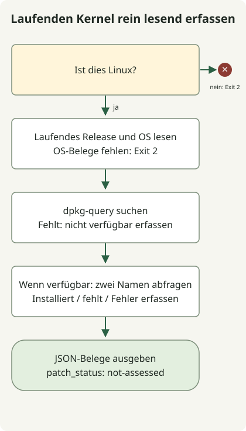

**Fragnesia (CVE-2026-46300) ist eine Schwachstelle zur lokalen Rechteausweitung im Linux-Kernel.** Wenden Sie die Korrekturen für die richtige Distribution und Kernelfamilie an und prüfen Sie dann, dass sie im laufenden Kernel aktiv sind. [Ubuntus offizielle Beschreibung](https://ubuntu.com/security/CVE-2026-46300) nennt außerdem einen möglichen Containerausbruch unter zutreffenden Bedingungen. Linux zu betreiben bedeutet nicht, dass jedes System gleich exponiert ist.

## Erhält ein Internetangreifer dadurch direkt root?

Diese CVE ermöglicht lokale Rechteausweitung. Sie setzt voraus, dass ein Angreifer Code auf dem System ausführen und den verwundbaren Kernelpfad erreichen kann. Unterscheiden Sie dies von entfernter Codeausführung in einer Webanwendung. [CISAs offizielle KEV-Daten](https://www.cisa.gov/sites/default/files/feeds/known_exploited_vulnerabilities.json) verzeichnen das Risiko der Verkettung mit PHP2Shell CVE-2026-109618 und CVE-2026-109619. Prüfen Sie [PHP-Laufzeitpatches](/en/posts/2026-10-30-php2shell-runtime-patching/) und Host-Kernel-Patches separat.

Der [ursprüngliche CVE-Eintrag](https://cveawg.mitre.org/api/cve/CVE-2026-46300) beschreibt eine Markierung für gemeinsam genutzte Seitenfragmente, die beim Zusammenführen von Socket-Puffern verloren geht. Spätere ESP-Verarbeitung kann gemeinsam genutzte Seiten für private halten und sie direkt verändern. Die CVE wurde am 23. Mai 2026 veröffentlicht; CISA nahm sie am 28. Oktober in KEV auf. Dies ist kein erst im Oktober eingeführter Fehler. Ordnen Sie die KEV-Frist vom 31. Oktober dem Geltungsbereich der jeweiligen Richtlinie zu, statt sie als allgemeine Änderungsfrist für alle Dienste zu verstehen.

## Welcher Kernel muss aktualisiert werden?

Beschränken Sie den Korrekturumfang nicht isoliert auf eine CVE. [Hinweise des Ubuntu-Sicherheitsteams](https://ubuntu.com/security/CVE-2026-46300#notes) empfehlen, die zugehörigen Korrekturen zusammen mit CVE-2026-43284 auszuliefern. Eine weitere Korrektur eines Fragmentübertragungspfads wird als [CVE-2026-43503](https://ubuntu.com/security/CVE-2026-43503) geführt. [CVE-2026-43284](https://ubuntu.com/security/CVE-2026-43284) ist ein separater Eintrag der Dirty-Frag-Familie. Bevorzugen Sie das vollständige korrigierte Paket des Anbieters; die Anwendung eines ausgewählten Commits belegt keinen Abschluss.

Die folgenden ausgewählten Korrekturschwellen für das Ubuntu-**linux-Quellpaket** wurden am 31. Oktober 2026 geprüft. Ordnen Sie zuerst das installierte Binärpaket seinem Quellpaket und seiner Kernelfamilie zu.

| Ubuntu-Version | linux-Korrekturschwelle |
| --- | --- |
| 22.04 LTS | 5.15.0-181.191 |
| 24.04 LTS | 6.8.0-124.124 |
| 26.04 LTS | 7.0.0-22.22 |

Verwenden Sie diese Schwellen nicht für AWS-, Azure-, HWE-, OEM- oder Echtzeitkernel: Paketnamen, unterstützte Familien und Anbieter-Backports unterscheiden sich. Folgen Sie für RHEL dem Produktstatus und der aus [Red Hats Bulletin](https://access.redhat.com/security/vulnerabilities/RHSB-2026-003) verlinkten RHSA. [AWS' eigenes Bulletin](https://aws.amazon.com/security/security-bulletins/2026-030-aws/) erklärt den nicht betroffenen Status von Amazon Linux und Bottlerocket anhand ihrer espintcp-Konfiguration. Übertragen Sie diese Aussage nicht auf beliebige eigene Kernel oder andere Distributionen auf EC2.

## Zuerst Belege zum laufenden Kernel sammeln



Das Diagramm folgt dem folgenden Erfassungsprogramm. Es benötigt [Python 3.10 oder neuer](https://docs.python.org/3/library/platform.html#platform.freedesktop_os_release). Unter Linux mit [dpkg-query](https://manpages.debian.org/trixie/dpkg/dpkg-query.1.en.html) fragt es nur zwei vom laufenden Kernel-Release abgeleitete Paketnamen ab. Es verwendet weder Netzwerkzugriff noch Administratorrechte, Modulladen oder Systemänderungen. **Es ist weder ein Schwachstellendetektor noch ein Urteil über abgeschlossene Patches.** Fehlende Belege werden niemals als sicher gemeldet.

### `kernel-evidence.py`

```python
import json
import platform
import shutil
import subprocess


def collect():
    result = {"patch_status": "not-assessed", "scope": "current-execution-context"}
    if platform.system() != "Linux":
        return {**result, "error": "linux-required"}, 2
    try:
        release = platform.release()
        distro = platform.freedesktop_os_release()
    except OSError:
        return {**result, "error": "os-evidence-unavailable"}, 2
    result.update(running_kernel=release,
                  os={key: distro.get(key) for key in ("ID", "VERSION_ID")}, queries=[])
    command = shutil.which("dpkg-query")
    if not command:
        return {**result, "package_query": "dpkg-query-unavailable"}, 0
    result["package_query"] = "dpkg-query"
    for name in ("linux-image-" + release, "linux-image-unsigned-" + release):
        row = {"package": name}
        try:
            answer = subprocess.run(
                [command, "-W", "-f=${Package}\t${Version}\t${db:Status-Status}\n", name],
                capture_output=True, text=True, timeout=5, check=False)
        except (OSError, subprocess.TimeoutExpired):
            row["state"] = "query-error"
        else:
            fields = answer.stdout.rstrip("\n").split("\t")
            if answer.returncode == 1:
                row["state"] = "not-found"
            elif answer.returncode != 0:
                row["state"] = "query-error"
            elif len(fields) != 3 or fields[0] != name or not fields[1]:
                row["state"] = "unexpected-output"
            elif fields[2] != "installed":
                row["state"] = "not-installed"
            else:
                row.update(state="installed", version=fields[1])
        result["queries"].append(row)
    return result, 0


if __name__ == "__main__":
    evidence, status = collect()
    print(json.dumps(evidence, ensure_ascii=False, indent=2, sort_keys=True))
    raise SystemExit(status)
```

```sh
python3 kernel-evidence.py
```

Eine Nicht-Linux-Umgebung oder nicht verfügbare Betriebssystembelege liefern Exit-Code 2. Auch nach abgeschlossener Linux-Erfassung kann eine einzelne Paketabfrage scheitern: Lesen Sie package_query und jeden state. Exit-Code 0 belegt keinen Patchabschluss. Diese beiden Abfragen können bei RPM- oder eigenen Kerneln das besitzende Paket nicht identifizieren.

Die folgende Ausgabe wurde **mit synthetischen Eingaben ausgeführt und geprüft**: Ubuntu 24.04, laufender Kernel 6.8.0-124-generic, erstes Paket installiert und zweites nicht vorhanden. Sie ist kein Beleg von einem produktiven Ubuntu-Host. Ausführungsprüfungen reproduzieren diese Ausgabe und die Fehlerzweige der Abfragen; sie testen weder tatsächliche Kernel-Verwundbarkeit noch Patchübernahme oder Ausnutzung.

```text
{
  "os": {
    "ID": "ubuntu",
    "VERSION_ID": "24.04"
  },
  "package_query": "dpkg-query",
  "patch_status": "not-assessed",
  "queries": [
    {
      "package": "linux-image-6.8.0-124-generic",
      "state": "installed",
      "version": "6.8.0-124.124"
    },
    {
      "package": "linux-image-unsigned-6.8.0-124-generic",
      "state": "not-found"
    }
  ],
  "running_kernel": "6.8.0-124-generic",
  "scope": "current-execution-context"
}
```

In einem Container können Betriebssystem und Paketdatenbank zum Container gehören, während der Kernel zum gemeinsam genutzten Host gehört. Erfassen Sie erneut über den Host- oder VM-Verwaltungspfad. Auch ein neu installiertes Kernelpaket kann vom aktuell laufenden Kernel abweichen. Dieses Erfassungsprogramm fragt nur Namen ab, die mit dem aktuellen Release verbunden sind; es listet nicht alle installierten Kernel auf. Es prüft weder Paketsignaturen noch Integrität oder Livepatch-Status.

## Was sollten Sie nach dem Patchen prüfen?

1. Ordnen Sie Distribution, laufenden Kernel und Paketfamilie des Systems dem CVE- oder Sicherheitshinweis des Anbieters zu. Vergleichen Sie Versionen unterschiedlicher Familien nicht mit einem einfachen Zeichenfolgenvergleich.
2. Wenden Sie korrigierte Pakete über unterstützte Repositorys oder Images an und ersetzen oder starten Sie Knoten dann schrittweise neu. [Ubuntu USN-8388-1](https://ubuntu.com/security/notices/USN-8388-1) verlangt nach einem Standardupdate einen Neustart und behandelt ABI-Änderungen für Kernelmodule von Drittanbietern. Wenn Sie allein auf Livepatch setzen, prüfen Sie Unterstützung und tatsächliche Anwendung für die CVE und den laufenden Kernel separat.
3. Sammeln Sie nach dem Neustart dieselben Belege, vergleichen Sie den aktiven Kernel mit den Korrekturbelegen des Anbieters und prüfen Sie Dienstzustand, Speicher und Netzwerk. Nur einen Kubernetes-Pod neu zu starten ersetzt den Kernel des Knotens nicht.
4. Untersuchen Sie auch möglichen Erstzugriff und Persistenz. Erfolgreiches Patchen belegt nicht, dass keine vorhandene Webshell oder gestohlene Zugangsdaten vorliegen.

Wenn ein sofortiges Update nicht möglich ist, lesen Sie [Ubuntus vorläufige Abhilfehinweise](https://ubuntu.com/blog/dirty-frag-linux-vulnerability-fixes-available) und die Anweisungen Ihres Anbieters. Modulbeschränkungen können mit Funktionen wie VPN/IPsec kollidieren; bereits geladene oder eingebaute Pfade benötigen eine separate Bewertung. Das Fehlen in einer Modulliste belegt keinen nicht betroffenen Status. Exposition zu verringern und nicht vertrauenswürdigen Code einzuschränken sind vorläufige Maßnahmen, kein Ersatz für korrigierte Pakete.
