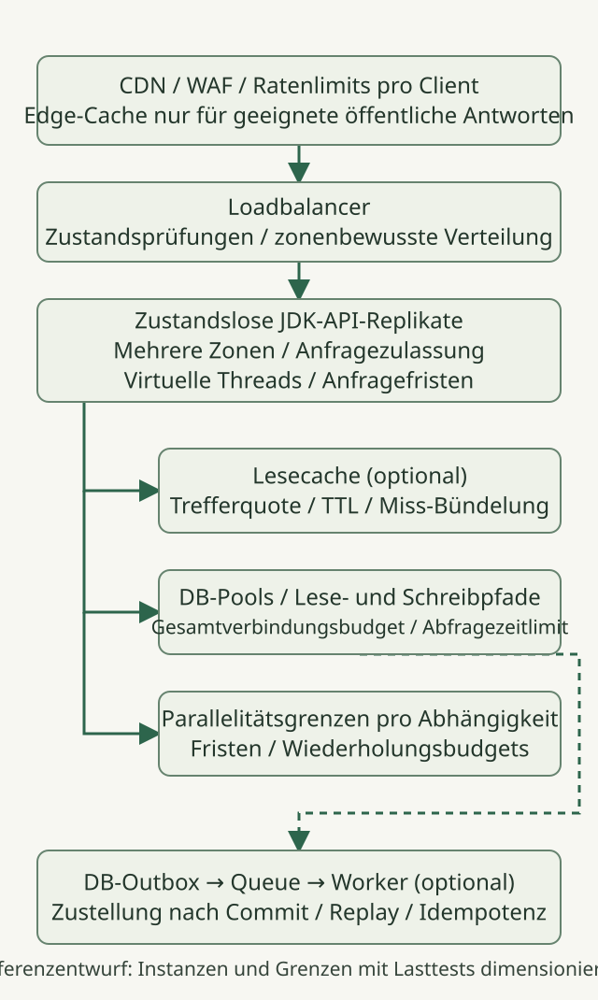
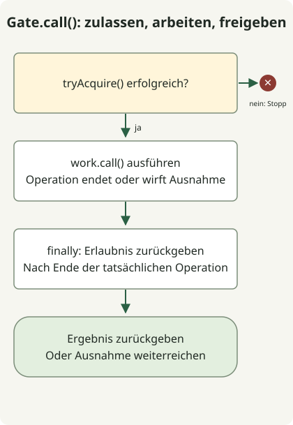

Eine **HTTP-API mit 10000 Anfragen pro Sekunde braucht explizite Kapazitätsbudgets für Anfragen und Abhängigkeiten sowie ein definiertes Überlastverhalten, bevor sie ein neueres JDK braucht**. Beginnen Sie mit zustandslosen API-Replikaten über mehrere Verfügbarkeitszonen, Zulassungsgrenzen für Anfragen und Parallelitätsgrenzen pro Abhängigkeit. Ergänzen Sie Caches, Warteschlangen und Lesereplikate entsprechend gemessenen Engpässen und Konsistenzanforderungen. Dies ist ein Entwurfsleitfaden mit Beispielrechnungen, **kein Bericht über einen erfolgreichen Lasttest mit 10k RPS**.

Am 31. Oktober 2026 ist die neueste GA-Version [JDK 27](https://openjdk.org/projects/jdk/27/). Der folgende Code wurde auf Temurin `27.0.1.0.2+1` geprüft. Trennen Sie Aktualität der Funktionen von Supportdauer: Die [Oracle-Support-Roadmap](https://www.oracle.com/java/technologies/java-se-support-roadmap.html) führt JDK 25 als LTS und 27 als Nicht-LTS auf. Prüfen Sie Supportregeln anderer Anbieter und Framework-Kompatibilität in deren eigener Dokumentation.

## 10k-Grenze und Erfolgskriterien definieren

Hier bedeutet 10k **Anfragen pro Sekunde, die den API-Loadbalancer erreichen**, ohne statische CDN-Treffer. Es bedeutet weder gleichzeitige Verbindungen noch die Zahl virtueller Threads. Erfassen Sie angebotene RPS, abgeschlossene fachlich erfolgreiche RPS, Zurückweisungen und Fehler separat. Schnelle Fehlerantworten allein belegen keine Kapazität.

Diese Annahmen veranschaulichen die Rechnungen. Sie sind weder Messungen eines realen Dienstes noch empfohlene Konfigurationswerte.

| Punkt | Beispielannahme |
| --- | --- |
| Angebotsziel | 10000 RPS |
| Lese-/Schreibmix | 90% / 10% |
| Trefferquote im Lesecache | 80% |
| Mittlere API-Verweilzeit im eingeschwungenen Zustand | 50ms |
| Antwortziel | p99 unter 200ms; Fehlerrate unter 0.1% |
| Datenbanknutzung | Ein Zugriff je Lese-Fehltreffer/Schreibvorgang; mittlere Verbindungshaltezeit 10ms |

[Little's Gesetz](https://web.mit.edu/2.810/www/files/lectures/lec1-intro-2019.pdf#page=56), `L = λ × W`, gilt für **Mittelwerte** über dieselbe Grenze in einem stabilen System. Bei angenommenem normalem Durchsatz von 10000/s und mittlerer Verweilzeit von 0.05 Sekunden ergeben sich im Durchschnitt etwa 500 laufende Anfragen über die gesamte Instanzgruppe. Setzen Sie nicht p99 200ms ein, um mittlere Parallelität zu berechnen, und machen Sie aus 500 nicht direkt eine harte Grenze. Lastspitzen, Latenzverteilungen und Ausfallreserven brauchen separate Validierung.

Die Datenbankzugriffe betragen `9,000 × (1 − 0.8) + 1,000 = 2,800/s`; im Mittel belegte Verbindungen sind `2,800 × 0.01 = 28`. **Dies empfiehlt keine Poolgröße von 28.** Mehrere Statements, Sperren, Transaktionen und Cache-Ausfälle ändern die Annahmen. Berücksichtigen Sie im Bandbreitenbudget auch Antwortbytes, TLS, Replikation und Protokollierung.

## Referenzarchitektur: Einen kleinen Dienst horizontal replizieren



Dies ist ein vorgeschlagener Aufbau. Das folgende Java-Beispiel implementiert nur das Prinzip der Zulassungskontrolle, nicht die gesamte Infrastruktur. Ein Ziel von 10k RPS allein begründet keinen Bedarf an Microservices oder Sharding. Replizieren Sie eine zustandslose modulare Anwendung und trennen Sie anschließend die Engpässe, die Messungen zeigen.

- **Edge und Loadbalancer:** Begrenzen Sie Anfrageraten pro Client, Verbindungen, Anfrage-Bodygrößen und langsame Verbindungen. Cachen Sie im CDN nur geeignete öffentliche Antworten; entwerfen Sie Schlüssel und Geltungsbereich für authentifizierte Daten separat. Verwenden Sie Zustandsprüfungen und geregeltes Entleeren, um neue Anfragen von noch nicht bereiten Replikaten fernzuhalten.
- **API-Replikate:** Begrenzen Sie laufende Arbeit an der Anfragegrenze und verwenden Sie virtuelle Threads für gut lesbaren Code mit blockierender I/O. Virtuelle Threads vergrößern keine Datenbankkapazität und beschleunigen keine CPU-Berechnungen. Begrenzen Sie knappe Ressourcen, wie im [JDK-27-Leitfaden](https://docs.oracle.com/en/java/javase/27/core/virtual-threads.html) beschrieben, separat mit Mechanismen wie Semaphoren.
- **Cache und Datenbank:** Ein Lesecache ist optional. Testen Sie die Streuung von TTLs, das Zusammenführen gleichzeitiger Fehltreffer und Datenbankverkehr bei Cache-Ausfall. Prüfen Sie zuerst Indizes, Abfragepläne und Transaktionsdauer. Verwenden Sie Lesereplikate nur, wenn Replikationsverzögerung akzeptabel ist.
- **Externe Aufrufe und asynchrone Arbeit:** Geben Sie jeder Abhängigkeit ein eigenes Parallelitätsbudget. Stellen Sie nur Arbeit in Warteschlangen, die nicht vor der Antwort abgeschlossen sein muss. Wenn Datenbankschreibvorgänge und Nachrichtenzustellung koordiniert werden müssen, entwerfen Sie eine [transaktionale Outbox](https://docs.aws.amazon.com/prescriptive-guidance/latest/cloud-design-patterns/transactional-outbox.html) mit wiederholbarer Zustellung und idempotenten Verbrauchern. Auch Warteschlangen sind begrenzte Ressourcen: Beobachten Sie Rückstand, Alter der ältesten Nachricht und Verarbeitungsfehler.

Entwerfen Sie schnelle Zurückweisung und Ressourcenschutz als normales Betriebsverhalten, wie in [Google SREs Überlastleitfaden](https://sre.google/sre-book/handling-overload/) beschrieben. Rein CPU-basierte Skalierung kann I/O-Stillstände übersehen; beobachten Sie laufende Anfragen, Zurückweisungsrate, Wartezeiten auf Verbindungen und Sättigung von Abhängigkeiten gemeinsam.

## Wie viele Replikate und Datenbankverbindungen?

Messen Sie bei festgelegter Hardware, Heap-Größe, Container-CPU-Grenzen und Anfragemix `q_safe`: **Durchsatz pro Replikat, der das SLO und die vereinbarte Betriebsreserve einhält**. Dieser Artikel hat ihn nicht gemessen.

Wenn Tests tatsächlich `q_safe = 2,500 RPS` belegen, decken vier Replikate das normale Ziel rechnerisch ab. Fünf liefern einen Ausgangspunkt, um 10k nach dem Ausfall eines Replikats zu halten. Dies garantiert keine Kapazität bei Zonenausfall. Sechs Replikate, je zwei in drei Zonen, lassen nach Ausfall einer Zone vier übrig und decken 10k damit auf dem Papier ab. Doch auch Umverteilung durch den Loadbalancer, ungleiche Zonenlast und Datenbank-/Cache-Failover müssen getestet werden. Halten Sie Reserve für die Zeit bis zum Abschluss der automatischen Skalierung vor.

Vergrößern Sie Datenbankpools nicht unabhängig pro Replikat. Halten Sie für jeden Datenbankendpunkt `maximum simultaneously existing API replicas × per-replica pool limit + worker connections + operational reserve` innerhalb seines verfügbaren Verbindungsbudgets. Zählen Sie gleichzeitig vorhandene alte und neue Replikate während Skalierung, rollender Bereitstellung und Beendigungsfristen mit. Die [PostgreSQL-Dokumentation](https://www.postgresql.org/docs/18/runtime-config-connection.html) erklärt, dass ein höheres `max_connections` mehr Ressourcen einschließlich gemeinsam genutzten Speichers zuweist. Mehr Verbindungen beheben keine langsamen Abfragen.

## Minimales Zulassungsbeispiel mit virtuellen Threads



Das Diagramm folgt `Gate.call()`. Die Methode `main()` ist eine **Demonstration der Zulassungssemantik ohne HTTP-Server**, die zwei Operationen und eine Zurückweisung erzeugt. Die Grenze von zwei dient dem Test, nicht als 10k-RPS-Konfiguration. Wenden Sie in einem echten Server die Zulassung vor teurer Arbeit an und begrenzen Sie auch Verbindungen, Serverwarteschlangen und die Erzeugung virtueller Threads vor dem Gate durch Edge- und Serverkontrollen.

### `AdmissionDemo.java`

```java
import java.util.concurrent.Callable;
import java.util.concurrent.CountDownLatch;
import java.util.concurrent.Executors;
import java.util.concurrent.RejectedExecutionException;
import java.util.concurrent.Semaphore;

public class AdmissionDemo {
    static final class Gate {
        private final Semaphore permits;
        Gate(int limit) {
            if (limit <= 0) throw new IllegalArgumentException("limit must be positive");
            permits = new Semaphore(limit);
        }
        <T> T call(Callable<T> work) throws Exception {
            if (!permits.tryAcquire()) throw new RejectedExecutionException("busy");
            try {
                return work.call();
            } finally {
                permits.release();
            }
        }
        int available() { return permits.availablePermits(); }
    }

    public static void main(String[] args) throws Exception {
        Gate gate = new Gate(2);
        CountDownLatch entered = new CountDownLatch(2);
        CountDownLatch release = new CountDownLatch(1);
        Callable<String> request = () -> gate.call(() -> {
            if (!Thread.currentThread().isVirtual()) throw new AssertionError("virtual thread required");
            entered.countDown();
            release.await();
            return "ok";
        });
        try (var tasks = Executors.newVirtualThreadPerTaskExecutor()) {
            var first = tasks.submit(request);
            var second = tasks.submit(request);
            try {
                entered.await();
                System.out.println("admitted=2");
                try {
                    gate.call(() -> "unexpected");
                    throw new AssertionError("capacity exceeded");
                } catch (RejectedExecutionException expected) {
                    System.out.println("overload=rejected");
                }
            } finally {
                release.countDown();
            }
            System.out.println("completed=" + first.get() + "," + second.get());
        }
        try {
            gate.call(() -> { throw new IllegalStateException("demonstration"); });
        } catch (IllegalStateException expected) {
            System.out.println("failure=propagated");
        }
        System.out.println("available=" + gate.available());
    }
}
```

```sh
javac --release 27 AdmissionDemo.java
java AdmissionDemo
```

Diese Ausgabe wurde mit `javac` und `java` derselben JDK-27-Installation beobachtet. Vorschauoptionen sind nicht nötig.

```text
admitted=2
overload=rejected
completed=ok,ok
failure=propagated
available=2
```

Ein Fehlschlag von [`tryAcquire()`](https://docs.oracle.com/en/java/javase/27/docs/api/java.base/java/util/concurrent/Semaphore.html#tryAcquire()) weist Arbeit zurück, statt sie einzureihen. `finally` gibt die Erlaubnis zurück, sobald die tatsächliche Operation endet, und Ausnahmen werden an den Aufrufer weitergereicht. Dies ist **eine Parallelitätsgrenze, kein Begrenzer für Anfragen pro Sekunde**. Ein HTTP-Adapter kann die Zurückweisung wegen Dienstkapazität auf eine Antwort wie 503 abbilden, getrennt von Kontingenten pro Client. Dieser Code implementiert weder HTTP-Statusabbildung noch Authentifizierung, Fristen oder Datenbankpools.

## Verhindern, dass Fristen und Wiederholungen Überlast verstärken

Setzen Sie eine durchgehende Frist und teilen Sie das verbleibende Budget auf Datenbankverbindungsbeschaffung, Abfragen, HTTP-Verbindung und Antwortlesen auf. Das Addieren von p99-Werten einzelner Stufen ergibt kein durchgehendes p99. Eine Zeitüberschreitung beim Aufrufer stoppt tatsächliche Datenbank- oder HTTP-Arbeit nicht sofort; prüfen Sie den Abbruch durch Treiber/Client und die Ressourcenrückgabe. Eine Parallelitätserlaubnis zurückzugeben, während die zugrunde liegende Operation weiterläuft, unterläuft die Grenze.

Wiederholen Sie auf einer Ebene mit begrenzter Versuchszahl, Gesamtfrist, exponentiellem Backoff und Jitter und beschränken Sie Wiederholungen auf geeignete Fehler und Operationen mit gesicherter Idempotenz. Wie [Amazons Leitfaden zu Zeitlimits und Wiederholungen](https://aws.amazon.com/builders-library/timeouts-retries-and-backoff-with-jitter/) erklärt, können Wiederholungen Last hinzufügen. Definieren Sie für Zahlungen und Bestellungen zuerst Duplikatvermeidung und das Verhalten bei Ergebnisabfragen.

## Was muss bestehen, bevor 10k-Kapazität behauptet werden kann?

Bereiten Sie den tatsächlichen HTTP-Server, produktionsnahe Daten, TLS, Authentifizierung und Antwortgrößen vor und testen Sie dann in dieser Reihenfolge.

1. Erhöhen Sie die Last auf einem Replikat, um `q_safe` zu ermitteln. Erfassen Sie CPU, GC, Allokation, Sockets, Sperren, Datenbankwartezeiten, erfolgreiche RPS und durchgehendes p99 gemeinsam.
2. Steigern Sie nach Vorbereitung und Aufwärmen den angebotenen Verkehr über den gesamten Aufbau durch 1k→3k→5k→10k und halten Sie das Ziel für eine vereinbarte Dauer. Nehmen Sie Dauer und Datenverteilung in die Ergebnisse auf.
3. Verknüpfen Sie bei einem offenen Lastmodell wie [k6 constant-arrival-rate](https://grafana.com/docs/k6/latest/using-k6/scenarios/executors/constant-arrival-rate/) 10000 Iterationen/s erst dann mit 10k HTTP-RPS, wenn **eine HTTP-Anfrage pro Iteration bei deaktivierten automatischen Weiterleitungen und Wiederholungen** bestätigt ist. Prüfen Sie CPU, Netzwerk und VU-Reserve des Generators sowie [dropped_iterations](https://grafana.com/docs/k6/latest/using-k6/scenarios/concepts/dropped-iterations/). Ein Test, der seine Zieleingabe nie erzeugt hat, belegt keine Serverkapazität.
4. Testen Sie Replikat-/Zonenverlust, kalte oder ausgefallene Caches, langsame Datenbanken/Abhängigkeiten, rollende Bereitstellung und Lastspitzen. Zählen Sie zurückgewiesene Antworten nicht als fachlichen Erfolg und prüfen Sie nach Sättigung Wiederherstellung, Warteschlangenabbau und Verbindungslecks.

Für diesen Artikel wurden nur Gate-Zurückweisung und Erlaubnisrückgabe nach normalen/fehlschlagenden Operationen ausgeführt. Die gesamte Architektur wurde keinem Lasttest unterzogen. Lesen Sie den [Vergleich virtueller Threads in JDK 21/25](/en/posts/2026-10-31-virtual-threads-jdk21-jdk25/) und die [ScopedValue-Grenzen des Anfragekontexts](/en/posts/2026-10-31-jdk25-scopedvalue/) getrennt von der Validierung einer Produktivarchitektur.
