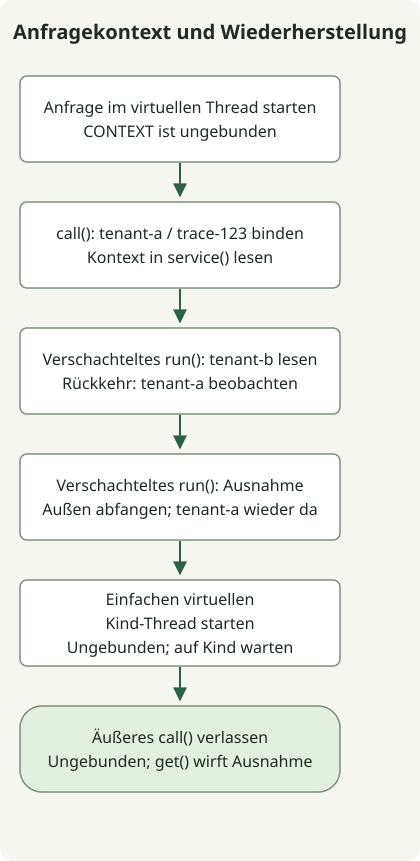

In JDK 25 ist **`ScopedValue` eine finalisierte API, um Daten wie Anfragekontext an einen begrenzten Ausführungsbereich zu binden und von Aufrufern an aufgerufene Methoden weiterzugeben**. Sie wurde mit [JEP 506](https://openjdk.org/jeps/506) finalisiert; Vorschauoptionen sind deshalb nicht nötig. Eine Bindung gilt während der Ausführung der an `run()` oder `call()` übergebenen Operation; normaler Abschluss oder eine Ausnahme stellt den vorherigen Zustand wieder her.

## Wie unterscheidet sie sich von ThreadLocal?

Ziehen Sie sie in Betracht, wenn die Weitergabe einer Mandanten- oder Trace-ID tief in Dienstcode sonst einen zusätzlichen Parameter in jeder Zwischenmethode erfordern würde. Gewöhnliche Parameter können klarer bleiben, wenn der Wert eine explizite Eingabe der Geschäftslogik ist.

[`ThreadLocal`](https://docs.oracle.com/en/java/javase/25/docs/api/java.base/java/lang/ThreadLocal.html) ändert den Wert des aktuellen Threads mit `set()` und entfernt ihn mit `remove()`. Eine anfragegebundene Verwendung erfordert sorgfältige Bereinigung, typischerweise in `finally`. Statt einen Wert gesetzt zu lassen, führt `ScopedValue` die Operation, die ihn benötigt, innerhalb einer Bindung aus.

| Vergleich | ThreadLocal | ScopedValue |
| --- | --- | --- |
| Datenzugriff | Für den aktuellen Thread gespeicherten Wert lesen und ändern | Bindung im aktuellen dynamischen Ausführungsbereich lesen |
| Bereichsende | Anfragegebundene Bereinigung ausdrücklich verwalten | Vorherige Bindung beim Ende von `run()` oder `call()` wiederherstellen |
| Anderer Wert in aufgerufener Methode | `set()` kann den vorhandenen gespeicherten Wert ändern | In verschachteltem Bereich neu binden, danach äußeren Wert wiederherstellen |
| Geeignete Verwendungen | Unter anderem veränderlicher Zustand pro Thread | Unter anderem Anfragekontext von Aufrufern an aufgerufene Methoden |

`ScopedValue` ersetzt weder jede Verwendung von `ThreadLocal` noch erklärt es diese API für veraltet. Ein `private static final`-Feld speichert **einen Zugriffsschlüssel, nicht den Kontextwert selbst**. Derselbe Schlüssel kann je nach ausführendem Thread und Bereich unterschiedliche Werte auflösen.

## Bereich und Wiederherstellung in einem virtuellen Thread beobachten



Das Diagramm folgt dem folgenden Beispiel. Der äußere Mandant ist `tenant-a`; der verschachtelte Bereich liest `tenant-b`. Ein fehlschlagender verschachtelter Bereich wird außerhalb dieses Bereichs abgefangen, bevor die Wiederherstellung geprüft wird. Dieses Beispiel zeigt die Semantik des Anfragekontexts ohne HTTP-Server oder Framework-Integration.

Führen Sie es in einem Verzeichnis aus, in dem `javac` und `java` auf dieselbe JDK-25-Installation zeigen. Die lokale Prüfumgebung war Eclipse Temurin `25.0.5+8` auf macOS AArch64. `ScopedValue` gehört zu `java.lang` und benötigt keinen expliziten Import.

### `ScopedContextExample.java`

```java
import java.util.NoSuchElementException;
import java.util.concurrent.Executors;

public class ScopedContextExample {
    private static final ScopedValue<RequestContext> CONTEXT = ScopedValue.newInstance();
    record RequestContext(String tenant, String traceId) {}

    public static void main(String[] args) throws Exception {
        try (var tasks = Executors.newVirtualThreadPerTaskExecutor()) {
            tasks.submit(ScopedContextExample::handleRequest).get();
        }
    }

    private static String handleRequest() throws InterruptedException {
        System.out.println("virtual=" + Thread.currentThread().isVirtual());
        System.out.println("before=" + CONTEXT.isBound());
        String result = ScopedValue.where(CONTEXT,
                new RequestContext("tenant-a", "trace-123")).call(() -> {
            System.out.println("outer=" + service());
            ScopedValue.where(CONTEXT,
                    new RequestContext("tenant-b", "trace-123")).run(() ->
                System.out.println("nested=" + service()));
            System.out.println("restored=" + service());

            try {
                ScopedValue.where(CONTEXT,
                        new RequestContext("tenant-fail", "trace-123")).run(() -> {
                    throw new IllegalStateException("demonstration");
                });
            } catch (IllegalStateException expected) {
                System.out.println("after-failure=" + service());
            }

            Thread child = Thread.ofVirtual().start(() ->
                System.out.println("plain-child-bound=" + CONTEXT.isBound()));
            child.join();
            return service();
        });
        System.out.println("result=" + result);
        System.out.println("after=" + CONTEXT.isBound());
        try {
            CONTEXT.get();
        } catch (NoSuchElementException expected) {
            System.out.println("outside=" + expected.getClass().getSimpleName());
        }
        return result;
    }

    private static String service() {
        RequestContext context = CONTEXT.get();
        return context.tenant() + "/" + context.traceId();
    }
}
```

```sh
javac --release 25 ScopedContextExample.java
java ScopedContextExample
```

Diese Standardausgabe wurde ohne Vorschauoptionen beobachtet. `get()` auf dem `Future` reicht Aufgabenfehler an den Aufrufer weiter; `join()` wartet auf die Ausgabe des Kind-Threads.

```text
virtual=true
before=false
outer=tenant-a/trace-123
nested=tenant-b/trace-123
restored=tenant-a/trace-123
after-failure=tenant-a/trace-123
plain-child-bound=false
result=tenant-a/trace-123
after=false
outside=NoSuchElementException
```

`service()` liest die aktuelle Bindung ohne Kontextparameter. Verwenden Sie `run()` für eine Operation ohne Ergebnis und [`Carrier.call()`](https://docs.oracle.com/en/java/javase/25/docs/api/java.base/java/lang/ScopedValue.Carrier.html#call(java.lang.ScopedValue.CallableOp)) für eine Operation, die ein Ergebnis zurückgibt oder eine Ausnahme weiterreicht. Nur einen `Carrier` mit `where()` zu erstellen aktiviert noch keine Bindung.

Sowohl `restored` als auch `after-failure` zeigen den äußeren Wert. Nach Abschluss des äußeren `call()` ist `isBound()` false, und ein ungebundenes `get()` wirft `NoSuchElementException`. Das Verlassen einer Bindung garantiert weder sofortige Garbage Collection des referenzierten Objekts noch schließt es automatisch eine `AutoCloseable`-Ressource.

## Erbt ein neu erstellter virtueller Thread den Wert?

**Ein gewöhnliches `Thread.ofVirtual().start()` erbt die Bindung seines Eltern-Threads nicht automatisch.** Das Beispiel zeigt dies mit `plain-child-bound=false`. Gehen Sie auch nicht davon aus, dass die Übergabe von Arbeit an einen `ExecutorService` oder `CompletableFuture` automatisch Kontext weitergibt. Der erste virtuelle Thread im Beispiel richtet seine Bindung innerhalb der Aufgabe ein, statt eine zu erben.

Die [offiziellen Vererbungsregeln](https://docs.oracle.com/en/java/javase/25/docs/api/java.base/java/lang/ScopedValue.html#inheritance) beschreiben das Erfassen von Bindungen beim Erstellen eines `StructuredTaskScope` und ihre Vererbung an Kinder, die über dessen `fork()` gestartet werden. **Strukturierte Nebenläufigkeit ist in JDK 25 eine separate Vorschau-API**, beschrieben in [JEP 505](https://openjdk.org/jeps/505), und wird im Code dieses Artikels nicht verwendet. Verstehen Sie das Beispiel nicht als Prüfung dieses Vererbungsmechanismus.

## Grenzen bei der Einführung von Anfragekontext

Eine unveränderbare Bindung macht ihr referenziertes Objekt nicht tief unveränderlich. Das Beispiel verwendet einen Record mit zwei Zeichenfolgen; eine veränderliche Sammlung benötigte ein separates Nebenläufigkeitskonzept. Halten Sie auch den Zugriff auf den Schlüssel eng begrenzt.

Prüfen Sie die JDK-25-API, statt ältere Vorschaubeispiele aus JDK 21 und ähnlichen Versionen unverändert zu kopieren. Insbesondere erlaubt JDK 25 kein `orElse(null)`. Auch eine Bindung an `null` unterscheidet sich von einer fehlenden Bindung.

Unterscheiden Sie zuerst ein `ThreadLocal`, das Anfragedaten entlang der Aufrufkette weitergibt, von einem, das während der Ausführung veränderlichen Zustand hält. Entwerfen Sie für Ersteres sowohl die Bindung am Einstiegspunkt als auch die asynchronen Grenzen. Framework-Transaktionen, MDC und Sicherheitskontext werden nicht automatisch angebunden; dieses Beispiel prüft weder diese Integrationen noch die Leistung. Für das Verhalten virtueller Threads selbst lesen Sie den [Artikel zu JDK-21-Funktionen](/en/posts/2023-09-20-jdk-21-release/).
