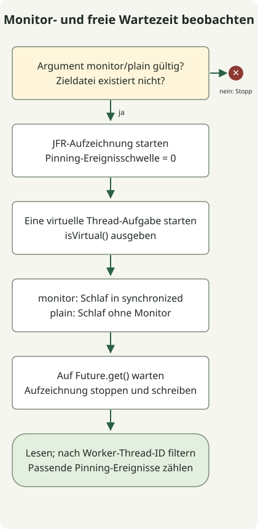

Virtuelle Threads sind **Java-Threads, die vielen Aufgaben erlauben, sich während des Wartens auf I/O eine kleinere Zahl von Betriebssystem-Threads zu teilen**. Sie wurden in JDK 21 durch [JEP 444](https://openjdk.org/jeps/444) finalisiert, und JDK 25 behält dieselben grundlegenden APIs bei. Ein wichtiger Unterschied ist Pinning beim Blockieren innerhalb von `synchronized`: [JEP 491](https://openjdk.org/jeps/491) verbesserte dies in JDK 24, und JDK 25 enthält diese Verbesserung.

## Was wird leichtgewichtiger?

Ein virtueller Thread benötigt zur Ausführung weiterhin einen Betriebssystem-Thread. Die JVM nennt den ausführenden Plattform-Thread einen **Carrier**. Wenn eine unterstützte blockierende Operation das Aushängen des virtuellen Threads erlaubt, kann der Carrier einen anderen virtuellen Thread ausführen.

Dies hilft bei der Anfrageverarbeitung mit vielen gleichzeitigen Wartevorgängen. Es beschleunigt keine CPU-Berechnungen und verringert nicht automatisch die Latenz einer einzelnen Anfrage. Der [offizielle Einführungsleitfaden](https://docs.oracle.com/en/java/javase/25/core/virtual-threads.html) empfiehlt einen virtuellen Thread pro Aufgabe und rät davon ab, virtuelle Threads in einem kleinen Pool wiederzuverwenden. Datenbankverbindungskapazität und Kontingente externer APIs wachsen nicht mit der Threadzahl; begrenzen Sie diese Ressourcen separat durch Mechanismen wie Semaphore und Verbindungspools.

## Unterschiede zwischen JDK 21 und 25

| Bereich | JDK 21 | JDK 25 |
| --- | --- | --- |
| APIs virtueller Threads | Final; keine Vorschauoptionen | Final; grundlegende Erstellungs-APIs beibehalten |
| Blockieren innerhalb von `synchronized` | Kann den Carrier binden und Skalierbarkeit begrenzen | Enthält die Verbesserung aus JDK 24 durch JEP 491 |
| Vollständige Beseitigung von Pinning | Nein | Nein; Pfade wie nativer Code mit Rückruf in blockierendes Java bleiben |
| Diagnose | JFR und Mechanismen wie `jdk.tracePinnedThreads` | JFR bleibt und wird erweitert; `jdk.tracePinnedThreads` wirkt nicht |
| `ScopedValue` | Vorschau | Final durch JEP 506 |
| Strukturierte Nebenläufigkeit | Vorschau | Weiterhin separate Vorschau; Kompatibilität mit früheren APIs nicht voraussetzen |

Lesen Sie den [JDK-21-Leitfaden](https://docs.oracle.com/en/java/javase/21/core/virtual-threads.html), JEP 491 und den [ScopedValue-Artikel](/en/posts/2026-10-31-jdk25-scopedvalue/) gemeinsam, um diese Änderungen zu unterscheiden. Die Finalisierung virtueller Threads, von ScopedValue und strukturierter Nebenläufigkeit folgt keinem gemeinsamen Zeitplan.

Pinning verhindert, dass ein wartender virtueller Thread seinen Carrier freigibt. In JDK 25 ist gewöhnliche `synchronized`-Nutzung allein kein Grund, jeden Monitor durch `ReentrantLock` zu ersetzen. Allerdings ist **die Freigabe eines Carriers etwas anderes als die Freigabe einer Monitorsperre**. Langsame I/O innerhalb von `synchronized` verhindert weiterhin, dass andere Aufgaben diese Sperre erhalten. Daher bleiben die Größe kritischer Abschnitte und Sperrkonkurrenz wichtig.

## Denselben Code mit JFR beobachten



Der Code vergleicht einen Modus `monitor`, der `Thread.sleep(100)` innerhalb von `synchronized` ausführt, mit einem Modus `plain`, der ohne diesen Block schläft. Er stellt keine echten Netzwerk- oder Datenbankanfragen. Er setzt die Ereignisschwelle über [Recording](https://docs.oracle.com/en/java/javase/21/docs/api/jdk.jfr/jdk/jfr/Recording.html) auf null und zählt anschließend mit [RecordingFile](https://docs.oracle.com/en/java/javase/21/docs/api/jdk.jfr/jdk/jfr/consumer/RecordingFile.html) nur Ereignisse des Worker-Threads.

Speichern Sie die Datei für jedes JDK in einem neuen Verzeichnis und verwenden Sie `javac` und `java` derselben Installation. Erforderlich ist ein HotSpot-JDK mit JFR; Vorschauoptionen werden nicht verwendet. Das Programm erstellt `monitor.jfr` und `plain.jfr` und verweigert die Ausführung, wenn die Zieldatei bereits existiert.

### `VirtualThreadProbe.java`

```java
import java.nio.file.Files;
import java.nio.file.Path;
import java.time.Duration;
import java.util.concurrent.Executors;
import jdk.jfr.Recording;
import jdk.jfr.consumer.RecordingFile;

public class VirtualThreadProbe {
    public static void main(String[] args) throws Exception {
        if (args.length != 1 || !(args[0].equals("monitor") || args[0].equals("plain"))) {
            throw new IllegalArgumentException("Usage: VirtualThreadProbe monitor|plain");
        }
        String mode = args[0];
        Path destination = Path.of(mode + ".jfr");
        if (Files.exists(destination)) {
            throw new IllegalStateException("Use a new directory: recording already exists");
        }
        Object monitor = new Object();
        long workerId;
        try (var recording = new Recording()) {
            recording.enable("jdk.VirtualThreadPinned").withThreshold(Duration.ZERO);
            recording.start();
            try (var tasks = Executors.newVirtualThreadPerTaskExecutor()) {
                workerId = tasks.submit(() -> {
                    Thread current = Thread.currentThread();
                    System.out.println("virtual=" + current.isVirtual());
                    if (mode.equals("monitor")) {
                        synchronized (monitor) { Thread.sleep(100); }
                    } else {
                        Thread.sleep(100);
                    }
                    return current.threadId();
                }).get();
            }
            recording.stop();
            recording.dump(destination);
        }
        long pinnedEvents = 0;
        try (var events = new RecordingFile(destination)) {
            while (events.hasMoreEvents()) {
                var event = events.readEvent();
                if (event.getEventType().getName().equals("jdk.VirtualThreadPinned")
                        && event.getThread() != null
                        && event.getThread().getJavaThreadId() == workerId) {
                    pinnedEvents++;
                }
            }
        }
        System.out.println(mode + "-pinned-events=" + pinnedEvents);
    }
}
```

```sh
javac --release 21 VirtualThreadProbe.java
java VirtualThreadProbe monitor
java VirtualThreadProbe plain
```

Diese Ausgabe wurde auf Eclipse Temurin `21.0.13+9` für macOS AArch64 beobachtet.

```text
virtual=true
monitor-pinned-events=1
virtual=true
plain-pinned-events=0
```

Eclipse Temurin `25.0.5+8` auf derselben Plattform lieferte:

```text
virtual=true
monitor-pinned-events=0
virtual=true
plain-pinned-events=0
```

`Future.get()` wartet auf den Abschluss und reicht Aufgabenfehler an den Aufrufer weiter. Die Aufzeichnung wird vor dem Lesen gestoppt und geschrieben, sodass die Aggregation nicht mit einer laufenden Aufzeichnung konkurriert. Die Carrier-Zahl wurde nicht begrenzt, und Gesamtausführungszeiten wurden nicht verglichen. Die Ereigniszahlen beschreiben diese eine Aufgabe; übertragen Sie exakte Anzahlen nicht ohne Prüfung auf andere JVMs, Patches oder Instrumentierungsbedingungen.

## Was ist nach einem Upgrade weiterhin zu prüfen?

Null Ereignisse unter JDK 25 gilt spezifisch für **den Wartevorgang innerhalb eines Monitors in diesem Beispiel**. Es prüft keine verbleibenden Pfade mit nativen oder Fremdfunktionsaufrufen oder Klasseninitialisierung. Die in JDK 21 nützliche Einstellung `-Djdk.tracePinnedThreads=full` hat in JDK 25 keine Wirkung; verwenden Sie stattdessen dessen JFR-Ereignisse und Thread-Dumps.

Beginnen Sie die Einführung mit Arbeitslasten, die überwiegend auf I/O warten, und betrachten Sie Datenbankpools, Parallelität externer Aufrufe, Zeitlimits und Abbruch gemeinsam. CPU-intensive Arbeit, lange kritische Abschnitte und große Caches pro Thread können Engpässe bleiben. Messen Sie Durchsatz, hohe Latenzperzentile, Speicher und Sperrkonkurrenz unter repräsentativer Produktivlast; berechnen Sie aus diesem kleinen Beobachtungsprogramm kein Verhältnis der Leistungsverbesserung. Für Kontext bei der Ausführung virtueller Threads lesen Sie die Regeln zu Bindungen und asynchronen Grenzen im ScopedValue-Artikel.
