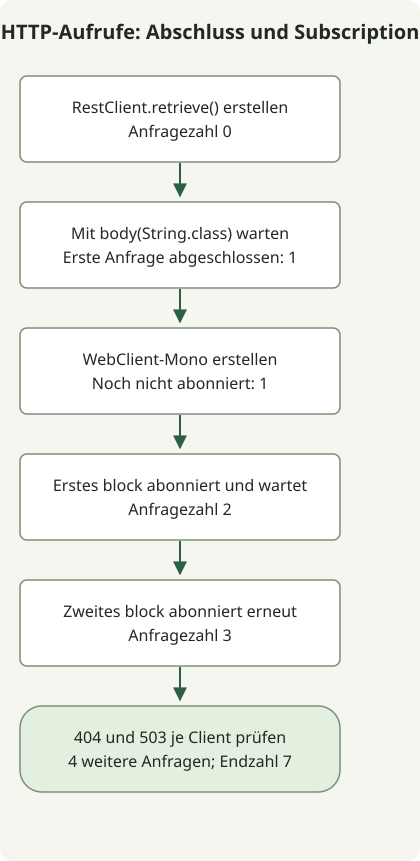

**Beginnen Sie mit RestClient, wenn synchroner Dienstcode vor dem Fortfahren eine HTTP-Antwort benötigt. Ziehen Sie WebClient für reaktive Verknüpfung oder Streaming in Betracht.** Beide bieten Fluent-APIs, doch [RestClient ist synchron und WebClient ein nicht blockierender, reaktiver Client](https://docs.spring.io/spring-framework/reference/integration/rest-clients.html). Passen Sie den Client an das Ausführungsmodell der Anwendung an statt an ihre Anfragezahl.


RestClient wurde in Spring Framework 6.1 eingeführt; WebClient ist seit 5.0 verfügbar. Prüfen Sie zuerst, ob Ihre Framework-Version den gewählten Client unterstützt. Folgen Sie beim Upgrade eines Boot-Projekts einer kompatiblen, von Boot verwalteten Kombination. Das folgende ausführbare Beispiel legt Framework 7.0.10 fest.

## Welcher Client passt zu welcher Anforderung?

| Kriterium | RestClient | WebClient |
| --- | --- | --- |
| Ergebnis | Eine terminale Operation wie die Body-Extraktion wartet auf die Antwort und gibt einen Wert zurück | Mono oder Flux repräsentiert das Ergebnis; die Subscription löst die Anfrage aus |
| Naheliegender Einsatz | Sequenzieller, synchroner Code in Spring MVC oder Batch-Aufträgen | WebFlux, reaktive Verknüpfung und Streaming wie SSE |
| Fehlerweitergabe | Standardbehandlung von retrieve wirft RestClientResponseException für 4xx und 5xx | Standardbehandlung von retrieve gibt für 4xx und 5xx einen WebClientResponseException-Fehler aus |
| Zusätzlicher Aufwand | Leichter über einen herkömmlichen Aufrufstapel nachzuvollziehen | Erfordert Verständnis von Operatoren, Subscription, Abbruch und Kontextweitergabe |
| Parallelitätskontrolle | Executors oder Parallelität virtueller Threads separat entwerfen | Parallelität der Verknüpfung, etwa flatMap, sowie Verbindungs- und Wartebudgets separat begrenzen |

Diese Tabelle geht von gewöhnlichen API-Aufrufen aus, die eine Antwort im Speicher zusammenführen. RestClient kann über Antwortbehandlung auf niedriger Ebene auch Bytestreams lesen, doch für reaktive Elementströme und Nachfragesteuerung ist WebClient die naheliegende Wahl. Die Verwendung von WebClient verlangt keine Umstellung des Servers auf WebFlux: Auch Spring MVC kann reaktive Rückgabetypen verwenden. [Springs HTTP-Client-Leitfaden](https://spring.io/blog/2025/09/30/the-state-of-http-clients-in-spring/) unterscheidet ebenso zwischen typischen synchronen Aufrufen und reaktiven oder Streaming-Anforderungen.

Ein synchroner Dienst mit virtuellen Threads kann sequenziellen RestClient-Code beibehalten. Virtuelle Threads machen dessen API nicht nicht blockierend und erhöhen weder nachgelagerte Kapazität noch Verbindungsgrenzen. Betrachten Sie den [Geltungsbereich virtueller Threads](/en/posts/2026-10-31-virtual-threads-jdk21-jdk25/) gemeinsam mit [Kapazitätsgrenzen von Abhängigkeiten](/en/posts/2026-10-31-jdk-10k-rps-architecture/).

## Ausführungszeitpunkt mit denselben HTTP-Antworten vergleichen



Das Diagramm zeigt die zentralen Prüfungen der main-Methode; Aufbau des lokalen Servers, Client-Konfiguration und Bereinigung sind ausgelassen. **RestClient sendet nicht schon beim Aufruf von retrieve() eine Anfrage.** Hier führt body(String.class) die Anfrage aus und wartet auf das Ergebnis. WebClient führt sein standardmäßiges Anfrage-Mono bei der Subscription aus. Zweimaliges Abonnieren dieses Mono ohne Cache- oder Sharing-Operatoren sendet zwei Anfragen.

Dieses eigenständige Konsolenbeispiel wurde mit Spring Framework 7.0.10, Reactor Core 3.8.8, JDK 17 und Gradle 8.4 ausgeführt. Es ist keine Spring-Boot-Anwendung. Beide Clients verwenden ausdrücklich JDK HttpClient, um Unterschiede bei der Standard-Connector-Auswahl zu beseitigen. Bevorzugen Sie in einem Boot-Projekt die von dieser Boot-Version verwalteten Abhängigkeiten, statt sie mit dieser BOM zu überschreiben.

### `settings.gradle`

```groovy
rootProject.name = 'http-client-comparison'
```

### `build.gradle`

```groovy
plugins { id 'application' }
repositories { mavenCentral() }
dependencies {
    implementation platform('org.springframework:spring-framework-bom:7.0.10')
    implementation 'org.springframework:spring-webflux'
}
java {
    sourceCompatibility = JavaVersion.VERSION_17
    targetCompatibility = JavaVersion.VERSION_17
}
application { mainClass = 'ClientComparison' }
```

### `src/main/java/ClientComparison.java`

```java
import com.sun.net.httpserver.HttpServer;
import java.net.InetSocketAddress;
import java.net.http.HttpClient;
import java.nio.charset.StandardCharsets;
import java.time.Duration;
import java.util.concurrent.atomic.AtomicInteger;
import org.springframework.http.client.JdkClientHttpRequestFactory;
import org.springframework.http.client.reactive.JdkClientHttpConnector;
import org.springframework.web.client.RestClient;
import org.springframework.web.client.RestClientResponseException;
import org.springframework.web.reactive.function.client.WebClient;
import org.springframework.web.reactive.function.client.WebClientResponseException;
import reactor.core.publisher.Mono;

public class ClientComparison {
    static void check(boolean condition) {
        if (!condition) throw new AssertionError("HTTP contract failed");
    }
    public static void main(String[] args) throws Exception {
        var requests = new AtomicInteger();
        var server = HttpServer.create(new InetSocketAddress("127.0.0.1", 0), 0);
        server.createContext("/", exchange -> {
            requests.incrementAndGet();
            String path = exchange.getRequestURI().getPath();
            int status = path.equals("/missing") ? 404 : path.equals("/unavailable") ? 503 : 200;
            byte[] body = (status == 200 ? "hello" : "error").getBytes(StandardCharsets.UTF_8);
            exchange.getResponseHeaders().set("Content-Type", "text/plain;charset=UTF-8");
            exchange.sendResponseHeaders(status, body.length);
            try (var output = exchange.getResponseBody()) { output.write(body); }
        });
        server.start();
        try {
            String base = "http://127.0.0.1:" + server.getAddress().getPort();
            var jdk = HttpClient.newBuilder().connectTimeout(Duration.ofSeconds(2)).build();
            var factory = new JdkClientHttpRequestFactory(jdk);
            factory.setReadTimeout(Duration.ofSeconds(2));
            var connector = new JdkClientHttpConnector(jdk);
            connector.setReadTimeout(Duration.ofSeconds(2));
            var rest = RestClient.builder().baseUrl(base).requestFactory(factory).build();
            var web = WebClient.builder().baseUrl(base).clientConnector(connector).build();

            var response = rest.get().uri("/hello").retrieve();
            check(requests.get() == 0);
            System.out.println("before-rest-terminal=" + requests.get());
            String sync = response.body(String.class);
            check("hello".equals(sync) && requests.get() == 1);
            System.out.println("rest=" + sync);

            Mono<String> pending = web.get().uri("/hello").retrieve().bodyToMono(String.class);
            check(requests.get() == 1);
            System.out.println("before-subscribe=" + requests.get());
            String first = pending.block(Duration.ofSeconds(5));
            check("hello".equals(first) && requests.get() == 2);
            System.out.println("web=" + first);
            System.out.println("after-first-subscribe=" + requests.get());
            String second = pending.block(Duration.ofSeconds(5));
            check("hello".equals(second) && requests.get() == 3);
            System.out.println("web-again=" + second);
            System.out.println("after-second-subscribe=" + requests.get());

            for (int status : new int[]{404, 503}) {
                String path = status == 404 ? "/missing" : "/unavailable";
                try {
                    rest.get().uri(path).retrieve().body(String.class);
                    throw new AssertionError("RestClient should fail");
                } catch (RestClientResponseException error) {
                    check(error.getStatusCode().value() == status);
                    System.out.println("rest-" + status + "=" + error.getStatusCode().value());
                }
                try {
                    web.get().uri(path).retrieve().bodyToMono(String.class).block(Duration.ofSeconds(5));
                    throw new AssertionError("WebClient should fail");
                } catch (WebClientResponseException error) {
                    check(error.getStatusCode().value() == status);
                    System.out.println("web-" + status + "=" + error.getStatusCode().value());
                }
            }
            check(requests.get() == 7);
            System.out.println("requests=" + requests.get());
        } finally { server.stop(0); }
    }
}
```

### Ausführen und prüfen

```sh
gradle --no-daemon --console=plain -q clean run
```

Der erste Download der Abhängigkeiten benötigt Netzwerkzugriff. HTTP-Anfragen zur Laufzeit gehen ausschließlich an einen 127.0.0.1-Server auf einem temporären Port. Das Folgende ist die beobachtete Standardausgabe der Anwendung in der angegebenen Umgebung; Gradle oder Logging-Implementierungen können separate Diagnosen ausgeben.

```text
before-rest-terminal=0
rest=hello
before-subscribe=1
web=hello
after-first-subscribe=2
web-again=hello
after-second-subscribe=3
rest-404=404
web-404=404
rest-503=503
web-503=503
requests=7
```

Der Wechsel von 0 auf 1 zeigt, dass die terminale RestClient-Operation die erste Anfrage abgeschlossen hat. Direkt nach dem Erstellen des Mono bleibt die Zahl bei 1. Jedes block abonniert und erhöht sie auf 2 und dann 3. Vier anschließende Anfragen prüfen die Behandlung von 404 und 503; insgesamt sind es 7. Diese Zählungen prüfen Ausführungs- und Fehlerverträge; sie vergleichen weder Durchsatz noch Latenz oder Event-Loop-Leistung.

## Macht block das Verhalten beider Clients gleich?

block zu WebClient hinzuzufügen lässt **den Aufrufer auf das Ergebnis warten**. Es macht die zugrunde liegende Transportimplementierung nicht identisch mit der von RestClient. Geben Sie, wie in der [Dokumentation zur synchronen Nutzung](https://docs.spring.io/spring-framework/reference/web/webflux-webclient/client-synchronous.html) beschrieben, Mono oder Flux aus einem reaktiven Controller zurück und lassen Sie das Framework abonnieren. Die obigen block-Aufrufe bleiben auf eine Konsolen-main zur Verhaltensbeobachtung begrenzt. RestClient aufzurufen oder mit block auf einem Event-Loop zu warten kann dessen Verarbeitungsthread belegen oder eine Ausnahme auslösen, die Blockieren auf einem nicht blockierenden Thread verbietet.

Wenn eine Anwendung bereits WebClient-Filter, Authentifizierung und Instrumentierung betreibt, erzwingen synchrone Aufrufe allein keinen sofortigen Austausch. Vergleichen Sie für einen neuen synchronen Aufruf die Kosten zusätzlicher reaktiver Abhängigkeiten und Subscription-Behandlung mit denen des Beibehaltens vorhandener Konfiguration. Vermeiden Sie unbegrenzte Subscriptions beim Kombinieren mehrerer entfernter Aufrufe. [Reaktive Nachfragesteuerung in WebFlux](https://docs.spring.io/spring-framework/reference/web/webflux/new-framework.html) koordiniert Produktions- und Verbrauchsraten; sie setzt nicht automatisch die RPS- oder Verbindungsgrenzen eines nachgelagerten Dienstes durch.

## Was sollten Sie vor dem Produktivbetrieb prüfen?

Beide Clients benötigen Budgets für Verbindungsaufbau, Antwortlesen und den gesamten Aufruf sowie eine Fehlerstatusregel. Die Verbindungsgrenze von 2 Sekunden, Lesegrenzen von 2 Sekunden und block-Wartezeit von 5 Sekunden im Beispiel sind Reproduktionseinstellungen, keine gleichbedeutenden Zeitlimit-Semantiken oder empfohlenen Produktivwerte. Lesen Sie die Dokumentation zu [Request-Factory](https://docs.spring.io/spring-framework/docs/7.0.10/javadoc-api/org/springframework/http/client/JdkClientHttpRequestFactory.html) und [reaktivem Connector](https://docs.spring.io/spring-framework/docs/7.0.10/javadoc-api/org/springframework/http/client/reactive/JdkClientHttpConnector.html) zum Geltungsbereich jedes Lesezeitlimits. Diese schnellen lokalen Antworten validieren weder Zeitlimits noch TLS oder Abbruchweitergabe.

Das Beispiel prüft die standardmäßige retrieve-Behandlung von 4xx- und 5xx-Antworten für beide Clients. Verwenden Sie onStatus für explizite Statusregeln. Setzen Sie nicht voraus, dass exchange-APIs niedriger Ebene die Standardstatusbehandlung von retrieve anwenden. Die Beispiele zur [WebClient-Antwortbehandlung](/en/posts/2023-09-19-springboot-test-webclient/) sowie zu [Zeitlimits und begrenzten Wiederholungen](/en/posts/2026-10-30-webclient-timeout-retry/) liefern weiterführende Verträge. Begrenzen Sie Wiederholungen durch Idempotenz, Versuchszahl und Gesamtzeitbudget; testen Sie leere Bodies, große Antworten und Verbindungsfehler separat.

Bestehender RestTemplate-Code ist eine separate Migrationsfrage. Spring Framework 7.0 empfiehlt RestClient und kennzeichnet RestTemplate als veraltet; WebClient ist nicht veraltet. Validieren Sie nach der Client-Wahl Authentifizierung, Instrumentierung und Verbindungseinstellungen anhand des tatsächlichen Anfragemixes.
