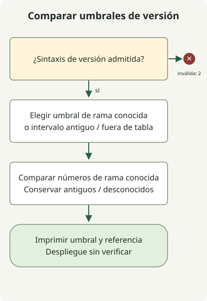

Corregir GitLab2Shell implica **actualizar GitLab CE/EE a una versión que corrija CVE-2026-110264 y verificar su adopción en el despliegue**. El [aviso de GitLab del 21 de octubre](https://docs.gitlab.com/releases/patches/patch-release-gitlab-19-5-1-released/) describe la ejecución remota de código sin autenticación en determinadas condiciones mediante un desbordamiento de entero durante la compilación de expresiones regulares. Actualizar solo GitLab Shell o Runner no completa la corrección del servidor CE/EE.

## Relacionar primero el CVE con la versión del producto

Este artículo trata **CVE-2026-110264**, del aviso oficial de GitLab, con una puntuación de 10.0 en CVSS v3.1. Distínguelo de otros CVE de GitLab publicados por las mismas fechas y de componentes Shell con nombres parecidos. El [registro del CVE elaborado por GitLab](https://cveawg.mitre.org/api/cve/CVE-2026-110264) recoge los mismos intervalos afectados y umbrales de corrección.

| Rama de GitLab CE/EE | Primera versión que corrige este CVE |
| --- | --- |
| 18.11 | 18.11.13 |
| 19.0 | 19.0.10 |
| 19.1 | 19.1.9 |
| 19.2 | 19.2.9 |
| 19.3 | 19.3.6 |
| 19.4 | 19.4.3 |
| 19.5 | 19.5.1 |

El aviso identifica como afectadas las versiones desde 7.0 anteriores a 18.11.13 y las de cada rama enumerada anteriores a su primera versión corregida. Esta tabla, comprobada el 30 de octubre de 2026, ofrece **umbrales de la primera corrección**, no una lista fija de las últimas versiones que deben instalarse. GitLab.com y GitLab Dedicated tienen información independiente sobre la adopción en el aviso; no apliques indiscriminadamente las instrucciones de actualización de Self-Managed a esos servicios.

## Comparar sin conexión una cadena de versión declarada



El diagrama sigue el código de comparación que aparece a continuación. Valida la entrada antes de comparar las ramas registradas. Las ramas antiguas afectadas requieren una ruta de actualización; las ramas fuera de la tabla quedan como desconocidas. Ningún resultado autentica el estado de un servidor ni la procedencia del parche.

Con Python 3.11 o posterior, guarda este archivo en un directorio nuevo. Ayuda a comparar numéricamente las versiones oficiales originales de CE/EE sin solicitudes de red, descubrimiento de servicios ni explotación. Acepta formas como `19.5.1`, `19.5.1-ee` y `19.5.1-ee.0`; no intenta adivinar formatos de versiones preliminares, nightly o personalizados por el proveedor.

### `release-threshold.py`

```python
import re
import sys

FIRST_FIX = {
    (18, 11): 13,
    (19, 0): 10,
    (19, 1): 9,
    (19, 2): 9,
    (19, 3): 6,
    (19, 4): 3,
    (19, 5): 1,
}
NUMBER = r"(0|[1-9][0-9]{0,2})"
VERSION = rf"{NUMBER}\.{NUMBER}\.{NUMBER}(?:-(?:ce|ee)(?:\.[0-9]{{1,3}})?)?"


def main(argv):
    match = re.fullmatch(VERSION, argv[1]) if len(argv) == 2 else None
    if match is None:
        print("usage: release-threshold.py VERSION (stable CE/EE release format)", file=sys.stderr)
        return 2
    major, minor, patch = map(int, match.groups())
    branch = (major, minor)
    if branch in FIRST_FIX:
        baseline = f"{major}.{minor}.{FIRST_FIX[branch]}"
        state = "met" if patch >= FIRST_FIX[branch] else "below"
        status = 0 if state == "met" else 1
    elif (7, 0) <= branch < (18, 11):
        baseline, state, status = "upgrade-path-required", "below", 1
    else:
        baseline, state, status = "not-covered", "outside-table", 2
    print(f"release-threshold={state}")
    print(f"baseline={baseline}")
    print("deployment-and-release-provenance=not-verified")
    return status


if __name__ == "__main__":
    raise SystemExit(main(sys.argv))
```

```sh
python3 release-threshold.py 19.5.1-ee.0
```

La ejecución local devolvió esta salida y el estado de salida 0.

```text
release-threshold=met
baseline=19.5.1
deployment-and-release-provenance=not-verified
```

El estado 0 solo significa que **los números proporcionados cumplen el umbral de corrección publicado para este CVE**. El estado 1 significa que están por debajo del umbral publicado; el estado 2 significa que el formato no está admitido o que la rama está fuera de la tabla. No comprueba que exista la versión, que el paquete sea oficial ni que algún nodo lo ejecute. Las correcciones adaptadas a versiones anteriores y las compilaciones personalizadas requieren pruebas independientes del parche del proveedor.

## Vincular las pruebas de instalación con la adopción en ejecución

La [documentación oficial de mantenimiento](https://docs.gitlab.com/administration/raketasks/maintenance/) describe cómo recopilar información de GitLab, Ruby y los componentes con `sudo gitlab-rake gitlab:env:info` para los paquetes Linux o `bundle exec rake gitlab:env:info RAILS_ENV=production` para las instalaciones desde código fuente. En despliegues con varios nodos, ejecútalo en los nodos que alojan Rails. La salida puede incluir rutas y direcciones internas, por lo que debe conservarse en registros operativos restringidos.

Aquí no se ejecutaron estos comandos contra un servidor de producción. Durante una corrección real, vincula la información con las revisiones completas de los paquetes, los resúmenes de las imágenes desplegadas y cada nodo web o de segundo plano, y verifica después de actualizar la adopción en todos los objetivos. Una cabecera HTTP o la salida del comando de otro nodo no constituyen pruebas para todo el despliegue.

## Elegir un parche actual y completar las migraciones

Sigue la [ruta oficial de actualización](https://docs.gitlab.com/update/upgrade_paths/) desde la versión instalada y deja terminar las migraciones en segundo plano en cada parada obligatoria antes de continuar. Una instalación antigua puede no admitir un salto directo a la versión más alta de la tabla. Planifica conjuntamente las copias de seguridad y la recuperación, la compatibilidad de extensiones, la interrupción del servicio y los procedimientos para varios nodos.

Distingue las primeras correcciones de los parches actuales. El [aviso de parches del 29 de octubre](https://docs.gitlab.com/releases/patches/patch-release-gitlab-19-5-3-released/) enumera versiones posteriores, entre ellas 19.5.3 y 19.4.5, junto con algunas migraciones de base de datos, e indica explícitamente que se omitieron 19.5.2 y 19.4.4. El script no consulta un catálogo de versiones, por lo que realiza la comparación numérica incluso con esas cadenas. Selecciona siempre el candidato real de instalación a partir de los registros oficiales de distribución.

Después de actualizar, comprueba por separado las versiones en ejecución, la finalización de las migraciones, el inicio de sesión normal, el acceso a repositorios y el procesamiento de tareas. Las detecciones del aviso sobre fallos de procesos Onigmo y ráfagas de errores al renderizar Org-mode son pistas de investigación; ninguna por sí sola demuestra ni descarta una intrusión. Conserva los registros y las pruebas de procesos y despliegue, e investiga por separado si se sospecha una intrusión.

La corrección de certificados Java del mismo período es un problema independiente. Para los servicios de compilación e integración que utilizan un JDK, consulta también [eMudhra e inspección del almacén de confianza de la JVM](/en/posts/2026-10-30-jdk-emudhra-truststore/).
