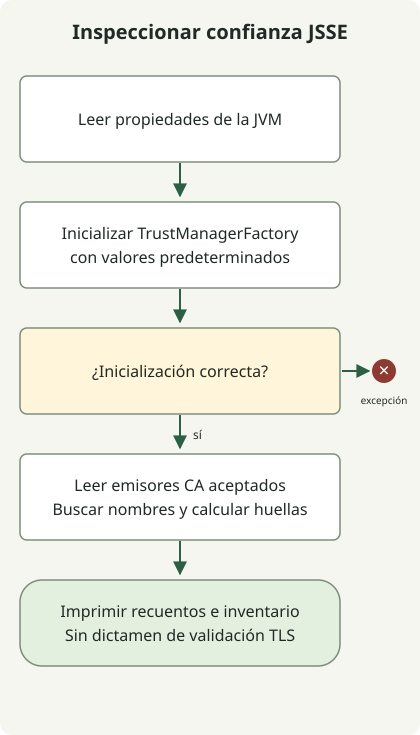

La corrección de eMudhra en el JDK requiere **comprobar tanto el JDK que ejecuta la aplicación como el almacén de confianza que utiliza realmente**. El [aviso de Oracle](https://ops.java/emudhra/) y el [aviso de Temurin](https://adoptium.net/news/2026/10/temurin-october-2026-emudhra/) describen distribuciones actualizadas y la retirada de confianza en las CA pertinentes, pero sus implementaciones difieren. La protección del navegador o una actualización del JDK del host no establecen la adopción en contenedores ni en JVM independientes.

## ¿Importar un certificado de servidor caducado lo resolverá?

Este incidente difiere de la caducidad habitual de un certificado de servidor. Las claves comprometidas de CA intermedias de eMudhra crearon vías por las que se podía confiar en certificados fraudulentos, lo que exige eliminar la confianza pertinente o aplicar la protección recomendada por el proveedor. La [alerta de seguridad de Oracle para CVE-2026-91403](https://www.oracle.com/security-alerts/alert-cve-2026-91403.html) detalla los productos afectados y las instrucciones de aplicación de parches. No apliques indiscriminadamente la tabla de productos y versiones de Oracle a otra distribución.

`PKIX path building failed` no es un diagnóstico exclusivo de este incidente. Distingue una cadena incompleta del servidor, un almacén de confianza incorrecto, las CA privadas y los cambios de confianza del proveedor. Desactivar la validación o importar una CA no verificada solo para silenciar un error puede debilitar la protección.

## Leer por separado el aviso de cada proveedor

Lo siguiente refleja los avisos comprobados el 30 de octubre de 2026. Al desplegar, vuelve a comprobar el producto, el sistema operativo, la compilación completa y los avisos posteriores actuales.

| Proveedor | Diferencia que debe comprobarse |
| --- | --- |
| [Oracle JDK](https://ops.java/emudhra/) | Actualizaciones que eliminan las raíces pertinentes y una mitigación provisional independiente cuando se retrasan las actualizaciones |
| [Eclipse Temurin](https://adoptium.net/news/2026/10/temurin-october-2026-emudhra/) | Utiliza datos de CA de Mozilla; retira la confianza en `emSign ECC Root CA - G3` y `AAA Certificate Services`. Las compilaciones corregidas incluyen 21.0.13+9 y 17.0.21+9 |
| [Ubuntu OpenJDK](https://ubuntu.com/blog/emudhra-ca-compromise-fixes-available) | Integración con el almacén de CA del sistema; un defecto actual de sincronización requiere una acción manual adicional sobre el almacén de Java después de actualizar `ca-certificates` |

El aviso de Temurin explica que la presencia de `emSign Root CA - G1` por sí sola no demuestra que la corrección haya fallado. Tratar la lista genérica de raíces de `CheckCerts` como criterio universal de aprobación puede clasificar erróneamente las distribuciones. Los alias, nombres y recuentos de raíces por sí solos no certifican la protección.

## Leer la información de confianza JSSE predeterminada de la JVM actual



El diagrama sigue el recopilador de solo lectura que aparece a continuación. Inicializa la `TrustManagerFactory` predeterminada y busca nombres de CA. Una coincidencia de nombre es un punto de partida para comparar huellas con las indicaciones del proveedor, no un dictamen de vulnerabilidad o seguridad. Si falla la inicialización del gestor de confianza predeterminado, termina con una excepción.

Guarda este archivo en un directorio nuevo con JDK 17 o posterior. Solo utiliza las API públicas de [TrustManagerFactory](https://docs.oracle.com/en/java/javase/21/docs/api/java.base/javax/net/ssl/TrustManagerFactory.html) y [X509TrustManager](https://docs.oracle.com/en/java/javase/21/docs/api/java.base/javax/net/ssl/X509TrustManager.html). No modifica archivos, envía solicitudes de red, añade o elimina certificados ni omite la validación TLS.

### `TrustInventory.java`

```java
import java.security.KeyStore;
import java.security.MessageDigest;
import java.security.cert.X509Certificate;
import java.util.HexFormat;
import java.util.Locale;
import javax.net.ssl.TrustManager;
import javax.net.ssl.TrustManagerFactory;
import javax.net.ssl.X509TrustManager;

public class TrustInventory {
    public static void main(String[] args) throws Exception {
        System.out.println("java.version=" + System.getProperty("java.version"));
        System.out.println("java.vendor=" + System.getProperty("java.vendor"));
        System.out.println("java.home=" + System.getProperty("java.home"));
        System.out.println("configuredTrustStore=" +
            System.getProperty("javax.net.ssl.trustStore", "<default JSSE lookup>"));
        TrustManagerFactory factory = TrustManagerFactory.getInstance(
            TrustManagerFactory.getDefaultAlgorithm());
        factory.init((KeyStore) null);
        System.out.println("trustManagerProvider=" + factory.getProvider().getName());
        MessageDigest sha256 = MessageDigest.getInstance("SHA-256");
        int issuers = 0;
        int matches = 0;
        for (TrustManager manager : factory.getTrustManagers()) {
            if (!(manager instanceof X509TrustManager x509)) continue;
            for (X509Certificate cert : x509.getAcceptedIssuers()) {
                issuers++;
                String subject = cert.getSubjectX500Principal().getName();
                String lower = subject.toLowerCase(Locale.ROOT);
                if (lower.contains("emsign") || lower.contains("aaa certificate services")) {
                    String fingerprint = HexFormat.of().withUpperCase()
                        .formatHex(sha256.digest(cert.getEncoded()));
                    System.out.println("candidate=" + subject + "\tSHA256=" + fingerprint);
                    matches++;
                }
            }
        }
        System.out.println("acceptedIssuers=" + issuers);
        System.out.println("nameMatches=" + matches);
        System.out.println("assessment=inventory-only; no validation verdict");
    }
}
```

```sh
javac --release 17 TrustInventory.java
java TrustInventory
```

Las comprobaciones locales con JDK compilaron el programa y confirmaron la salida del inventario predeterminado. También se comprobaron, mediante almacenes de CA de prueba generados por separado, los nombres candidatos y las huellas SHA-256, los almacenes con nombres no relacionados y un almacén vacío. Estas CA de prueba no son certificados reales de eMudhra; una ejecución correcta no certifica la protección de una JVM de producción.

El `java.home` indicado pertenece a **la JVM que acaba de iniciarse**. Que `configuredTrustStore` tenga el valor `<default JSSE lookup>` significa que no se especificó la propiedad del sistema, no que no se encontrara ningún almacén. La salida no incluye contraseñas de almacenes de confianza.

## La búsqueda predeterminada puede diferir de la configuración de la aplicación

La [referencia de SunJSSE](https://docs.oracle.com/en/java/javase/25/security/java-secure-socket-extension-jsse-reference-guide.html) distingue un `javax.net.ssl.trustStore` explícito de la búsqueda predeterminada de `jssecacerts`/`cacerts`. Este programa lee esa vía de inicialización predeterminada en una JVM nueva. No descubre automáticamente instancias de `SSLContext`/`TrustManager` creadas por la aplicación, configuraciones de frameworks ni bibliotecas TLS nativas.

Cero candidatos no es un dictamen de seguridad. Según el proveedor y la compilación, una ruta de almacén inexistente puede hacer que se utilice otro almacén, producir un inventario vacío o provocar un fallo de inicialización. Las comprobaciones locales con JDK observaron el uso alternativo del almacén predeterminado y un fallo por discrepancia de contraseña. También pueden pasarse por alto otros nombres o vías de validación. A la inversa, que aparezca un nombre no establece que la validación TLS acepte necesariamente su cadena. Este código no ejecuta comprobaciones de listas de bloqueo, revocación ni rutas de certificación.

## Comprobar las conexiones normales y el rechazo después de actualizar

1. Identifica el proveedor del JDK del servicio real, la compilación completa, el ejecutable, las opciones de inicio de la JVM y el resumen de la imagen, incluidos los almacenes de confianza personalizados y los ajustes TLS específicos de la aplicación.
2. Despliega la compilación corregida del proveedor. Si mantienes un almacén independiente, compara su contenido con las indicaciones del proveedor. Antes de cualquier eliminación manual, establece copias de seguridad, huellas e impacto en las conexiones. El defecto actual de sincronización de Ubuntu requiere el [procedimiento adicional de actualización del almacén de CA raíz de Java](https://ubuntu.com/blog/emudhra-ca-compromise-fixes-available#updating-the-java-root-ca-store) después de actualizar `ca-certificates`. Conserva las CA aprovisionadas localmente y prepárate para volver a añadirlas antes de regenerar.
3. Sustituye o reinicia cada JVM y réplica. Cambiar el `cacerts` de una instalación no actualiza automáticamente otro JDK ni un proceso ya en ejecución.
4. Verifica tanto el funcionamiento correcto del HTTPS habitual como el rechazo de las cadenas afectadas especificadas por el proveedor. Un resultado TLS no sustituye la validación de JAR firmados.

Este artículo no se conectó a hosts externos de prueba ni verificó el rechazo de cadenas afectadas reales. No registres esas comprobaciones como completadas basándote en la salida del recopilador. Sigue las [indicaciones de verificación específicas del proveedor](https://adoptium.net/news/2026/10/temurin-october-2026-emudhra/) junto con un plan de sustitución de certificados en producción.

El RCE por expresiones regulares de GitLab es independiente de este problema de certificados. Consulta la [guía de respuesta a CVE-2026-110264](/en/posts/2026-10-30-gitlab2shell-cve-2026-110264/) para las indicaciones de actualización de GitLab.
