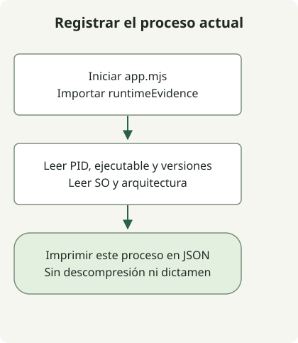

Corregir Node2Shell implica sustituir Node.js por un entorno de ejecución corregido y verificar que lo adopte cada proceso que descomprime datos Brotli no confiables. El [aviso de seguridad de Node.js](https://nodejs.org/en/blog/vulnerability/october-2026-security-releases) identifica **CVE-2026-111497** como una escritura fuera de límites en su decodificador Brotli incorporado. Actualizar los paquetes npm y sustituir el entorno de ejecución son operaciones independientes.

## ¿Toda utilización de Brotli tiene la misma exposición?

La vía relevante **descomprime** una entrada comprimida. Los datos Brotli malformados proporcionados por un atacante y procesados por `node:zlib` pueden corromper la memoria del proceso y causar fallos, divulgación de memoria o ejecución remota de código. Comprimir respuestas salientes con Brotli o habilitar HTTP/2 por sí solo no establece esa vía. El proyecto Node.js clasifica este problema como de gravedad alta.

Rastrea la descompresión automática de respuestas HTTP externas, subidas, archivos y tareas de colas, además de los cuerpos de las solicitudes. Por ejemplo, la [documentación de body-parser](https://expressjs.com/en/resources/middleware/body-parser/) describe la descompresión automática de Brotli. Comprueba la versión y las opciones del middleware instalado; no encontrar `brotliDecompress` en el código de la aplicación no demuestra que no exista exposición. Una tarea en segundo plano puede descomprimir datos externos sin un puerto de escucha accesible desde Internet.

## ¿Qué versiones de Node.js contienen la corrección?

La siguiente tabla, comprobada el 30 de octubre de 2026, enumera las versiones oficiales de seguridad que contienen la corrección de este CVE. No fija la última versión recomendada. Al desplegar, consulta la versión con soporte del mismo proveedor y los avisos posteriores.

| Rama de Node.js | Versión oficial corregida |
| --- | --- |
| 22.x | [22.23.4](https://nodejs.org/en/blog/release/v22.23.4) |
| 24.x | [24.22.1](https://nodejs.org/en/blog/release/v24.22.1) |
| 26.x | [26.12.1](https://nodejs.org/en/blog/release/v26.12.1) |

Para compilaciones de distribuciones, productos integrados o compilaciones personalizadas, utiliza la revisión completa del paquete del proveedor y las pruebas de la corrección. No apliques estos umbrales numéricos a otra rama principal. El aviso de Node.js también considera afectadas las ramas que han llegado al final de su vida útil; su ausencia en la tabla no demuestra que sean seguras.

En particular, `process.versions.brotli` por sí solo es insuficiente. El [código de la versión de Brotli en Node.js 24.22.1 corregido](https://github.com/nodejs/node/blob/v24.22.1/deps/brotli/c/common/version.h) sigue declarando `1.2.0`. El [registro de la versión](https://nodejs.org/en/blog/release/v24.22.1) enumera explícitamente la corrección incorporada mediante cherry-pick. Establece la procedencia del artefacto corregido del entorno de ejecución en lugar de confiar en la etiqueta de la biblioteca.

## Registrar pruebas desde el propio proceso



El diagrama sigue el inicio de la aplicación de ejemplo que aparece a continuación. Lee información dentro del mismo proceso e imprime JSON sin comparar versiones, descubrir servicios ni decidir si está corregido. La salida de una nueva invocación del CLI no sustituye las pruebas de un servicio existente.

Con Node.js 22 o posterior, guarda estos dos archivos en un directorio nuevo. Leen propiedades documentadas en la [referencia de process](https://nodejs.org/docs/latest-v24.x/api/process.html) sin solicitudes de red, descompresión ni salida de variables de entorno.

### `runtime-evidence.mjs`

```javascript
export function runtimeEvidence() {
  return {
    scope: 'this-process-only',
    pid: process.pid,
    executable: process.execPath,
    node: process.version,
    brotliLabel: process.versions.brotli ?? null,
    platform: process.platform,
    arch: process.arch,
  };
}
```

### `app.mjs`

```javascript
import {runtimeEvidence} from './runtime-evidence.mjs';

console.log(JSON.stringify(runtimeEvidence(), null, 2));
```

```sh
node app.mjs
```

La comprobación local utilizó un contenedor oficial de Node.js 24.22.1 y devolvió JSON con `node` igual a `v24.22.1` y `brotliLabel` igual a `1.2.0`. El PID, la ruta, el sistema operativo y la arquitectura varían según el entorno. Esto demuestra que una compilación corregida puede conservar la etiqueta antigua de Brotli; no prueba una explotación ni un despliegue de producción.

Para un servicio real, incorpora un registro de inicio equivalente mediante su proceso de despliegue y restringe el acceso a esos registros operativos. Vincula el registro con el gestor del servicio, el proceso y el resumen de la imagen. Las rutas y los PID no deben aparecer en respuestas HTTP públicas. Iniciar un proceso de diagnóstico independiente no verifica la sustitución de los procesos existentes.

## ¿Qué queda por hacer después de instalar el paquete?

1. Registra el ejecutable Node.js de cada servicio, su proveedor, la versión completa del paquete o el resumen de la imagen, los procesos, los trabajadores y las réplicas. El comando `node -v` del host o una etiqueta de Dockerfile por sí solos no establecen qué entorno de ejecución utiliza un contenedor en marcha.
2. Rastrea las bibliotecas que conectan las entradas con el decodificador Brotli. Mantén separado el estado de corrección del entorno de ejecución de la exposición de las entradas. No localizar una vía de descompresión dentro del alcance de la investigación no corrige un entorno de ejecución sin parchear.
3. Obtén un entorno de ejecución corregido compatible mediante un canal confiable. Reconstruye y despliega las imágenes de contenedor; sustituye también el ejecutable real que usan los gestores de procesos y las plataformas administradas. No supongas que actualizar una biblioteca Brotli del sistema sustituye una copia incorporada.
4. Verifica nuevas pruebas en ejecución para cada proceso y réplica, y comprueba después las llamadas normales a la API, el procesamiento de respuestas externas, las tareas en segundo plano y las tasas de error. Sustituir los archivos de instalación o dejar réplicas antiguas en ejecución no constituye una adopción verificada.

Si se retrasa la aplicación del parche, considera rechazar u omitir la descompresión de Brotli no confiable en la vía real de los datos. Eliminar `br` de `Accept-Encoding` por sí solo no bloquea todas las vías de entrada. Un ciclo correcto de compresión y descompresión de datos válidos o un resultado limpio de `npm audit` tampoco permiten establecer que este CVE esté corregido.

## ¿Es el mismo problema que PHP2Shell?

Son fallos distintos. Los dos CVE de PHP2Shell afectan al estado de las solicitudes del motor de PHP; Node2Shell afecta al decodificador Brotli. No obstante, el mismo CVE de Brotli puede aparecer en otros productos, por lo que debes seguir el aviso de cada producto. La [guía de respuesta a PHP2Shell](/en/posts/2026-10-30-php2shell-runtime-patching/) explica la diferencia entre la recompilación de Brotli para PHP en Windows y las correcciones del motor de PHP.

Un fallo por sí solo no demuestra una intrusión, y la ausencia de rastros no la descarta. Si se sospecha una intrusión, conserva las pruebas en una ubicación restringida e investiga o reconstruye desde una fuente confiable por separado de la aplicación del parche.
