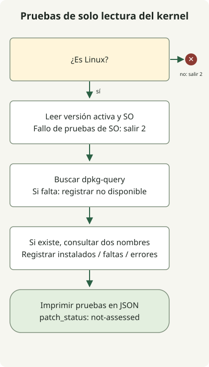

**Fragnesia (CVE-2026-46300) es una vulnerabilidad de elevación local de privilegios en el kernel de Linux.** Aplica las correcciones de la distribución y la familia de kernel adecuadas, y verifica después que estén activas en el kernel en ejecución. La [descripción oficial de Ubuntu](https://ubuntu.com/security/CVE-2026-46300) también indica la posibilidad de escapar de contenedores en las condiciones pertinentes. Ejecutar Linux no significa que todos los sistemas tengan la misma exposición.

## ¿Esto da directamente acceso root a un atacante de Internet?

Este CVE es una elevación local de privilegios. Requiere que el atacante pueda ejecutar código en el sistema y alcanzar la vía vulnerable del kernel. Distínguelo de la ejecución remota de código en una aplicación web. Los [datos oficiales KEV de CISA](https://www.cisa.gov/sites/default/files/feeds/known_exploited_vulnerabilities.json) registran el riesgo de encadenarlo con PHP2Shell CVE-2026-109618 y CVE-2026-109619. Comprueba por separado los [parches del entorno de ejecución de PHP](/en/posts/2026-10-30-php2shell-runtime-patching/) y los del kernel del host.

El [registro original del CVE](https://cveawg.mitre.org/api/cve/CVE-2026-46300) describe un marcador de fragmento de página compartida que se pierde durante la unión de búferes de socket. El procesamiento posterior de ESP puede confundir páginas compartidas con privadas y modificarlas en su ubicación. El CVE se publicó el 23 de mayo de 2026; CISA lo añadió a KEV el 28 de octubre. No es un defecto introducido por primera vez en octubre. Interpreta el plazo del 31 de octubre de KEV dentro del alcance de la directiva aplicable, en lugar de como un plazo universal de cambio para todos los servicios.

## ¿Qué kernel necesita actualizarse?

No reduzcas el alcance de la corrección a un único CVE aislado. Las [notas del equipo de seguridad de Ubuntu](https://ubuntu.com/security/CVE-2026-46300#notes) aconsejan distribuir las correcciones relacionadas junto con CVE-2026-43284. Otra corrección de la vía de transferencia de fragmentos también se sigue como [CVE-2026-43503](https://ubuntu.com/security/CVE-2026-43503). [CVE-2026-43284](https://ubuntu.com/security/CVE-2026-43284) es una entrada independiente de la familia Dirty Frag. Prefiere el paquete corregido completo del proveedor; aplicar un commit seleccionado no establece que el trabajo esté completo.

Los siguientes son umbrales seleccionados de corrección del **paquete fuente linux** de Ubuntu, comprobados el 31 de octubre de 2026. Relaciona primero el paquete binario instalado con su paquete fuente y su familia de kernel.

| Versión de Ubuntu | Umbral de corrección de linux |
| --- | --- |
| 22.04 LTS | 5.15.0-181.191 |
| 24.04 LTS | 6.8.0-124.124 |
| 26.04 LTS | 7.0.0-22.22 |

No reutilices estos umbrales para kernels AWS, Azure, HWE, OEM o de tiempo real: los nombres de los paquetes, las familias con soporte y las correcciones adaptadas por los proveedores difieren. Para RHEL, sigue el estado del producto y los RHSA enlazados desde el [boletín de Red Hat](https://access.redhat.com/security/vulnerabilities/RHSB-2026-003). El [boletín propio de AWS](https://aws.amazon.com/security/security-bulletins/2026-030-aws/) explica que Amazon Linux y Bottlerocket no están afectados debido a su configuración de espintcp. No extiendas esa afirmación a kernels personalizados arbitrarios ni a otras distribuciones que se ejecuten en EC2.

## Recopilar primero pruebas del kernel en ejecución



El diagrama sigue el recopilador siguiente. Requiere [Python 3.10 o posterior](https://docs.python.org/3/library/platform.html#platform.freedesktop_os_release). En Linux con [dpkg-query](https://manpages.debian.org/trixie/dpkg/dpkg-query.1.en.html), consulta únicamente dos nombres de paquete derivados de la versión del kernel en ejecución. No utiliza acceso de red, privilegios de administrador, carga de módulos ni cambios del sistema. **No es un detector de vulnerabilidades ni un dictamen de finalización del parche.** La ausencia de pruebas nunca se informa como seguridad.

### `kernel-evidence.py`

```python
import json
import platform
import shutil
import subprocess


def collect():
    result = {"patch_status": "not-assessed", "scope": "current-execution-context"}
    if platform.system() != "Linux":
        return {**result, "error": "linux-required"}, 2
    try:
        release = platform.release()
        distro = platform.freedesktop_os_release()
    except OSError:
        return {**result, "error": "os-evidence-unavailable"}, 2
    result.update(running_kernel=release,
                  os={key: distro.get(key) for key in ("ID", "VERSION_ID")}, queries=[])
    command = shutil.which("dpkg-query")
    if not command:
        return {**result, "package_query": "dpkg-query-unavailable"}, 0
    result["package_query"] = "dpkg-query"
    for name in ("linux-image-" + release, "linux-image-unsigned-" + release):
        row = {"package": name}
        try:
            answer = subprocess.run(
                [command, "-W", "-f=${Package}\t${Version}\t${db:Status-Status}\n", name],
                capture_output=True, text=True, timeout=5, check=False)
        except (OSError, subprocess.TimeoutExpired):
            row["state"] = "query-error"
        else:
            fields = answer.stdout.rstrip("\n").split("\t")
            if answer.returncode == 1:
                row["state"] = "not-found"
            elif answer.returncode != 0:
                row["state"] = "query-error"
            elif len(fields) != 3 or fields[0] != name or not fields[1]:
                row["state"] = "unexpected-output"
            elif fields[2] != "installed":
                row["state"] = "not-installed"
            else:
                row.update(state="installed", version=fields[1])
        result["queries"].append(row)
    return result, 0


if __name__ == "__main__":
    evidence, status = collect()
    print(json.dumps(evidence, ensure_ascii=False, indent=2, sort_keys=True))
    raise SystemExit(status)
```

```sh
python3 kernel-evidence.py
```

Un entorno distinto de Linux o la falta de pruebas del sistema operativo devuelve el código de salida 2. Incluso cuando termina la recopilación en Linux, una consulta de paquete individual puede fallar: lee package_query y cada state. El código de salida 0 no establece que la aplicación del parche haya terminado. Estas dos consultas no pueden identificar el paquete propietario en RPM ni en kernels personalizados.

La salida siguiente se **ejecutó y comprobó con entradas sintéticas**: Ubuntu 24.04, kernel en ejecución 6.8.0-124-generic, el primer paquete instalado y el segundo ausente. No son pruebas procedentes de un host Ubuntu de producción. Las comprobaciones de ejecución reproducen esta salida y las ramas de fallo de consulta; no prueban la vulnerabilidad real del kernel, la adopción del parche ni una explotación.

```text
{
  "os": {
    "ID": "ubuntu",
    "VERSION_ID": "24.04"
  },
  "package_query": "dpkg-query",
  "patch_status": "not-assessed",
  "queries": [
    {
      "package": "linux-image-6.8.0-124-generic",
      "state": "installed",
      "version": "6.8.0-124.124"
    },
    {
      "package": "linux-image-unsigned-6.8.0-124-generic",
      "state": "not-found"
    }
  ],
  "running_kernel": "6.8.0-124-generic",
  "scope": "current-execution-context"
}
```

Dentro de un contenedor, el sistema operativo y la base de datos de paquetes pueden pertenecer al contenedor, mientras que el kernel pertenece al host compartido. Recopila de nuevo mediante la vía de administración del host o de la máquina virtual. Un paquete de kernel recién instalado también puede diferir del kernel que está en ejecución. Este recopilador consulta únicamente nombres ligados a la versión actual; no enumera todos los kernels instalados. No verifica firmas de paquetes, integridad ni el estado de livepatch.

## ¿Qué debes verificar después de aplicar el parche?

1. Relaciona la distribución del activo, el kernel en ejecución y la familia de paquetes con el CVE o el aviso de seguridad del proveedor. No compares versiones de familias distintas mediante una simple comparación de cadenas.
2. Aplica paquetes corregidos mediante repositorios o imágenes con soporte y sustituye o reinicia después los nodos por etapas. [Ubuntu USN-8388-1](https://ubuntu.com/security/notices/USN-8388-1) exige reiniciar después de una actualización estándar y trata los cambios de ABI para módulos de kernel de terceros. Si dependes únicamente de livepatch, verifica por separado el soporte y su aplicación real para el CVE y el kernel en ejecución.
3. Recopila las mismas pruebas después de reiniciar, compara el kernel activo con las pruebas de corrección del proveedor y comprueba la salud del servicio, el almacenamiento y la red. Reiniciar únicamente un pod de Kubernetes no sustituye el kernel del nodo.
4. Investiga también el posible acceso inicial y la persistencia. Aplicar el parche correctamente no demuestra la ausencia de un webshell existente ni de credenciales robadas.

Si no es posible actualizar de inmediato, consulta las [indicaciones de mitigación temporal de Ubuntu](https://ubuntu.com/blog/dirty-frag-linux-vulnerability-fixes-available) y las instrucciones de tu proveedor. Las restricciones de módulos pueden entrar en conflicto con funciones como VPN/IPsec; las vías ya cargadas o integradas requieren una evaluación independiente. La ausencia en una lista de módulos no establece que el sistema no esté afectado. Reducir la exposición y restringir el código no confiable son medidas temporales, no sustitutos de la aplicación de paquetes corregidos.
