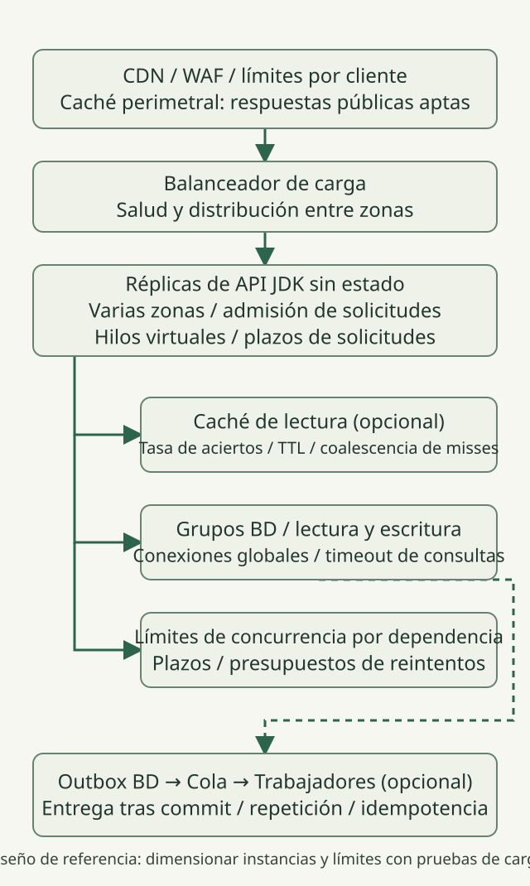
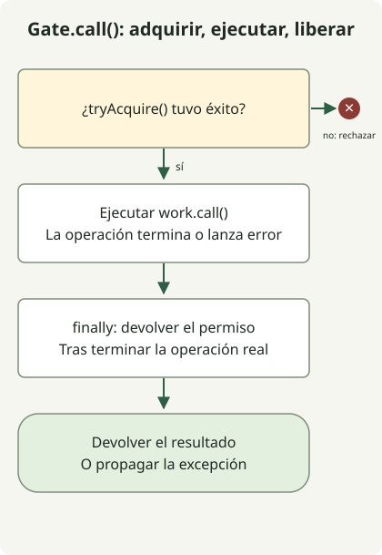

Una **API HTTP de 10000 solicitudes por segundo necesita presupuestos explícitos de capacidad de solicitudes y dependencias, y un comportamiento ante sobrecargas, antes de necesitar un JDK más nuevo**. Empieza con réplicas de API sin estado repartidas entre zonas de disponibilidad, límites de admisión de solicitudes y límites de concurrencia por dependencia. Añade cachés, colas y réplicas de lectura según los cuellos de botella medidos y los requisitos de consistencia. Esta es una guía de diseño con cálculos ilustrativos, **no un informe de una prueba de carga satisfactoria de 10k RPS**.

A fecha del 31 de octubre de 2026, la última versión GA es [JDK 27](https://openjdk.org/projects/jdk/27/). El código siguiente se comprobó en Temurin `27.0.1.0.2+1`. Separa la novedad de las funciones de la duración del soporte: la [hoja de ruta de soporte de Oracle](https://www.oracle.com/java/technologies/java-se-support-roadmap.html) enumera JDK 25 como LTS y 27 como no LTS. Consulta en su propia documentación las políticas de soporte de otros proveedores y la compatibilidad con frameworks.

## Definir el límite de 10k y los criterios de éxito

Aquí, 10k significa **solicitudes por segundo que llegan al balanceador de carga de la API**, excluidas las peticiones estáticas a la CDN. No significa conexiones simultáneas ni número de hilos virtuales. Registra por separado los RPS ofrecidos, los RPS completados con éxito de negocio, los rechazos y los fallos. Las respuestas rápidas de error por sí solas no establecen la capacidad.

Estos supuestos ilustran los cálculos. No son mediciones de un servicio real ni valores de configuración recomendados.

| Elemento | Supuesto ilustrativo |
| --- | --- |
| Objetivo ofrecido | 10000 RPS |
| Proporción lectura/escritura | 90% / 10% |
| Tasa de aciertos de caché de lectura | 80% |
| Tiempo medio de permanencia en la API en estado estable | 50ms |
| Objetivo de respuesta | p99 inferior a 200ms; tasa de fallos inferior a 0.1% |
| Uso de la base de datos | Una visita por fallo de caché de lectura o escritura; tiempo medio de ocupación de conexión de 10ms |

La [ley de Little](https://web.mit.edu/2.810/www/files/lectures/lec1-intro-2019.pdf#page=56), `L = λ × W`, se aplica a **promedios** con el mismo límite en un sistema estable. Suponiendo un rendimiento normal de 10000/s y un tiempo medio de permanencia de 0.05 segundos, resulta un promedio aproximado de 500 solicitudes en curso en el conjunto de instancias. No sustituyas el promedio por p99 de 200ms para calcular la concurrencia media ni conviertas directamente 500 en un límite estricto. Las ráfagas, las distribuciones de latencia y el margen ante fallos necesitan una validación independiente.

Las visitas a la base de datos son `9,000 × (1 − 0.8) + 1,000 = 2,800/s`; el promedio de conexiones ocupadas es `2,800 × 0.01 = 28`. **Esto no recomienda un tamaño de grupo de 28.** Varias sentencias, los bloqueos, las transacciones y un fallo de caché cambian los supuestos. Incluye también los bytes de respuesta, TLS, la replicación y los registros en el presupuesto de ancho de banda.

## Arquitectura de referencia: replicar horizontalmente un servicio pequeño



Esta es una disposición propuesta. El ejemplo Java siguiente solo implementa el principio de control de admisión, no toda la infraestructura. Un objetivo de 10k RPS por sí solo no establece la necesidad de microservicios ni particionado. Replica una aplicación modular sin estado y separa después los cuellos de botella que revelen las mediciones.

- **Capas perimetrales y balanceador de carga:** Limita las tasas de solicitudes por cliente, las conexiones, los tamaños de los cuerpos de solicitud y las conexiones lentas. Almacena en la CDN solo las respuestas públicas adecuadas; diseña por separado las claves y el alcance para datos autenticados. Utiliza comprobaciones de salud y drenaje para evitar que lleguen nuevas solicitudes a réplicas que no estén listas.
- **Réplicas de API:** Limita el trabajo en curso en el punto de entrada de las solicitudes y utiliza hilos virtuales para escribir código legible de E/S bloqueante. Los hilos virtuales no amplían la capacidad de la base de datos ni aceleran los cálculos de CPU. Como explica la [guía de JDK 27](https://docs.oracle.com/en/java/javase/27/core/virtual-threads.html), restringe por separado los recursos escasos con mecanismos como semáforos.
- **Caché y base de datos:** Una caché de lectura es opcional. Prueba la distribución de TTL, la unificación de solicitudes ante fallos de caché y el tráfico a la base de datos durante un fallo de caché. Inspecciona primero los índices, los planes de consulta y la duración de las transacciones. Utiliza réplicas de lectura solo cuando sea aceptable el retraso de replicación.
- **Llamadas externas y trabajo asíncrono:** Asigna a cada dependencia su propio presupuesto de concurrencia. Pon en cola solo el trabajo que no deba terminar antes de la respuesta. Cuando deban coordinarse las escrituras en la base de datos y la entrega de mensajes, diseña un [outbox transaccional](https://docs.aws.amazon.com/prescriptive-guidance/latest/cloud-design-patterns/transactional-outbox.html) con entrega que admita reintentos y consumidores idempotentes. Las colas también son recursos limitados: observa los mensajes pendientes, la antigüedad del mensaje más antiguo y los fallos de procesamiento.

Diseña el rechazo rápido y la protección de recursos como un comportamiento operativo normal, tal como se describe en las [indicaciones de Google SRE sobre sobrecarga](https://sre.google/sre-book/handling-overload/). Escalar solo según la CPU puede pasar por alto bloqueos de E/S; observa conjuntamente las solicitudes en curso, la tasa de rechazo, las esperas para adquirir conexiones y la saturación de dependencias.

## ¿Cuántas réplicas y conexiones de base de datos?

Con hardware, heap, límites de CPU del contenedor y combinación de solicitudes fijos, mide `q_safe`: **el rendimiento por réplica que cumple el SLO y el margen operativo acordado**. Este artículo no lo ha medido.

Si las pruebas establecen realmente `q_safe = 2,500 RPS`, cuatro réplicas cubren aritméticamente el objetivo normal. Cinco constituyen un punto de partida para mantener 10k tras fallar una réplica. Eso no garantiza capacidad ante el fallo de una zona. Seis réplicas, dos en cada una de tres zonas, dejan cuatro tras fallar una zona y, por tanto, cubren 10k sobre el papel, pero también deben probarse la redistribución del balanceador, el desequilibrio entre zonas y la conmutación por fallo de la base de datos y la caché. Mantén margen durante el período anterior a que termine el escalado automático.

No aumentes los grupos de conexiones de base de datos de forma independiente por réplica. Para cada punto de conexión de base de datos, mantén `maximum simultaneously existing API replicas × per-replica pool limit + worker connections + operational reserve` dentro de su presupuesto de conexiones disponible. Cuenta las réplicas que se solapan durante el escalado horizontal, los despliegues graduales y los períodos de gracia de terminación. La [documentación de PostgreSQL](https://www.postgresql.org/docs/18/runtime-config-connection.html) explica que aumentar `max_connections` incrementa las asignaciones de recursos, incluida la memoria compartida. Más conexiones no corrigen consultas lentas.

## Un ejemplo mínimo de admisión con hilos virtuales



El diagrama sigue `Gate.call()`. El método `main()` es una **demostración de la semántica de admisión sin servidor HTTP**, que crea dos operaciones y un rechazo. El límite de dos es para pruebas, no una configuración para 10k RPS. En un servidor real, aplica la admisión antes del trabajo costoso y limita también las conexiones, las colas del servidor y la creación de hilos virtuales antes de la puerta mediante controles perimetrales y del servidor.

### `AdmissionDemo.java`

```java
import java.util.concurrent.Callable;
import java.util.concurrent.CountDownLatch;
import java.util.concurrent.Executors;
import java.util.concurrent.RejectedExecutionException;
import java.util.concurrent.Semaphore;

public class AdmissionDemo {
    static final class Gate {
        private final Semaphore permits;
        Gate(int limit) {
            if (limit <= 0) throw new IllegalArgumentException("limit must be positive");
            permits = new Semaphore(limit);
        }
        <T> T call(Callable<T> work) throws Exception {
            if (!permits.tryAcquire()) throw new RejectedExecutionException("busy");
            try {
                return work.call();
            } finally {
                permits.release();
            }
        }
        int available() { return permits.availablePermits(); }
    }

    public static void main(String[] args) throws Exception {
        Gate gate = new Gate(2);
        CountDownLatch entered = new CountDownLatch(2);
        CountDownLatch release = new CountDownLatch(1);
        Callable<String> request = () -> gate.call(() -> {
            if (!Thread.currentThread().isVirtual()) throw new AssertionError("virtual thread required");
            entered.countDown();
            release.await();
            return "ok";
        });
        try (var tasks = Executors.newVirtualThreadPerTaskExecutor()) {
            var first = tasks.submit(request);
            var second = tasks.submit(request);
            try {
                entered.await();
                System.out.println("admitted=2");
                try {
                    gate.call(() -> "unexpected");
                    throw new AssertionError("capacity exceeded");
                } catch (RejectedExecutionException expected) {
                    System.out.println("overload=rejected");
                }
            } finally {
                release.countDown();
            }
            System.out.println("completed=" + first.get() + "," + second.get());
        }
        try {
            gate.call(() -> { throw new IllegalStateException("demonstration"); });
        } catch (IllegalStateException expected) {
            System.out.println("failure=propagated");
        }
        System.out.println("available=" + gate.available());
    }
}
```

```sh
javac --release 27 AdmissionDemo.java
java AdmissionDemo
```

Esta salida se observó con `javac` y `java` de la misma instalación de JDK 27. No se necesitan opciones de funciones preliminares.

```text
admitted=2
overload=rejected
completed=ok,ok
failure=propagated
available=2
```

El fallo de [`tryAcquire()`](https://docs.oracle.com/en/java/javase/27/docs/api/java.base/java/util/concurrent/Semaphore.html#tryAcquire()) rechaza el trabajo en lugar de ponerlo en cola. `finally` devuelve el permiso cuando termina la operación real, y las excepciones se propagan al llamador. Esto es **un límite de concurrencia, no un limitador de solicitudes por segundo**. Un adaptador HTTP puede traducir el rechazo por capacidad del servicio a una respuesta como 503, por separado de las cuotas por cliente. Este código no implementa la correspondencia con estados HTTP, autenticación, plazos ni grupos de conexiones de base de datos.

## Evitar que los plazos y reintentos amplifiquen la sobrecarga

Establece un plazo de extremo a extremo y asigna el presupuesto restante a la adquisición de conexiones de base de datos, las consultas, la conexión HTTP y la lectura de respuestas. Sumar los valores p99 de las etapas no produce el p99 de extremo a extremo. Que venza el tiempo de espera del llamador no detiene instantáneamente el trabajo real de base de datos o HTTP; verifica la cancelación del controlador o cliente y la devolución de recursos. Devolver un permiso de concurrencia mientras la operación subyacente sigue ejecutándose rompe el límite.

Reintenta en una sola capa, con un número limitado de intentos, un plazo global, espera exponencial y variación aleatoria, restringiendo los reintentos a errores adecuados y operaciones cuya idempotencia esté establecida. Como explican las [indicaciones de Amazon sobre tiempos de espera y reintentos](https://aws.amazon.com/builders-library/timeouts-retries-and-backoff-with-jitter/), los reintentos pueden añadir carga. Define primero la prevención de duplicados y el comportamiento de consulta de resultados para pagos y pedidos.

## ¿Qué debe superarse antes de afirmar una capacidad de 10k?

Prepara el servidor HTTP real, datos similares a los de producción, TLS, autenticación y tamaños de respuesta, y prueba después en este orden.

1. Aumenta la carga en una réplica para establecer `q_safe`. Registra conjuntamente CPU, GC, asignación, sockets, bloqueos, esperas de base de datos, RPS satisfactorios y p99 de extremo a extremo.
2. Tras la preparación y el calentamiento, aumenta el tráfico ofrecido en toda la arquitectura siguiendo 1k→3k→5k→10k y mantén el objetivo durante un período acordado. Incluye la duración y la distribución de datos en los resultados.
3. Con un modelo de carga abierto como [k6 constant-arrival-rate](https://grafana.com/docs/k6/latest/using-k6/scenarios/executors/constant-arrival-rate/), relaciona 10000 iteraciones/s con 10k RPS HTTP solo después de confirmar **una solicitud HTTP por iteración, con las redirecciones automáticas y los reintentos desactivados**. Comprueba la CPU del generador, la red, el margen de VU y [dropped_iterations](https://grafana.com/docs/k6/latest/using-k6/scenarios/concepts/dropped-iterations/). Una prueba que nunca generó su entrada objetivo no demuestra la capacidad del servidor.
4. Prueba la pérdida de réplicas o zonas, las cachés frías o fallidas, las bases de datos y dependencias lentas, los despliegues graduales y las ráfagas. Excluye las respuestas rechazadas de los éxitos de negocio y comprueba la recuperación, el vaciado de colas y las fugas de conexiones después de la saturación.

Para este artículo solo se ejecutaron el rechazo de la puerta y la devolución de permisos tras operaciones normales y fallidas. La arquitectura completa no se ha sometido a una prueba de carga. Consulta la [comparación de hilos virtuales de JDK 21/25](/en/posts/2026-10-31-virtual-threads-jdk21-jdk25/) y los [límites del contexto de solicitud de ScopedValue](/en/posts/2026-10-31-jdk25-scopedvalue/) por separado de la validación de la arquitectura de producción.
