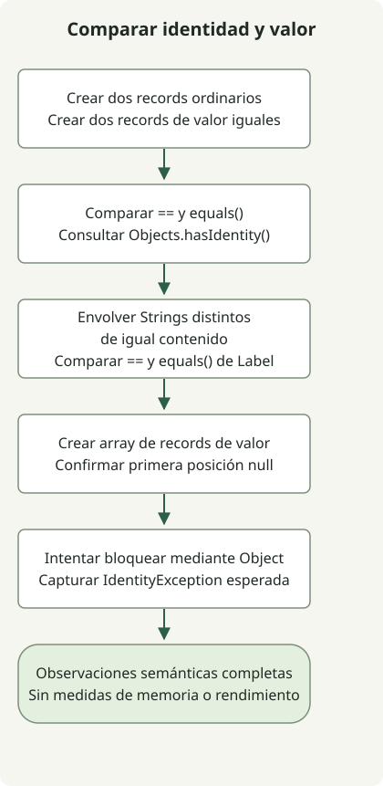

Project Valhalla es **un proyecto de OpenJDK que permite representar mediante objetos de valor los datos que no necesitan identidad de objeto y da a la JVM más libertad para almacenarlos y pasarlos de forma eficiente**. Según la comprobación del 31 de octubre de 2026, la [página del proyecto](https://openjdk.org/projects/valhalla/) y [JEP 401](https://openjdk.org/jeps/401) muestran la primera versión preliminar de objetos de valor integrada en JDK 28. No es una función definitiva. El ejemplo siguiente se ejecutó en JDK 28 EA Build 21.

## ¿Por qué clases de valor si Java ya tiene records?

Los objetos ordinarios tienen identidad aunque sus campos coincidan. Las cuentas mutables y los objetos de bloqueo necesitan esa distinción, pero unos datos como la coordenada `(3, 4)` pueden necesitar únicamente su valor.

Un [`record`](https://docs.oracle.com/en/java/javase/17/language/records.html) declara componentes de datos y proporciona métodos de acceso, constructores y métodos como `equals()`. Los records ordinarios existentes siguen permitiendo que `==` distinga dos objetos construidos por separado con componentes coincidentes. El modificador `value` toma una decisión independiente: eliminar la identidad de objeto. Puede combinarse con records como `value record`.

| Declaración | Significado en este ejemplo |
| --- | --- |
| `record IdentityPoint(int x, int y)` | Conserva identidades de objeto distintas aunque coincidan los componentes |
| `value record ValuePoint(int x, int y)` | Las instancias de la misma clase con el mismo estado de campos no se distinguen por identidad |
| `value record Label(String text)` | Carece de identidad, pero `==` y `equals()` siguen sin tener que coincidir |

Los campos de instancia de una clase de valor son `final`. Esto no vuelve automáticamente inmutables en profundidad los objetos referenciados: una colección mutable almacenada en un campo puede seguir cambiando su contenido. Los objetos de valor siguen manejándose mediante referencias a objetos; no se convierten en tipos primitivos.

## Probar la versión preliminar de JDK 28



El diagrama sigue el código que aparece a continuación. `Label` contiene objetos `String` distintos con el mismo contenido para mostrar la comparación de campos de referencia. Por último, el programa comprueba que colocar un objeto de valor en una variable `Object` no lo convierte en un monitor válido, y gestiona la excepción esperada.

Utiliza un directorio de experimentación independiente donde `javac` y `java` apunten a la misma compilación de [JDK 28 EA](https://jdk.java.net/28/). Compara la descarga con su SHA-256 oficial y confirma la compilación con `java --version`. JDK 17 y 21 no pueden compilar esta sintaxis. Las opciones de funciones preliminares son obligatorias tanto al compilar como al ejecutar.

### `ValhallaExample.java`

```java
import java.util.Objects;

public class ValhallaExample {
    record IdentityPoint(int x, int y) {}
    value record ValuePoint(int x, int y) {}
    value record Label(String text) {}

    public static void main(String[] args) {
        IdentityPoint a = new IdentityPoint(3, 4);
        IdentityPoint b = new IdentityPoint(3, 4);
        ValuePoint p = new ValuePoint(3, 4);
        ValuePoint q = new ValuePoint(3, 4);
        System.out.println("record == " + (a == b));
        System.out.println("record equals " + a.equals(b));
        System.out.println("value == " + (p == q));
        System.out.println("value equals " + p.equals(q));
        System.out.println("record identity " + Objects.hasIdentity(a));
        System.out.println("value identity " + Objects.hasIdentity(p));

        Label first = new Label(new String(new char[] {'x'}));
        Label second = new Label(new String(new char[] {'x'}));
        System.out.println("label == " + (first == second));
        System.out.println("label equals " + first.equals(second));

        ValuePoint[] points = new ValuePoint[1];
        System.out.println("array slot null " + (points[0] == null));
        Object monitor = p;
        try {
            synchronized (monitor) {
                throw new AssertionError("A value object must not be a monitor");
            }
        } catch (IdentityException expected) {
            System.out.println("monitor " + expected.getClass().getSimpleName());
        }
    }
}
```

```sh
javac --enable-preview --release 28 ValhallaExample.java
java --enable-preview ValhallaExample
```

Esta salida se observó en OpenJDK `28-ea+21-1707` para macOS AArch64. El aviso del compilador sobre funciones preliminares es independiente de esta salida estándar.

```text
record == false
record equals true
value == true
value equals true
record identity true
value identity false
label == false
label equals true
array slot null true
monitor IdentityException
```

Los records ordinarios devuelven true con `equals()` pero false con `==`. Los records de valor solo tienen campos enteros, por lo que la coincidencia de su estado hace que ambas comparaciones sean true. [`Objects.hasIdentity()`](https://download.java.net/java/early_access/jdk28/docs/api/java.base/java/util/Objects.html#hasIdentity(java.lang.Object)) también expone la distinción.

## ¿Deben compararse los objetos de valor con ==?

Sigue utilizando `equals()` para la igualdad del dominio. En los objetos de valor, `==` compara el estado de los campos dentro de la misma clase de valor y aplica recursivamente `==` a los campos de referencia. Los objetos referenciados con identidad siguen siendo distinguibles cuando son objetos separados, aunque su contenido coincida. Los campos primitivos se comparan por patrón de bits, que también puede diferir de la igualdad semántica de los números en coma flotante. Consulta las [reglas de comparación de objetos de valor de JEP 401](https://openjdk.org/jeps/401#Comparing-value-objects) para conocer las reglas precisas.

Los dos objetos `Label` tienen cadenas con el mismo contenido, por lo que el `equals()` generado para el record devuelve true. Sus cadenas son objetos con identidad distintos, por lo que `==` devuelve false. No interpretes que `value` hace que cada campo de referencia utilice una comparación basada en el contenido.

La posición del nuevo array de valores es `null`, y utilizar dinámicamente un objeto de valor como monitor lanza `IdentityException`. En cambio, el bloqueo directo de una expresión cuyo tipo es claramente una clase de valor puede rechazarse al compilar. Comprueba los usos sensibles a la identidad, como los bloqueos y las cachés basadas en identidad, antes de migrar.

## ¿Esto ahorra memoria de inmediato o permite List<int>?

Eliminar la identidad deja margen a la JVM para el **aplanamiento**, que representa una referencia mediante el estado de sus campos en lugar de un puntero, y la **escalarización**, que pasa los valores como componentes separados en registros y ubicaciones similares. El lenguaje no garantiza una disposición concreta, la eliminación de asignaciones ni una mejora de velocidad. La salida anterior comprueba la semántica; no mide el uso del heap ni el rendimiento en operaciones por unidad de tiempo.

Valhalla abarca varias versiones del JDK. La [hoja de ruta oficial](https://openjdk.org/projects/valhalla/) separa los objetos de valor del almacenamiento con restricciones de null, las mejoras de arrays, la unificación de primitivos y clases y la JVM paramétrica para la especialización de genéricos. JEP 401 por sí solo no completa `List<int>` ni garantiza almacenamiento contiguo para todos los arrays. El [JEP 539](https://openjdk.org/jeps/539) que lo acompaña proporciona soporte de la JVM para la inicialización estricta de campos; no añade un modificador de campo `strict` arbitrario al código fuente Java.

Empieza a experimentar con tipos de datos pequeños, como coordenadas o importes monetarios que no necesiten identidad, y compara el comportamiento en la misma compilación. Comprueba las dependencias de frameworks, serialización y bloqueos, y mide después la asignación, el GC y el rendimiento con cargas de trabajo representativas antes de valorar el beneficio. No trates esta versión preliminar como una función definitiva con soporte al elegir un JDK de producción. Continúa con la [guía de funciones del JDK](/en/posts/2023-09-20-jdk-21-release/) para distinguir entre funciones definitivas y preliminares.
