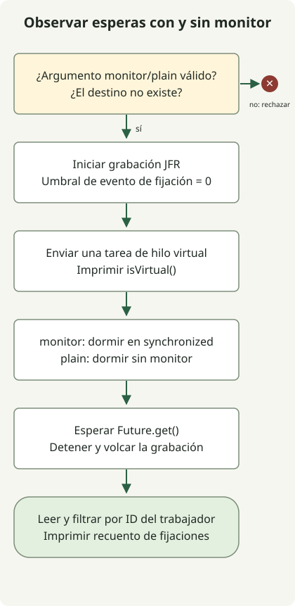

Los hilos virtuales son **hilos de Java que permiten que muchas tareas compartan un conjunto menor de hilos del sistema operativo mientras esperan operaciones de E/S**. Se hicieron definitivos en JDK 21 mediante [JEP 444](https://openjdk.org/jeps/444), y JDK 25 conserva las mismas API básicas. Una diferencia importante es la fijación del portador al bloquearse dentro de `synchronized`: [JEP 491](https://openjdk.org/jeps/491) mejoró este aspecto en JDK 24, y JDK 25 incluye esa mejora.

## ¿Qué se vuelve ligero?

Un hilo virtual sigue necesitando un hilo del sistema operativo para ejecutarse. La JVM denomina **portador** al hilo de plataforma que lo ejecuta. Cuando una operación bloqueante compatible permite desmontar el hilo virtual, el portador puede ejecutar otro hilo virtual.

Esto ayuda al procesamiento de solicitudes con muchas esperas simultáneas. No acelera los cálculos de CPU ni reduce automáticamente la latencia de una solicitud individual. La [guía oficial de adopción](https://docs.oracle.com/en/java/javase/25/core/virtual-threads.html) recomienda un hilo virtual por tarea y desaconseja reutilizar hilos virtuales en un grupo pequeño. La capacidad de conexiones de base de datos y las cuotas de las API externas no crecen con el número de hilos; limita esos recursos por separado mediante mecanismos como semáforos y grupos de conexiones.

## Diferencias entre JDK 21 y 25

| Área | JDK 21 | JDK 25 |
| --- | --- | --- |
| API de hilos virtuales | Definitivas; sin opciones de funciones preliminares | Definitivas; conservan las API básicas de creación |
| Bloqueo dentro de `synchronized` | Puede fijar el portador y limitar la escalabilidad | Incluye la mejora de JDK 24 mediante JEP 491 |
| Eliminación de toda fijación | No | No; persisten vías como código nativo que vuelve a llamar a Java y se bloquea |
| Diagnóstico | JFR y mecanismos como `jdk.tracePinnedThreads` | Se conserva y mejora JFR; `jdk.tracePinnedThreads` no tiene efecto |
| `ScopedValue` | Preliminar | Definitiva mediante JEP 506 |
| Concurrencia estructurada | Preliminar | Sigue siendo una función preliminar independiente; no supongas compatibilidad con las API anteriores |

Lee conjuntamente la [guía de JDK 21](https://docs.oracle.com/en/java/javase/21/core/virtual-threads.html), JEP 491 y el [artículo sobre ScopedValue](/en/posts/2026-10-31-jdk25-scopedvalue/) para distinguir estos cambios. La finalización de los hilos virtuales, ScopedValue y la concurrencia estructurada no sigue un único calendario compartido.

La fijación impide que un hilo virtual en espera libere su portador. En JDK 25, el uso ordinario de `synchronized` por sí solo no es motivo para sustituir todos los monitores por `ReentrantLock`. Sin embargo, **liberar un portador es distinto de liberar el bloqueo de un monitor**. Una E/S lenta dentro de `synchronized` sigue impidiendo que otras tareas adquieran ese bloqueo, por lo que el tamaño de la sección crítica y la contención de bloqueos siguen siendo relevantes.

## Observar el mismo código con JFR



El código compara un modo `monitor` que ejecuta `Thread.sleep(100)` dentro de `synchronized` con un modo `plain` que duerme sin ese bloque. No realiza solicitudes reales de red ni de base de datos. Establece el umbral del evento en cero mediante [Recording](https://docs.oracle.com/en/java/javase/21/docs/api/jdk.jfr/jdk/jfr/Recording.html) y utiliza después [RecordingFile](https://docs.oracle.com/en/java/javase/21/docs/api/jdk.jfr/jdk/jfr/consumer/RecordingFile.html) para contar solo los eventos del hilo trabajador.

Para cada JDK, guarda el archivo en un directorio nuevo y utiliza `javac` y `java` de la misma instalación. Se requiere un JDK HotSpot que incluya JFR; no se utilizan opciones de funciones preliminares. El programa crea `monitor.jfr` y `plain.jfr` y se niega a ejecutarse si el destino ya existe.

### `VirtualThreadProbe.java`

```java
import java.nio.file.Files;
import java.nio.file.Path;
import java.time.Duration;
import java.util.concurrent.Executors;
import jdk.jfr.Recording;
import jdk.jfr.consumer.RecordingFile;

public class VirtualThreadProbe {
    public static void main(String[] args) throws Exception {
        if (args.length != 1 || !(args[0].equals("monitor") || args[0].equals("plain"))) {
            throw new IllegalArgumentException("Usage: VirtualThreadProbe monitor|plain");
        }
        String mode = args[0];
        Path destination = Path.of(mode + ".jfr");
        if (Files.exists(destination)) {
            throw new IllegalStateException("Use a new directory: recording already exists");
        }
        Object monitor = new Object();
        long workerId;
        try (var recording = new Recording()) {
            recording.enable("jdk.VirtualThreadPinned").withThreshold(Duration.ZERO);
            recording.start();
            try (var tasks = Executors.newVirtualThreadPerTaskExecutor()) {
                workerId = tasks.submit(() -> {
                    Thread current = Thread.currentThread();
                    System.out.println("virtual=" + current.isVirtual());
                    if (mode.equals("monitor")) {
                        synchronized (monitor) { Thread.sleep(100); }
                    } else {
                        Thread.sleep(100);
                    }
                    return current.threadId();
                }).get();
            }
            recording.stop();
            recording.dump(destination);
        }
        long pinnedEvents = 0;
        try (var events = new RecordingFile(destination)) {
            while (events.hasMoreEvents()) {
                var event = events.readEvent();
                if (event.getEventType().getName().equals("jdk.VirtualThreadPinned")
                        && event.getThread() != null
                        && event.getThread().getJavaThreadId() == workerId) {
                    pinnedEvents++;
                }
            }
        }
        System.out.println(mode + "-pinned-events=" + pinnedEvents);
    }
}
```

```sh
javac --release 21 VirtualThreadProbe.java
java VirtualThreadProbe monitor
java VirtualThreadProbe plain
```

Esta salida se observó en Eclipse Temurin `21.0.13+9` para macOS AArch64.

```text
virtual=true
monitor-pinned-events=1
virtual=true
plain-pinned-events=0
```

Eclipse Temurin `25.0.5+8` en la misma plataforma produjo:

```text
virtual=true
monitor-pinned-events=0
virtual=true
plain-pinned-events=0
```

`Future.get()` espera la finalización y propaga los fallos de las tareas al llamador. La grabación se detiene y se vuelca antes de leerla, por lo que la agregación no compite con una grabación activa. No se restringió el número de portadores ni se compararon los tiempos totales de ejecución. Los recuentos de eventos describen esta única tarea; no generalices los recuentos exactos a otras JVM, parches o condiciones de instrumentación sin comprobarlos.

## ¿Qué debe seguir comprobándose después de actualizar?

La ausencia de eventos en JDK 25 se aplica específicamente a **la espera dentro de un monitor de este ejemplo**. No verifica las vías restantes que implican llamadas nativas, llamadas a funciones externas o inicialización de clases. Establecer `-Djdk.tracePinnedThreads=full`, útil en JDK 21, no tiene efecto en JDK 25; utiliza en su lugar los eventos de JFR y los volcados de hilos de esa versión.

Empieza la adopción con cargas de trabajo dominadas por esperas de E/S y revisa conjuntamente los grupos de conexiones de base de datos, la concurrencia de llamadas externas, los tiempos de espera y la cancelación. El trabajo intensivo de CPU, las secciones críticas largas y las cachés grandes por hilo pueden seguir siendo cuellos de botella. Mide el rendimiento, la latencia de los percentiles altos, la memoria y la contención de bloqueos con una carga de producción representativa; no calcules una proporción de mejora del rendimiento a partir de este pequeño programa de observación. Para el contexto asociado a la ejecución de hilos virtuales, continúa con las reglas de enlaces y límites asíncronos del artículo sobre ScopedValue.
