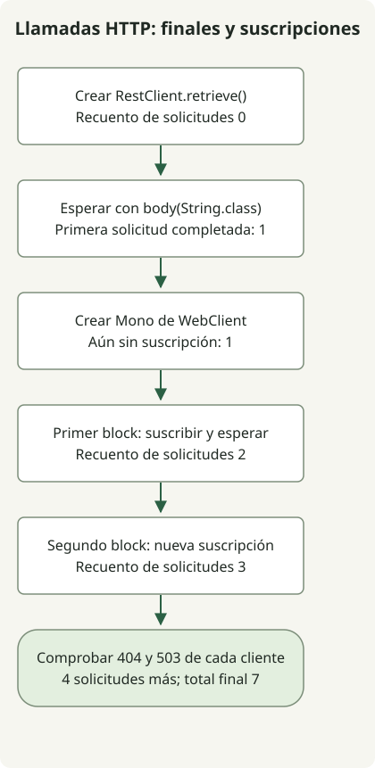

**Empieza con RestClient cuando el código síncrono de un servicio necesite una respuesta HTTP antes de continuar. Considera WebClient cuando necesites composición reactiva o streaming.** Ambos ofrecen API fluidas, pero [RestClient es síncrono y WebClient es un cliente reactivo no bloqueante](https://docs.spring.io/spring-framework/reference/integration/rest-clients.html). Adapta el cliente al modelo de ejecución de la aplicación en lugar de a su número de solicitudes.


RestClient se introdujo en Spring Framework 6.1; WebClient está disponible desde 5.0. Comprueba primero si tu versión de Framework admite el cliente que elijas. Al actualizar un proyecto Boot, utiliza una combinación compatible administrada por Boot. El ejemplo ejecutable siguiente fija Framework 7.0.10.

## ¿Qué cliente se adapta a cada requisito?

| Criterio | RestClient | WebClient |
| --- | --- | --- |
| Resultado | Una operación terminal, como extraer el cuerpo, espera la respuesta y devuelve un valor | Mono o Flux representa el resultado; la suscripción activa la solicitud |
| Encaje natural | Código secuencial y síncrono en Spring MVC o tareas por lotes | WebFlux, composición reactiva y streaming como SSE |
| Entrega de errores | La gestión predeterminada de retrieve lanza RestClientResponseException para 4xx y 5xx | La gestión predeterminada de retrieve emite un error WebClientResponseException para 4xx y 5xx |
| Coste adicional | Más fácil de seguir mediante una pila de llamadas convencional | Requiere comprender operadores, suscripciones, cancelación y propagación de contexto |
| Control de concurrencia | Diseña por separado los ejecutores o la concurrencia de hilos virtuales | Limita por separado la concurrencia de composición, como flatMap, y los presupuestos de conexiones y esperas |

Esta tabla parte de llamadas API ordinarias que reúnen una respuesta en memoria. RestClient también puede leer flujos de bytes mediante gestión de respuestas de bajo nivel, pero WebClient es la opción natural para flujos reactivos de elementos y control de demanda. Utilizar WebClient no exige convertir el servidor a WebFlux: Spring MVC también puede utilizar tipos de retorno reactivos. Las [indicaciones de Spring sobre clientes HTTP](https://spring.io/blog/2025/09/30/the-state-of-http-clients-in-spring/) hacen la misma distinción entre llamadas síncronas habituales y requisitos reactivos o de streaming.

Un servicio síncrono que utilice hilos virtuales puede conservar el código secuencial de RestClient. Los hilos virtuales no convierten su API en no bloqueante ni aumentan la capacidad de los servicios de destino o los límites de conexiones. Considera [el alcance de los hilos virtuales](/en/posts/2026-10-31-virtual-threads-jdk21-jdk25/) junto con los [límites de capacidad de las dependencias](/en/posts/2026-10-31-jdk-10k-rps-architecture/).

## Comparar el momento de ejecución con las mismas respuestas HTTP



El diagrama muestra las comprobaciones principales del método main; omite la preparación del servidor local, la configuración de clientes y la limpieza. **RestClient no envía una solicitud por el mero hecho de llamar a retrieve().** Aquí, body(String.class) realiza la solicitud y espera su resultado. WebClient ejecuta su Mono de solicitud predeterminado al suscribirse. Suscribirse dos veces a este Mono, sin operadores de caché ni de uso compartido, envía dos solicitudes.

Este ejemplo de consola independiente se ejecutó con Spring Framework 7.0.10, Reactor Core 3.8.8, JDK 17 y Gradle 8.4. No es una aplicación Spring Boot. Ambos clientes utilizan explícitamente JDK HttpClient para eliminar diferencias en la selección del conector predeterminado. En un proyecto Boot, prefiere las dependencias administradas por esa versión de Boot en lugar de sustituirlas con este BOM.

### `settings.gradle`

```groovy
rootProject.name = 'http-client-comparison'
```

### `build.gradle`

```groovy
plugins { id 'application' }
repositories { mavenCentral() }
dependencies {
    implementation platform('org.springframework:spring-framework-bom:7.0.10')
    implementation 'org.springframework:spring-webflux'
}
java {
    sourceCompatibility = JavaVersion.VERSION_17
    targetCompatibility = JavaVersion.VERSION_17
}
application { mainClass = 'ClientComparison' }
```

### `src/main/java/ClientComparison.java`

```java
import com.sun.net.httpserver.HttpServer;
import java.net.InetSocketAddress;
import java.net.http.HttpClient;
import java.nio.charset.StandardCharsets;
import java.time.Duration;
import java.util.concurrent.atomic.AtomicInteger;
import org.springframework.http.client.JdkClientHttpRequestFactory;
import org.springframework.http.client.reactive.JdkClientHttpConnector;
import org.springframework.web.client.RestClient;
import org.springframework.web.client.RestClientResponseException;
import org.springframework.web.reactive.function.client.WebClient;
import org.springframework.web.reactive.function.client.WebClientResponseException;
import reactor.core.publisher.Mono;

public class ClientComparison {
    static void check(boolean condition) {
        if (!condition) throw new AssertionError("HTTP contract failed");
    }
    public static void main(String[] args) throws Exception {
        var requests = new AtomicInteger();
        var server = HttpServer.create(new InetSocketAddress("127.0.0.1", 0), 0);
        server.createContext("/", exchange -> {
            requests.incrementAndGet();
            String path = exchange.getRequestURI().getPath();
            int status = path.equals("/missing") ? 404 : path.equals("/unavailable") ? 503 : 200;
            byte[] body = (status == 200 ? "hello" : "error").getBytes(StandardCharsets.UTF_8);
            exchange.getResponseHeaders().set("Content-Type", "text/plain;charset=UTF-8");
            exchange.sendResponseHeaders(status, body.length);
            try (var output = exchange.getResponseBody()) { output.write(body); }
        });
        server.start();
        try {
            String base = "http://127.0.0.1:" + server.getAddress().getPort();
            var jdk = HttpClient.newBuilder().connectTimeout(Duration.ofSeconds(2)).build();
            var factory = new JdkClientHttpRequestFactory(jdk);
            factory.setReadTimeout(Duration.ofSeconds(2));
            var connector = new JdkClientHttpConnector(jdk);
            connector.setReadTimeout(Duration.ofSeconds(2));
            var rest = RestClient.builder().baseUrl(base).requestFactory(factory).build();
            var web = WebClient.builder().baseUrl(base).clientConnector(connector).build();

            var response = rest.get().uri("/hello").retrieve();
            check(requests.get() == 0);
            System.out.println("before-rest-terminal=" + requests.get());
            String sync = response.body(String.class);
            check("hello".equals(sync) && requests.get() == 1);
            System.out.println("rest=" + sync);

            Mono<String> pending = web.get().uri("/hello").retrieve().bodyToMono(String.class);
            check(requests.get() == 1);
            System.out.println("before-subscribe=" + requests.get());
            String first = pending.block(Duration.ofSeconds(5));
            check("hello".equals(first) && requests.get() == 2);
            System.out.println("web=" + first);
            System.out.println("after-first-subscribe=" + requests.get());
            String second = pending.block(Duration.ofSeconds(5));
            check("hello".equals(second) && requests.get() == 3);
            System.out.println("web-again=" + second);
            System.out.println("after-second-subscribe=" + requests.get());

            for (int status : new int[]{404, 503}) {
                String path = status == 404 ? "/missing" : "/unavailable";
                try {
                    rest.get().uri(path).retrieve().body(String.class);
                    throw new AssertionError("RestClient should fail");
                } catch (RestClientResponseException error) {
                    check(error.getStatusCode().value() == status);
                    System.out.println("rest-" + status + "=" + error.getStatusCode().value());
                }
                try {
                    web.get().uri(path).retrieve().bodyToMono(String.class).block(Duration.ofSeconds(5));
                    throw new AssertionError("WebClient should fail");
                } catch (WebClientResponseException error) {
                    check(error.getStatusCode().value() == status);
                    System.out.println("web-" + status + "=" + error.getStatusCode().value());
                }
            }
            check(requests.get() == 7);
            System.out.println("requests=" + requests.get());
        } finally { server.stop(0); }
    }
}
```

### Ejecutar y comprobar

```sh
gradle --no-daemon --console=plain -q clean run
```

La primera descarga de dependencias requiere acceso a la red. Las solicitudes HTTP en tiempo de ejecución solo van a un servidor 127.0.0.1 en un puerto temporal. Lo siguiente es la salida estándar observada de la aplicación en el entorno indicado; Gradle o las implementaciones de registro pueden emitir diagnósticos independientes.

```text
before-rest-terminal=0
rest=hello
before-subscribe=1
web=hello
after-first-subscribe=2
web-again=hello
after-second-subscribe=3
rest-404=404
web-404=404
rest-503=503
web-503=503
requests=7
```

El cambio de 0 a 1 muestra que la operación terminal de RestClient completó la primera solicitud. El recuento sigue siendo 1 justo después de construir el Mono. Cada block se suscribe y lo aumenta a 2 y después a 3. Cuatro solicitudes posteriores comprueban la gestión de 404 y 503, para un total de 7. Estos recuentos verifican los contratos de ejecución y errores; no comparan rendimiento, latencia ni rendimiento del bucle de eventos.

## ¿block hace que ambos clientes se comporten igual?

Añadir block a WebClient hace que **el llamador espere el resultado**. No hace que la implementación de transporte subyacente sea idéntica a la de RestClient. Como explica la [documentación de uso síncrono](https://docs.spring.io/spring-framework/reference/web/webflux-webclient/client-synchronous.html), devuelve Mono o Flux desde un controlador reactivo y deja que el framework se suscriba. Las llamadas block anteriores se limitan a un main de consola que observa el comportamiento. Llamar a RestClient o esperar con block en un bucle de eventos puede ocupar su hilo de procesamiento o lanzar una excepción que prohíba el bloqueo en un hilo no bloqueante.

Si una aplicación ya utiliza filtros, autenticación e instrumentación de WebClient, las llamadas síncronas por sí solas no exigen una sustitución inmediata. Compara el coste de introducir dependencias reactivas y gestión de suscripciones para una nueva llamada síncrona con el de conservar la configuración existente. Evita las suscripciones sin límite al combinar varias llamadas remotas. El [control de demanda reactivo de WebFlux](https://docs.spring.io/spring-framework/reference/web/webflux/new-framework.html) coordina las tasas de producción y consumo; no impone automáticamente los límites de RPS o conexiones de un servicio de destino.

## ¿Qué debes comprobar antes de producción?

Ambos clientes necesitan presupuestos para establecer conexiones, leer respuestas y realizar la llamada completa, además de una política de estados de error. El límite de conexión de 2 segundos del ejemplo, los límites de lectura de 2 segundos y la espera de block de 5 segundos son ajustes para reproducir el ejemplo, no semánticas de tiempo de espera equivalentes ni valores recomendados para producción. Consulta la documentación de la [fábrica de solicitudes](https://docs.spring.io/spring-framework/docs/7.0.10/javadoc-api/org/springframework/http/client/JdkClientHttpRequestFactory.html) y del [conector reactivo](https://docs.spring.io/spring-framework/docs/7.0.10/javadoc-api/org/springframework/http/client/reactive/JdkClientHttpConnector.html) para conocer el alcance de cada tiempo de espera de lectura. Estas respuestas locales rápidas no validan los tiempos de espera, TLS ni la propagación de cancelación.

El ejemplo comprueba la gestión predeterminada de retrieve para respuestas 4xx y 5xx en ambos clientes. Utiliza onStatus para políticas explícitas de estados. No supongas que las API exchange de bajo nivel aplican la gestión predeterminada de estados de retrieve. Los ejemplos de [gestión de respuestas de WebClient](/en/posts/2023-09-19-springboot-test-webclient/) y de [tiempos de espera y reintentos limitados](/en/posts/2026-10-30-webclient-timeout-retry/) ofrecen contratos adicionales. Limita los reintentos según la idempotencia, el número de intentos y el presupuesto total de tiempo; prueba por separado los cuerpos vacíos, las respuestas grandes y los fallos de conexión.

El código existente de RestTemplate es una cuestión de migración independiente. Spring Framework 7.0 recomienda RestClient y marca RestTemplate como obsoleto; WebClient no está obsoleto. Después de elegir un cliente, valida la autenticación, la instrumentación y la configuración de conexiones con la combinación real de solicitudes.
