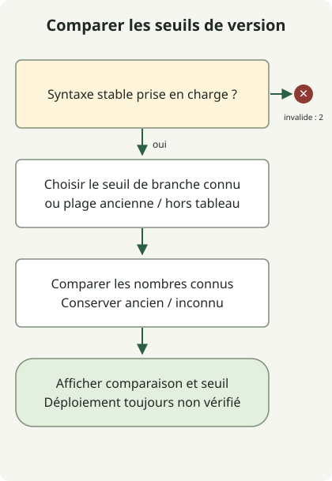

Corriger GitLab2Shell consiste à **mettre GitLab CE/EE à niveau vers une version corrigeant CVE-2026-110264 et à vérifier son utilisation effective dans le déploiement**. L’[avis GitLab du 21 octobre](https://docs.gitlab.com/releases/patches/patch-release-gitlab-19-5-1-released/) décrit une exécution de code à distance sans authentification, sous certaines conditions, par débordement d’entier pendant la compilation d’expressions régulières. Mettre uniquement GitLab Shell ou Runner à jour ne termine pas la correction du serveur CE/EE.

## Associer d’abord la CVE à la version du produit

Cet article couvre **CVE-2026-110264** de l’avis officiel GitLab, notée 10.0 selon CVSS v3.1. Distinguez-la des autres CVE GitLab publiées à la même période et des composants Shell aux noms similaires. La [fiche CVE rédigée par GitLab](https://cveawg.mitre.org/api/cve/CVE-2026-110264) indique les mêmes plages affectées et seuils de correction.

| Branche GitLab CE/EE | Première version corrigeant cette CVE |
| --- | --- |
| 18.11 | 18.11.13 |
| 19.0 | 19.0.10 |
| 19.1 | 19.1.9 |
| 19.2 | 19.2.9 |
| 19.3 | 19.3.6 |
| 19.4 | 19.4.3 |
| 19.5 | 19.5.1 |

L’avis désigne comme affectées les versions depuis 7.0 jusqu’avant 18.11.13, ainsi que chaque branche répertoriée avant sa première version corrigée. Vérifié le 30 octobre 2026, ce tableau donne des **seuils de première correction**, pas une liste figée des dernières versions à installer. GitLab.com et GitLab Dedicated disposent d’informations distinctes sur l’adoption du correctif dans l’avis ; n’appliquez pas indistinctement les instructions de mise à niveau Self-Managed à ces services.

## Comparer une chaîne de version déclarée hors ligne



Le schéma suit le code de comparaison ci-dessous. Il valide l’entrée avant de comparer les branches enregistrées. Les anciennes branches affectées nécessitent un chemin de mise à niveau ; les branches hors tableau restent inconnues. Aucun résultat n’authentifie l’état d’un serveur ni la provenance d’un correctif.

Avec Python 3.11 ou ultérieur, enregistrez ce fichier dans un nouveau répertoire. Il aide à comparer numériquement les versions officielles amont CE/EE, sans requêtes réseau, découverte de services ni exploitation. Il accepte des formes comme `19.5.1`, `19.5.1-ee` et `19.5.1-ee.0` ; il ne tente pas de deviner les formats de préversion, de build nocturne ou de version personnalisée par un fournisseur.

### `release-threshold.py`

```python
import re
import sys

FIRST_FIX = {
    (18, 11): 13,
    (19, 0): 10,
    (19, 1): 9,
    (19, 2): 9,
    (19, 3): 6,
    (19, 4): 3,
    (19, 5): 1,
}
NUMBER = r"(0|[1-9][0-9]{0,2})"
VERSION = rf"{NUMBER}\.{NUMBER}\.{NUMBER}(?:-(?:ce|ee)(?:\.[0-9]{{1,3}})?)?"


def main(argv):
    match = re.fullmatch(VERSION, argv[1]) if len(argv) == 2 else None
    if match is None:
        print("usage: release-threshold.py VERSION (stable CE/EE release format)", file=sys.stderr)
        return 2
    major, minor, patch = map(int, match.groups())
    branch = (major, minor)
    if branch in FIRST_FIX:
        baseline = f"{major}.{minor}.{FIRST_FIX[branch]}"
        state = "met" if patch >= FIRST_FIX[branch] else "below"
        status = 0 if state == "met" else 1
    elif (7, 0) <= branch < (18, 11):
        baseline, state, status = "upgrade-path-required", "below", 1
    else:
        baseline, state, status = "not-covered", "outside-table", 2
    print(f"release-threshold={state}")
    print(f"baseline={baseline}")
    print("deployment-and-release-provenance=not-verified")
    return status


if __name__ == "__main__":
    raise SystemExit(main(sys.argv))
```

```sh
python3 release-threshold.py 19.5.1-ee.0
```

L’exécution locale a renvoyé la sortie suivante et le statut de sortie 0.

```text
release-threshold=met
baseline=19.5.1
deployment-and-release-provenance=not-verified
```

Le statut 0 signifie uniquement que **les nombres fournis atteignent le seuil de correction publié pour cette CVE**. Le statut 1 signifie qu’ils sont inférieurs au seuil publié ; le statut 2 indique un format non pris en charge ou une branche hors tableau. Le programme ne vérifie pas que la version existe, que le paquet est officiel ou qu’un nœud l’exécute. Les rétroportages et les builds personnalisés nécessitent des preuves de correction distinctes du fournisseur.

## Relier les preuves d’installation à l’utilisation effective

La [documentation officielle de maintenance](https://docs.gitlab.com/administration/raketasks/maintenance/) décrit la collecte d’informations sur GitLab, Ruby et les composants avec `sudo gitlab-rake gitlab:env:info` pour les paquets Linux ou `bundle exec rake gitlab:env:info RAILS_ENV=production` pour les installations depuis les sources. Dans les déploiements multinœuds, exécutez la commande sur les nœuds hébergeant Rails. La sortie peut inclure des chemins et adresses internes : conservez-la dans des dossiers d’exploitation à accès restreint.

Ces commandes n’ont pas été exécutées ici sur un serveur de production. Lors d’une correction réelle, reliez les informations aux révisions complètes des paquets, aux empreintes des images déployées et à chaque nœud web ou d’arrière-plan, puis vérifiez l’adoption sur toutes les cibles après la mise à niveau. Une bannière HTTP ou la sortie d’une commande sur un autre nœud ne constitue pas une preuve pour tout le déploiement.

## Choisir un correctif actuel et terminer les migrations

Suivez le [chemin officiel de mise à niveau](https://docs.gitlab.com/update/upgrade_paths/) depuis la version installée, en laissant les migrations d’arrière-plan se terminer à chaque étape obligatoire avant de poursuivre. Une ancienne installation ne permet pas forcément de passer directement à la version la plus élevée du tableau. Planifiez ensemble la sauvegarde et la restauration, la compatibilité des extensions, l’indisponibilité et les procédures multinœuds.

Distinguez les premières corrections des correctifs actuels. L’[avis de correctifs du 29 octobre](https://docs.gitlab.com/releases/patches/patch-release-gitlab-19-5-3-released/) répertorie des versions ultérieures, dont 19.5.3 et 19.4.5, ainsi que certaines migrations de base de données, et indique explicitement que 19.5.2 et 19.4.4 ont été sautées. Le script n’interroge pas de catalogue de versions : il effectue donc une comparaison numérique même avec ces chaînes. Sélectionnez toujours la version à installer depuis les registres de distribution officiels.

Après la mise à niveau, vérifiez séparément les versions en cours d’exécution, l’achèvement des migrations, la connexion normale, l’accès aux dépôts et le traitement des tâches. Les détections de plantage de processus Onigmo et de rafales d’erreurs de rendu Org-mode mentionnées dans l’avis sont des pistes d’enquête ; aucune ne prouve ni n’exclut à elle seule une compromission. Préservez les journaux ainsi que les preuves de processus et de déploiement, et enquêtez séparément si vous suspectez une compromission.

La correction des certificats Java de la même période est un problème distinct. Pour les services de build et d’intégration utilisant un JDK, lisez aussi l’[inspection d’eMudhra et du magasin de confiance JVM](/en/posts/2026-10-30-jdk-emudhra-truststore/).
