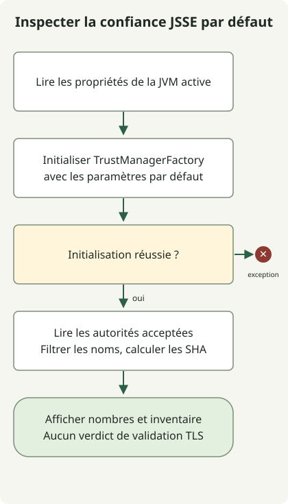

La correction eMudhra du JDK exige de **vérifier à la fois le JDK qui exécute l’application et le magasin de confiance qu’elle utilise réellement**. L’[avis Oracle](https://ops.java/emudhra/) et l’[avis Temurin](https://adoptium.net/news/2026/10/temurin-october-2026-emudhra/) décrivent des distributions mises à jour et la suppression de confiance envers les autorités concernées, mais leurs implémentations diffèrent. La protection d’un navigateur ou la mise à jour du JDK de l’hôte n’établit pas l’adoption dans les conteneurs ou les JVM distinctes.

## Importer un certificat serveur expiré résoudra-t-il le problème ?

Cet incident diffère d’une simple expiration de certificat serveur. Des clés compromises d’autorités intermédiaires eMudhra ont créé des chemins pouvant accorder confiance à des certificats frauduleux, ce qui impose de supprimer la confiance concernée ou d’appliquer la protection recommandée par le fournisseur. L’[alerte de sécurité Oracle CVE-2026-91403](https://www.oracle.com/security-alerts/alert-cve-2026-91403.html) fournit les produits affectés et les consignes de correction. N’appliquez pas indistinctement le tableau des produits et versions Oracle à une autre distribution.

`PKIX path building failed` n’est pas un diagnostic propre à cet incident. Distinguez une chaîne serveur incomplète, un mauvais magasin de confiance, des autorités privées et les changements de confiance du fournisseur. Désactiver la validation ou importer une autorité non vérifiée uniquement pour faire taire une erreur peut compromettre la protection.

## Lire séparément l’avis de chaque fournisseur

Les éléments suivants reflètent les avis vérifiés le 30 octobre 2026. Revérifiez le produit, le système, le build complet et les compléments actuels lors du déploiement.

| Fournisseur | Distinction à vérifier |
| --- | --- |
| [Oracle JDK](https://ops.java/emudhra/) | Mises à jour supprimant les racines concernées et mesure temporaire distincte si les mises à jour sont différées |
| [Eclipse Temurin](https://adoptium.net/news/2026/10/temurin-october-2026-emudhra/) | Utilise les données d’autorités de Mozilla ; retire la confiance à `emSign ECC Root CA - G3` et `AAA Certificate Services`. Les builds corrigés comprennent 21.0.13+9 et 17.0.21+9 |
| [Ubuntu OpenJDK](https://ubuntu.com/blog/emudhra-ca-compromise-fixes-available) | Intégration au magasin d’autorités système ; un défaut actuel de synchronisation impose une action manuelle supplémentaire sur le magasin Java après la mise à jour de `ca-certificates` |

L’avis Temurin explique que la seule présence de `emSign Root CA - G1` ne suffit pas à établir un échec de correction. Utiliser la liste générique de racines `CheckCerts` comme critère universel de réussite peut conduire à mal classer les distributions. Les alias, noms et nombres de racines ne certifient pas à eux seuls la protection.

## Lire les informations de confiance JSSE par défaut de la JVM courante



Le schéma suit le collecteur en lecture seule ci-dessous. Il initialise le `TrustManagerFactory` par défaut et recherche des noms d’autorités. Un nom correspondant est un point de départ pour comparer les empreintes aux consignes du fournisseur, pas un verdict de vulnérabilité ou de sécurité. Si l’initialisation du gestionnaire de confiance par défaut échoue, le programme se termine avec une exception.

Enregistrez ce fichier dans un nouveau répertoire avec JDK 17 ou ultérieur. Il utilise uniquement les API publiques [TrustManagerFactory](https://docs.oracle.com/en/java/javase/21/docs/api/java.base/javax/net/ssl/TrustManagerFactory.html) et [X509TrustManager](https://docs.oracle.com/en/java/javase/21/docs/api/java.base/javax/net/ssl/X509TrustManager.html). Il ne modifie aucun fichier, n’envoie aucune requête réseau, n’ajoute ni ne supprime de certificats et ne contourne pas la validation TLS.

### `TrustInventory.java`

```java
import java.security.KeyStore;
import java.security.MessageDigest;
import java.security.cert.X509Certificate;
import java.util.HexFormat;
import java.util.Locale;
import javax.net.ssl.TrustManager;
import javax.net.ssl.TrustManagerFactory;
import javax.net.ssl.X509TrustManager;

public class TrustInventory {
    public static void main(String[] args) throws Exception {
        System.out.println("java.version=" + System.getProperty("java.version"));
        System.out.println("java.vendor=" + System.getProperty("java.vendor"));
        System.out.println("java.home=" + System.getProperty("java.home"));
        System.out.println("configuredTrustStore=" +
            System.getProperty("javax.net.ssl.trustStore", "<default JSSE lookup>"));
        TrustManagerFactory factory = TrustManagerFactory.getInstance(
            TrustManagerFactory.getDefaultAlgorithm());
        factory.init((KeyStore) null);
        System.out.println("trustManagerProvider=" + factory.getProvider().getName());
        MessageDigest sha256 = MessageDigest.getInstance("SHA-256");
        int issuers = 0;
        int matches = 0;
        for (TrustManager manager : factory.getTrustManagers()) {
            if (!(manager instanceof X509TrustManager x509)) continue;
            for (X509Certificate cert : x509.getAcceptedIssuers()) {
                issuers++;
                String subject = cert.getSubjectX500Principal().getName();
                String lower = subject.toLowerCase(Locale.ROOT);
                if (lower.contains("emsign") || lower.contains("aaa certificate services")) {
                    String fingerprint = HexFormat.of().withUpperCase()
                        .formatHex(sha256.digest(cert.getEncoded()));
                    System.out.println("candidate=" + subject + "\tSHA256=" + fingerprint);
                    matches++;
                }
            }
        }
        System.out.println("acceptedIssuers=" + issuers);
        System.out.println("nameMatches=" + matches);
        System.out.println("assessment=inventory-only; no validation verdict");
    }
}
```

```sh
javac --release 17 TrustInventory.java
java TrustInventory
```

Des vérifications locales de JDK ont compilé le programme et confirmé la sortie d’inventaire par défaut. Des magasins d’autorités de test générés séparément ont aussi permis de vérifier les noms candidats et les empreintes SHA-256, des magasins aux noms sans rapport et un magasin vide. Ces autorités de test ne sont pas de véritables certificats eMudhra ; la réussite de l’exécution ne certifie pas la protection d’une JVM de production.

La propriété `java.home` rapportée appartient à **la JVM qui vient de démarrer**. Une valeur de `configuredTrustStore` égale à `<default JSSE lookup>` signifie que la propriété système n’a pas été spécifiée, et non qu’aucun magasin n’a été trouvé. La sortie n’inclut pas les mots de passe des magasins de confiance.

## La recherche par défaut peut différer de la configuration applicative

La [référence SunJSSE](https://docs.oracle.com/en/java/javase/25/security/java-secure-socket-extension-jsse-reference-guide.html) distingue un `javax.net.ssl.trustStore` explicite de la recherche par défaut de `jssecacerts`/`cacerts`. Ce programme lit ce chemin d’initialisation par défaut dans une nouvelle JVM. Il ne découvre pas automatiquement les instances `SSLContext`/`TrustManager` créées par l’application, les paramètres des frameworks ou les bibliothèques TLS natives.

L’absence de candidats n’est pas un verdict de sécurité. Selon le fournisseur et le build, un chemin de magasin inexistant peut entraîner un repli vers un autre magasin, produire un inventaire vide ou faire échouer l’initialisation. Les vérifications locales de JDK ont observé un repli vers le magasin par défaut et un échec dû à un mot de passe incorrect. D’autres noms ou chemins de validation peuvent aussi échapper à la recherche. Inversement, un nom répertorié ne démontre pas que la validation TLS accepte nécessairement sa chaîne. Ce code n’effectue pas de vérifications de liste de blocage, de révocation ou de chemin de certification.

## Vérifier les connexions normales et les rejets après la mise à jour

1. Identifiez le fournisseur du JDK du service réel, le build complet, l’exécutable, les options de démarrage JVM et l’empreinte de l’image, y compris les magasins personnalisés et les paramètres TLS propres à l’application.
2. Déployez le build corrigé du fournisseur. Si vous maintenez un magasin distinct, comparez son contenu aux consignes du fournisseur. Avant toute suppression manuelle, établissez les sauvegardes, les empreintes et l’impact sur les connexions. Le défaut actuel de synchronisation d’Ubuntu nécessite la [procédure supplémentaire de mise à jour du magasin d’autorités racines Java](https://ubuntu.com/blog/emudhra-ca-compromise-fixes-available#updating-the-java-root-ca-store) après la mise à jour de `ca-certificates`. Préservez les autorités ajoutées localement et préparez leur réintégration avant la régénération.
3. Remplacez ou redémarrez chaque JVM et réplica. Modifier le `cacerts` d’une installation ne met pas automatiquement à jour un autre JDK ou un processus déjà actif.
4. Vérifiez à la fois la réussite des connexions HTTPS ordinaires et le rejet des chaînes affectées spécifiées par le fournisseur. Un résultat TLS ne remplace pas la validation des JAR signés.

Cet article n’a pas établi de connexion à des hôtes de test externes ni vérifié le rejet de véritables chaînes affectées. N’enregistrez pas ces vérifications comme terminées sur la seule base de la sortie du collecteur. Suivez les [consignes de vérification propres au fournisseur](https://adoptium.net/news/2026/10/temurin-october-2026-emudhra/) avec un plan de remplacement des certificats en production.

La RCE des expressions régulières de GitLab est distincte de ce problème de certificats. Consultez le [guide de réponse à CVE-2026-110264](/en/posts/2026-10-30-gitlab2shell-cve-2026-110264/) pour les consignes de mise à niveau de GitLab.
