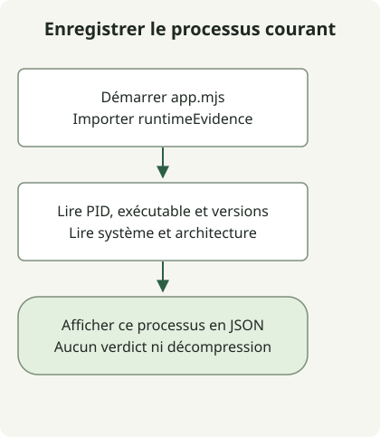

Corriger Node2Shell consiste à remplacer Node.js par un runtime corrigé et à vérifier son utilisation par chaque processus qui décompresse des données Brotli non fiables. L’[avis de sécurité Node.js](https://nodejs.org/en/blog/vulnerability/october-2026-security-releases) identifie **CVE-2026-111497** comme une écriture hors limites dans son décodeur Brotli intégré. Mettre à jour les paquets npm et remplacer le runtime sont des opérations distinctes.

## Tous les usages de Brotli présentent-ils la même exposition ?

Le chemin concerné **décompresse** des données d’entrée compressées. Des données Brotli malformées fournies par un attaquant et traitées par `node:zlib` peuvent corrompre la mémoire du processus, entraînant des plantages, une divulgation de mémoire ou une exécution de code à distance. Compresser les réponses sortantes avec Brotli ou activer HTTP/2 ne suffit pas à établir ce chemin. Le projet Node.js classe ce problème comme de sévérité élevée.

Suivez la décompression automatique des réponses HTTP externes, des téléversements, des fichiers et des tâches en file d’attente, ainsi que des corps de requête. Par exemple, la [documentation de body-parser](https://expressjs.com/en/resources/middleware/body-parser/) décrit la décompression automatique Brotli. Vérifiez la version et les options du middleware installé ; ne pas trouver `brotliDecompress` dans le code applicatif ne démontre pas une absence d’exposition. Une tâche en arrière-plan peut décompresser des données externes sans port d’écoute accessible depuis Internet.

## Quelles versions de Node.js contiennent le correctif ?

Vérifié le 30 octobre 2026, le tableau suivant répertorie les versions de sécurité officielles contenant le correctif de cette CVE. Il ne fige pas la dernière version recommandée. Consultez la version prise en charge et les avis complémentaires du même fournisseur lors du déploiement.

| Branche Node.js | Version officielle corrigée |
| --- | --- |
| 22.x | [22.23.4](https://nodejs.org/en/blog/release/v22.23.4) |
| 24.x | [24.22.1](https://nodejs.org/en/blog/release/v24.22.1) |
| 26.x | [26.12.1](https://nodejs.org/en/blog/release/v26.12.1) |

Pour les builds de distribution, de produits embarqués ou personnalisés, utilisez la révision complète du paquet du fournisseur et les preuves de correction. N’appliquez pas ces seuils numériques à une autre branche majeure. L’avis Node.js considère aussi les branches en fin de vie comme affectées ; leur absence du tableau n’établit pas leur sécurité.

En particulier, `process.versions.brotli` seul ne suffit pas. Le [fichier source de version Brotli dans Node.js 24.22.1 corrigé](https://github.com/nodejs/node/blob/v24.22.1/deps/brotli/c/common/version.h) déclare toujours `1.2.0`. Les [notes de version](https://nodejs.org/en/blog/release/v24.22.1) répertorient explicitement le correctif repris. Établissez la provenance de l’artefact du runtime corrigé plutôt que de vous fier à l’étiquette de la bibliothèque.

## Enregistrer les preuves depuis le processus lui-même



Le schéma suit le démarrage de l’application exemple ci-dessous. Elle lit les informations au sein du même processus et affiche du JSON sans comparer les versions, découvrir les services ni décider de l’état du correctif. La sortie d’une nouvelle invocation CLI ne remplace pas les preuves provenant d’un service existant.

Avec Node.js 22 ou ultérieur, enregistrez ces deux fichiers dans un nouveau répertoire. Ils lisent les propriétés documentées dans la [référence de process](https://nodejs.org/docs/latest-v24.x/api/process.html), sans requêtes réseau, décompression ni affichage de variables d’environnement.

### `runtime-evidence.mjs`

```javascript
export function runtimeEvidence() {
  return {
    scope: 'this-process-only',
    pid: process.pid,
    executable: process.execPath,
    node: process.version,
    brotliLabel: process.versions.brotli ?? null,
    platform: process.platform,
    arch: process.arch,
  };
}
```

### `app.mjs`

```javascript
import {runtimeEvidence} from './runtime-evidence.mjs';

console.log(JSON.stringify(runtimeEvidence(), null, 2));
```

```sh
node app.mjs
```

La vérification locale utilisait un conteneur officiel Node.js 24.22.1 et a renvoyé du JSON avec `node` égal à `v24.22.1` et `brotliLabel` égal à `1.2.0`. Le PID, le chemin, le système et l’architecture varient selon l’environnement. Cela montre qu’un build corrigé peut conserver l’ancienne étiquette Brotli ; cela ne teste ni une exploitation ni un déploiement de production.

Pour un service réel, ajoutez une journalisation équivalente au démarrage par son processus de déploiement et limitez l’accès à ces journaux d’exploitation. Reliez l’enregistrement au gestionnaire de services, au processus et à l’empreinte de l’image. Les chemins et les PID n’ont pas leur place dans des réponses HTTP publiques. Démarrer un processus de diagnostic distinct ne vérifie pas le remplacement des processus existants.

## Que reste-t-il après l’installation du paquet ?

1. Enregistrez pour chaque service l’exécutable Node.js, le fournisseur, la version complète du paquet ou l’empreinte de l’image, les processus, les workers et les réplicas. Un `node -v` sur l’hôte ou une étiquette Dockerfile ne suffit pas à établir le runtime d’un conteneur en cours d’exécution.
2. Suivez les bibliothèques qui relient les entrées au décodeur Brotli. Distinguez l’état du correctif du runtime de l’exposition des entrées. Ne pas localiser un chemin de décompression dans le périmètre de l’enquête ne corrige pas un runtime non corrigé.
3. Obtenez un runtime corrigé compatible par un canal fiable. Reconstruisez et déployez les images de conteneurs ; remplacez aussi l’exécutable réel utilisé par les gestionnaires de processus et les plateformes gérées. Ne supposez pas qu’une mise à jour de la bibliothèque Brotli du système remplace une copie intégrée.
4. Vérifiez de nouvelles preuves d’exécution pour chaque worker et réplica, puis contrôlez les appels API normaux, le traitement des réponses externes, les tâches en arrière-plan et les taux d’erreur. Remplacer les fichiers d’installation ou laisser d’anciens réplicas en cours d’exécution ne constitue pas une utilisation vérifiée du correctif.

Si le correctif est différé, envisagez de rejeter ou de contourner la décompression Brotli non fiable sur le chemin réel des données. Retirer `br` de `Accept-Encoding` ne bloque pas à lui seul tous les chemins d’entrée. Un aller-retour réussi de compression et décompression de données valides ou un `npm audit` sans alerte ne peut pas non plus établir que cette CVE est corrigée.

## S’agit-il du même problème que PHP2Shell ?

Ce sont des failles distinctes. Les deux CVE de PHP2Shell concernent l’état des requêtes dans le moteur PHP ; Node2Shell concerne le décodeur Brotli. La même CVE Brotli peut néanmoins apparaître dans d’autres produits : suivez donc l’avis de chaque produit. Le [guide de réponse à PHP2Shell](/en/posts/2026-10-30-php2shell-runtime-patching/) explique la distinction entre la reconstruction Brotli de PHP pour Windows et les correctifs du moteur PHP.

Un plantage seul ne prouve pas une compromission, et l’absence de traces ne l’exclut pas. En cas de suspicion de compromission, préservez les preuves dans un emplacement à accès restreint et enquêtez, ou reconstruisez depuis une source fiable, séparément de l’application des correctifs.
