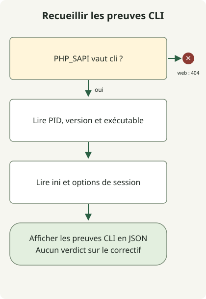

La correction de PHP2Shell ne s’arrête pas à une mise à jour du CMS ou d’une extension. Obtenez un build PHP corrigeant [CVE-2026-109618](https://github.com/php/php-src/security/advisories/GHSA-w8hw-w9fx-j79w) et [CVE-2026-109619](https://github.com/php/php-src/security/advisories/GHSA-6wmf-4rv5-p3rp), puis vérifiez que chaque processus servant des requêtes web l’utilise. La commande `php -v` d’un terminal indique uniquement la CLI sélectionnée dans ce terminal.

## Que touche PHP2Shell ?

Les deux CVE concernent l’état des requêtes et la durée de vie de la mémoire dans le moteur PHP. La première implique l’utilisation d’un état invalide pendant le nettoyage après qu’une gestion de manque de mémoire a interrompu l’initialisation. La seconde implique un état interne qui subsiste après la libération de la mémoire d’une requête et qu’une requête ultérieure utilise dans le même processus. Dans les conditions affectées, une exécution de code à distance sans authentification est possible.

L’[avis de l’équipe PHP](https://www.php.net/archive/2026.php) inclut PHP-FPM, php-cgi, FrankenPHP et LiteSpeed ainsi que mod_php parmi les déploiements web à examiner. Une SAPI particulière n’est pas une raison d’exclure un service. À l’inverse, une chaîne de version vulnérable ne démontre pas à elle seule qu’un chemin d’exploitation est accessible dans ce service.

## Quelle version comparer ?

Voici les **premières versions sources amont corrigeant les deux CVE d’origine**, vérifiées le 30 octobre 2026. Avant l’installation, consultez la version actuellement prise en charge et les avis complémentaires du même fournisseur.

| Branche PHP | Première version source corrigeant les deux CVE |
| --- | --- |
| 8.2 | 8.2.35 |
| 8.3 | 8.3.36 |
| 8.4 | 8.4.27 |
| 8.5 | 8.5.12 |

Pour les paquets de distribution, comparez la révision complète du paquet à l’avis du fournisseur plutôt qu’à la version courte de PHP. Par exemple, [Ubuntu USN-8948-1](https://ubuntu.com/security/notices/USN-8948-1) désigne `8.3.6-0ubuntu0.24.04.13` comme paquet `php8.3-fpm` corrigé pour Ubuntu 24.04. Comparer ce numéro à la version amont `8.3.36` conduit à mal classer un rétroportage. L’avis n’authentifie pas des builds personnalisés arbitraires affichant la même chaîne de version.

PHP 8.1 et les versions antérieures ne sont plus pris en charge par le projet PHP. Vérifiez la prise en charge par le fournisseur et les preuves de rétroportage, ou migrez vers une branche prise en charge. La publication d’un correctif source et la preuve qu’un serveur l’exécute sont deux choses différentes.

## Recueillir les preuves CLI sans les confondre avec des preuves web



Le schéma suit le collecteur ci-dessous. Sous une SAPI web, il se termine sans afficher d’informations. Sous la CLI, il enregistre l’exécutable, la version et la configuration sans décider si le correctif est présent. L’identification du service, l’application du correctif et le redémarrage sont des opérations distinctes que ce code n’effectue pas.

Avec PHP 8.2 ou ultérieur, enregistrez le fichier dans un nouveau répertoire hors de la racine documentaire. Il lit uniquement le processus courant à l’aide des [constantes PHP](https://www.php.net/manual/en/reserved.constants.php) et de [ini_get](https://www.php.net/manual/en/function.ini-get.php) ; il n’envoie aucune requête, ne modifie aucun paramètre et ne démarre aucune session. Il n’est pas nécessaire de publier une page `phpinfo()`.

### `runtime-evidence.php`

```php
<?php
if (PHP_SAPI !== 'cli') {
    http_response_code(404);
    exit;
}

$evidence = [
    'scope' => 'this-cli-process-only',
    'pid' => getmypid(),
    'version' => PHP_VERSION,
    'sapi' => PHP_SAPI,
    'binary' => PHP_BINARY,
    'loadedIni' => php_ini_loaded_file() ?: null,
    'uploadProgress' => ini_get('session.upload_progress.enabled'),
    'serializeHandler' => ini_get('session.serialize_handler'),
];
echo json_encode($evidence, JSON_PRETTY_PRINT | JSON_THROW_ON_ERROR), PHP_EOL;
```

```sh
php runtime-evidence.php
php -n -d session.upload_progress.enabled=0 runtime-evidence.php
```

La première commande lit la configuration de la CLI sélectionnée. La seconde ignore les fichiers ini et désactive la progression des téléversements uniquement pour cette invocation CLI. **Elle ne modifie pas les paramètres du serveur web et ne vérifie pas la configuration effective d’un processus web.**

La vérification locale s’est exécutée dans un conteneur PHP CLI isolé et a confirmé une sortie JSON avec `sapi` égal à `cli`. La seconde commande a renvoyé `null` pour `loadedIni` et la chaîne `"0"` pour `uploadProgress`. Les chemins, le PID, la version et les valeurs par défaut varient selon l’environnement. Ces résultats n’établissent pas l’état du correctif d’un service de production et ne reproduisent pas une exploitation.

## Vérifier séparément l’installation et les processus en cours

1. Suivez la configuration de l’amont du serveur web, de FastCGI ou du module pour identifier l’exécutable PHP réel, les pools, les conteneurs et les réplicas. Ne supposez pas que la CLI de l’hôte et le runtime web partagent un chemin d’installation.
2. Comparez le fournisseur de ce runtime et la révision complète de son paquet ou l’empreinte de son image à l’avis. Pour un build personnalisé, établissez le lien entre le commit correctif et l’artefact déployé.
3. Déployez un build corrigé compatible et remplacez les processus du pool ou du service affecté, ou ses conteneurs. Vérifiez d’abord le périmètre du changement si d’autres services partagent le runtime.
4. Vérifiez le lien entre les nouveaux processus et le build corrigé sur chaque cible. Contrôlez les pages normales, la connexion et les sessions, les téléversements et les taux d’erreur. Un déploiement partiel ou l’absence de preuves concernant les processus en cours ne signifie pas que le travail est terminé.

Distinguer « artefact corrigé identifié » et « utilisation effective vérifiée » dans les inventaires internes aide à repérer les processus oubliés. Un plantage seul ne prouve pas une compromission, et l’absence de journaux d’erreur ne l’exclut pas. En cas de suspicion de compromission, préservez les preuves et enquêtez séparément de l’application des correctifs.

## Distinguer le complément sur les sessions et la reconstruction Windows

Le [complément PHP du 23 octobre](https://www.php.net/archive/2026.php) suit séparément **CVE-2026-115560**. Il concerne la combinaison de `session.serialize_handler` configuré sur `php_binary` ou `php_serialize`, de code applicatif qui le passe à `php` avant d’appeler `session_start()`, et d’une progression des téléversements laissée active. L’avis suggère `session.upload_progress.enabled=0` jusqu’au prochain correctif régulier. Ce paramètre ne prouve pas que les deux CVE d’origine sont entièrement résolues. Vérifiez la configuration effective de la SAPI web et l’impact fonctionnel.

L’[avis Windows du 26 octobre](https://www.php.net/archive/2026.php) annonce les paquets `8.5.12-1`, `8.4.27-1`, `8.3.36-1` et `8.2.35-1` intégrant le correctif Brotli pour **CVE-2026-111497**. Ils reconstruisent les dépendances sans changer la version source de PHP ; `PHP_VERSION` seul ne permet donc pas de les distinguer. Les déploiements Windows utilisant la décompression automatique des réponses de cURL doivent aussi vérifier ce correctif de paquet. Consultez le [guide de réponse à Node2Shell](/en/posts/2026-10-30-node2shell-brotli-runtime-patching/) pour la même CVE Brotli dans Node.js.
